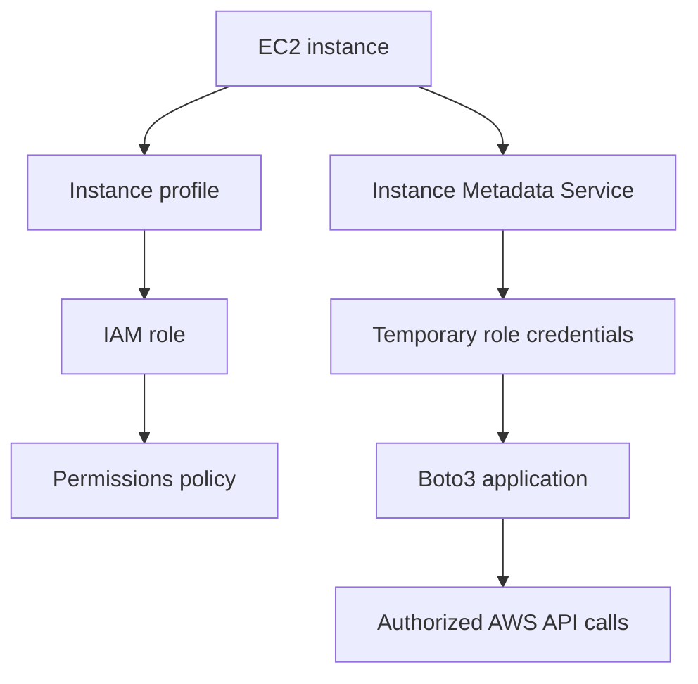
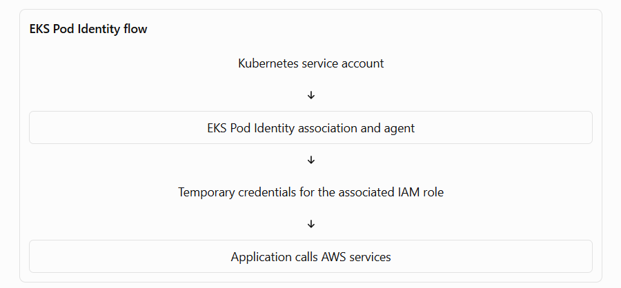
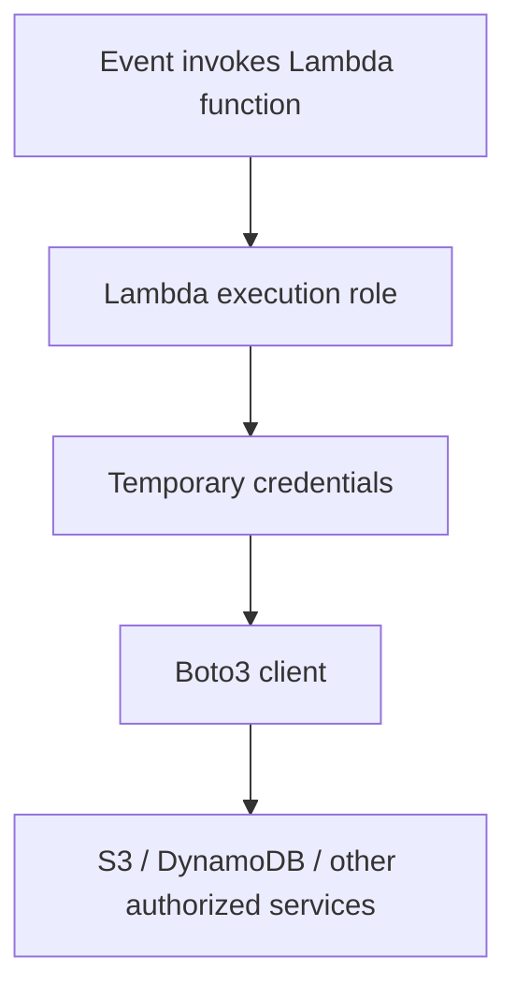

# IAM Roles for AWS Services and Workloads

AWS IAM course · Workload identity · EC2, Lambda, ECS, EKS, and secure credential delivery

In Module 4, we created an IAM role, configured its trust policy, attached permissions, and assumed the role using AWS STS.

Now we'll apply those concepts to a real production question:

How can an application access AWS services securely without storing access keys in its source code, Docker image, or environment configuration?

Imagine you're deploying a FastAPI application that reads book covers from S3, stores metadata in DynamoDB, and runs inside a container. You want the application to access only the resources it needs, and you want AWS to manage the delivery and renewal of credentials.

The solution is workload identity: assign an appropriate identity to the workload and let the supported AWS credential mechanism provide temporary credentials.

## Module roadmap

5.1 — Workload identity fundamentals

Why embedded credentials are dangerous and how the AWS SDK credential provider chain works.

5.2 — EC2 instance roles

Instance profiles, temporary credentials, and the Instance Metadata Service (IMDS).

5.3 — Containers: ECS and EKS

ECS task roles, EKS Pod Identity, and IAM Roles for Service Accounts (IRSA).

5.4 — Lambda execution roles

Give serverless functions only the permissions they require.

5.5 — Practical implementation

Use Pulumi Python to define workload roles and policies, then verify the resulting identity.

# Lesson 5.1 — Workload identity fundamentals

## 1. The wrong approach: hard-coded access keys

Consider this FastAPI application:

```py
import boto3

s3 = boto3.client(
    "s3",
    aws_access_key_id="AKIA_EXAMPLE",
    aws_secret_access_key="example-secret",
)
```

This is a bad production pattern for several reasons:

- Credentials can leak through source control, logs, images, or diagnostic output.
- Rotating keys requires updating the application configuration.
- Multiple services may end up sharing the same credentials.
- Long-lived keys can remain valid after an application is compromised.

Environment variables are not automatically a secure alternative if they contain permanent access keys. Moving a secret from source code to an environment variable changes where it's stored, not the underlying credential risk.

## 2. The better approach: let the workload obtain credentials

With a supported AWS execution environment, the application can use the SDK's default credential provider chain.

```py
import boto3

s3 = boto3.client("s3")
```

Notice that there are no access keys in the code.

The SDK looks for credentials using its supported provider chain. Depending on the environment and SDK configuration, sources may include explicit configuration, environment variables, shared profiles, IAM Identity Center credentials, web identity, container credentials, and EC2 instance metadata.

For an AWS-hosted workload, configure the appropriate role-based credential mechanism and avoid unintentionally overriding it with static credentials.

The important distinction is that the role provides the permissions, while the environment's credential provider makes temporary credentials available to the application.

## 3. The AWS SDK credential provider chain

The default credential provider chain is the mechanism through which an AWS SDK searches supported credential sources and selects credentials. The exact order and supported sources vary by SDK and configuration. Once a valid source is selected, the SDK can refresh temporary credentials when its provider supports refresh.&#x20;

[image](https://www.google.com/s2/favicons?domain=https://docs.aws.amazon.com\&sz=32)

Reference Guide


For Python, the AWS SDK is Boto3, which uses Botocore underneath.

```py
import boto3

session = boto3.Session()
sts = session.client("sts")

identity = sts.get_caller_identity()
print(identity["Arn"])
```

This is a safe diagnostic pattern: it prints the caller's ARN, not the temporary secret key.

The same code can work in different environments:

| Environment               | Typical credential source                    |
| ------------------------- | -------------------------------------------- |
| Local Windows development | AWS CLI profile or IAM Identity Center login |
| EC2 virtual machine       | Instance role credentials                    |
| ECS container             | ECS task role credentials                    |
| EKS pod                   | EKS Pod Identity or IRSA                     |
| Lambda function           | Lambda execution role credentials            |

You generally shouldn't write separate access-key logic for each environment. Instead, configure the correct credential provider for the deployment and let Boto3 use it.

One important caveat: environment variables or explicit credentials can take precedence over workload credentials in a provider chain. Stale local credentials inside a container can therefore cause the application to use the wrong identity. Avoid injecting static keys into production workloads.

# Lesson 5.2 — IAM roles for Amazon EC2

## 1. How an EC2 instance receives an IAM role

An EC2 instance can use an IAM role through an instance profile, which is the container AWS uses to associate a role with the instance.

The general process is:

1. Create an IAM role trusted by the EC2 service.
2. Attach a least-privilege permissions policy.
3. Associate the role with the EC2 instance through its instance profile.
4. Let the application obtain temporary credentials through the Instance Metadata Service (IMDS).

AWS manages the temporary credential delivery, so your application doesn't need embedded access keys.&#x20;



### What is IMDS?

The Instance Metadata Service is an endpoint available from an EC2 instance that provides instance metadata and, when configured, temporary credentials for its attached role.

For new EC2 workloads, prefer IMDSv2, which uses a session-oriented request mechanism rather than allowing an unauthenticated metadata request. Enforce IMDSv2 where compatible with your applications, and configure the metadata hop limit appropriately for the workload.

Do not treat metadata credentials as harmless information. If an attacker can exploit an application to access credentials from IMDS, they may be able to exercise the role's permissions.

### EC2 trust policy

An EC2 role typically trusts the EC2 service principal:

```json
{
  "Version": "2012-10-17",
  "Statement": [
    {
      "Effect": "Allow",
      "Principal": {
        "Service": "ec2.amazonaws.com"
      },
      "Action": "sts:AssumeRole"
    }
  ]
}
```

This lets the EC2 service assume the role for the appropriate instance association. It does not grant the application any S3 permissions by itself.

For a production EC2 application, keep the instance role narrow and consider whether separate workloads should run on separate instances or use more isolated compute arrangements.

## Lesson 5.3 — IAM for containers: ECS and EKS

Containers introduce a subtle security challenge: multiple applications may run on the same host or Kubernetes node, but they shouldn't automatically share the same AWS permissions.

The solution depends on the container platform.

### 1. Amazon ECS: task role vs. task execution role

Amazon ECS uses two distinct IAM roles for different purposes.&#x20;


#### Task role

Used by your application code inside the container.

Example: a FastAPI service calls S3 to retrieve book covers or DynamoDB to query book metadata.

#### Task execution role

Used by ECS infrastructure components to perform supported setup operations on behalf of the task.

Examples include pulling images from private Amazon ECR repositories and sending logs to CloudWatch Logs through the configured log driver.

These roles aren't interchangeable. Giving your application's task role image-pulling permissions just because ECS needs them is unnecessary in the typical configuration.

A useful design rule is to create separate task roles for applications with different permissions, rather than giving every service the same broad role.

### 2. Amazon EKS: Kubernetes service accounts and IAM

In Kubernetes, a Pod runs under a Kubernetes service account. That service account identifies the workload within Kubernetes, but it doesn't automatically provide AWS IAM permissions.

Amazon EKS provides two principal approaches for connecting workloads to IAM roles:

- EKS Pod Identity: associates an IAM role with a Kubernetes service account through the EKS Pod Identity mechanism.
- IAM Roles for Service Accounts (IRSA): uses an OIDC identity provider and a web-identity token to obtain temporary AWS credentials.

AWS recommends considering EKS Pod Identity whenever it meets your requirements. IRSA remains an important supported option, especially when its compatibility or configuration model suits the environment.&#x20;



EKS Pod Identity flow

Kubernetes service account

EKS Pod Identity association and agent

Temporary credentials for the associated IAM role

Application calls AWS services

With Pod Identity, the IAM role trusts the `pods.eks.amazonaws.com` service principal. The association identifies the cluster, namespace, and service account that receive the role's credentials. The Pod Identity Agent is required unless the cluster configuration, such as EKS Auto Mode, already provides the relevant functionality.&#x20;

[image](https://www.google.com/s2/favicons?domain=https://docs.aws.amazon.com\&sz=32)

Amazon EKS


### 3. A critical Kubernetes security point

Do not assume that Kubernetes namespaces or Pods are complete security boundaries for AWS credentials.

If a Pod can access the EC2 node's instance metadata, it might obtain the node role's credentials in addition to its intended workload credentials. Configure node permissions narrowly, restrict unnecessary metadata access, and use workload-specific identities.

This principle is especially important when multiple tenants or applications share a Kubernetes cluster.

For a self-managed Kubernetes cluster running on your own laptop or on EC2 outside Amazon EKS, EKS Pod Identity isn't available. Use an appropriate credential mechanism for that environment rather than assuming an EKS-specific feature will work everywhere.&#x20;


## Lesson 5.4 — Lambda execution roles

AWS Lambda also uses IAM roles to provide temporary credentials to functions.

Every Lambda function that needs to access AWS resources should have an appropriate execution role.

For example, a book-processing function might need permission to:

- Write logs to CloudWatch Logs.
- Read files from a particular S3 bucket.
- Write processed metadata to a specific DynamoDB table.

The execution role should include only the required actions and resources.

The Lambda service assumes the execution role when the function runs. Your function code normally should not call `sts:AssumeRole` on its own execution role to obtain credentials that Lambda already provides.&#x20;

[image](https://www.google.com/s2/favicons?domain=https://docs.aws.amazon.com\&sz=32)

AWS Lambda


A typical architecture looks like this:



The application code can remain simple:

```py
import boto3

s3 = boto3.client("s3")

def handler(event, context):
    response = s3.list_objects_v2(
        Bucket="study-books",
        MaxKeys=5,
    )
    return {
        "count": len(response.get("Contents", []))
    }
```

This function needs the appropriate `s3:ListBucket` permission on the bucket. It doesn't need to create its own credential-management system.

The role may also need logging permissions, depending on how the function and logging configuration are set up.

# Lesson 5.5 — Practical implementation with Pulumi Python

Let's build a reusable workload role and attach a least-privilege S3 policy. We'll start with an EC2 workload because its role-assumption mechanism is straightforward, then look at how the same permissions concept applies to other services.

## 1. Define the role and permissions

Create a Pulumi Python project:

```sh
mkdir iam-workload-lab
cd iam-workload-lab
pulumi new aws-python
```

Configure the AWS profile you intend to use for deployment:

```sh
$env:AWS_PROFILE = "study"
aws sts get-caller-identity --profile study
```

Set the name of an existing S3 bucket that you own or are authorized to use:

```sh
pulumi config set bucketName YOUR-EXISTING-BUCKET-NAME
```

Replace the generated `__main__.py` with this example:

```py

import json

import pulumi
import pulumi_aws as aws

config = pulumi.Config()
bucket_name = config.require("bucketName")

# The EC2 service can assume this role.
ec2_trust_policy = {
    "Version": "2012-10-17",
    "Statement": [
        {
            "Effect": "Allow",
            "Principal": {
                "Service": "ec2.amazonaws.com",
            },
            "Action": "sts:AssumeRole",
        }
    ],
}

workload_role = aws.iam.Role(
    "book-service-role",
    name="BookServiceRole",
    description="Read book objects from S3",
    assume_role_policy=json.dumps(ec2_trust_policy),
    max_session_duration=3600,
    tags={
        "Application": "book-service",
        "Purpose": "workload-identity-lab",
    },
)

s3_read_policy_document = {
    "Version": "2012-10-17",
    "Statement": [
        {
            "Sid": "ReadBookObjects",
            "Effect": "Allow",
            "Action": ["s3:GetObject"],
            "Resource": f"arn:aws:s3:::{bucket_name}/covers/*",
        }
    ],
}

s3_read_policy = aws.iam.Policy(
    "book-service-s3-read-policy",
    name="BookServiceS3ReadPolicy",
    description="Read only book-cover objects",
    policy=json.dumps(s3_read_policy_document),
)

attachment = aws.iam.RolePolicyAttachment(
    "book-service-s3-read-attachment",
    role=workload_role.name,
    policy_arn=s3_read_policy.arn,
)

# EC2 uses an instance profile to receive the role.
instance_profile = aws.iam.InstanceProfile(
    "book-service-instance-profile",
    name="BookServiceInstanceProfile",
    role=workload_role.name,
)

pulumi.export("roleArn", workload_role.arn)
pulumi.export("instanceProfileName", instance_profile.name)
pulumi.export("policyArn", s3_read_policy.arn)

```

This creates four related resources: a role, a managed permissions policy, its attachment, and an instance profile.

The trust policy authorizes EC2 to assume the role. The permissions policy allows the workload to read objects under the `covers/` prefix. The instance profile makes the role available for association with an EC2 instance.

The code does not launch an EC2 instance, create an S3 bucket, or configure networking. Those are separate infrastructure concerns.

## 2. Preview and deploy

```sh
pulumi preview
pulumi up
```

Review the preview and approve the deployment only when the proposed changes are correct.

The deployment identity needs permission to create and manage the IAM resources in this example. Organizations may also impose additional restrictions on IAM role creation or policy attachment.

## 3. Verify the deployed role

Inspect the role:

```
aws iam get-role `
  --role-name BookServiceRole `
  --profile study
```

Inspect the attached managed policies:

```
aws iam list-attached-role-policies `
  --role-name BookServiceRole `
  --profile study
```

These commands verify the role and its attached policies. They do not prove that an application running on EC2 has obtained the expected credentials.

For that, you must associate the instance profile with an EC2 instance and test from the intended workload environment.

## 4. Use the default credential provider in Python

Inside the EC2 application, use Boto3 without embedding credentials:

```py
import boto3

s3 = boto3.client("s3")

response = s3.get_object(
    Bucket="YOUR-EXISTING-BUCKET-NAME",
    Key="covers/example.jpg",
)

print(response["ContentLength"])
```

The example requires an actual object at that key. The role permits reads under `covers/`, but an absent object or other S3 restrictions can still cause the request to fail.

When the workload is correctly configured, Boto3 obtains temporary credentials through the instance role's credential provider and refreshes them as supported by the SDK.

Security reminder: An IAM role doesn't make an application invulnerable. An attacker who compromises the workload may still exercise its permitted actions. Least privilege limits the damage that those credentials can cause.

## 5. Choosing the right workload identity

Use this as a practical decision guide for new deployments.

| Workload                                         | Recommended identity mechanism                                        |
| ------------------------------------------------ | --------------------------------------------------------------------- |
| EC2 application                                  | EC2 instance role through an instance profile                         |
| ECS application container                        | ECS task role                                                         |
| ECS image pulling and supported setup operations | ECS task execution role                                               |
| EKS application pod                              | EKS Pod Identity when suitable; IRSA when appropriate                 |
| Lambda function                                  | Lambda execution role                                                 |
| Developer on Windows                             | IAM Identity Center and AWS CLI SSO profile                           |
| External CI/CD system                            | OIDC federation or another supported short-lived credential mechanism |
| On-premises workload                             | IAM Roles Anywhere or another suitable federated credential mechanism |

The right choice depends on the runtime, deployment platform, and isolation requirements. In all cases, the goal is to avoid distributing permanent credentials to applications.

## 6. Production checklist

Before deploying a workload that accesses AWS, verify the following:

- It has a dedicated role appropriate to its purpose.
- Its trust policy names the intended principal or service.
- Its permissions policy grants only the necessary actions and resources.
- It uses the platform's supported temporary credential mechanism.
- Static credentials aren't unintentionally overriding workload credentials.
- Containers and Pods cannot unnecessarily access other workloads' credentials.
- The role's permissions and relevant access events are reviewed periodically.
- Deployment and runtime identities are separated when their responsibilities differ.
- Changes are validated and reviewed before production deployment.

For current implementation details, consult the official documentation:

- [IAM security best practices](https://docs.aws.amazon.com/IAM/latest/UserGuide/best-practices.html)
- [AWS SDK credential providers](https://docs.aws.amazon.com/sdkref/latest/guide/standardized-credentials.html)
- [IAM roles for EC2](https://docs.aws.amazon.com/AWSEC2/latest/UserGuide/iam-roles-for-amazon-ec2.html)
- [ECS task IAM roles](https://docs.aws.amazon.com/AmazonECS/latest/developerguide/task-iam-roles.html)
- [EKS Pod Identity](https://docs.aws.amazon.com/eks/latest/userguide/pod-identities.html)
- [Lambda execution roles](https://docs.aws.amazon.com/lambda/latest/dg/lambda-intro-execution-role.html)

## Module 5 recap

The central principle is straightforward: give each workload an appropriate identity, grant that identity the minimum permissions it needs, and let the platform deliver temporary credentials securely.

EC2, ECS, EKS, and Lambda implement this principle through different mechanisms, so understanding the platform-specific credential delivery model matters just as much as writing the IAM policy.

Next: Module 6 — IAM Identity Center, Federation, and Human Access. We'll explore workforce access, SSO, identity providers, SAML, OIDC, permission sets, and how to manage access across multiple AWS accounts without creating a separate permanent IAM user for every person.