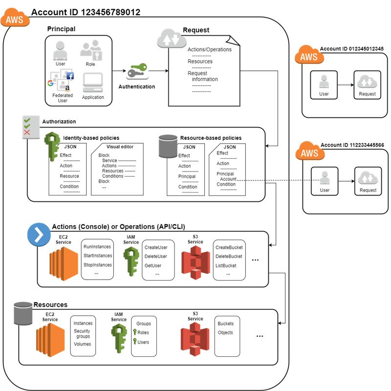
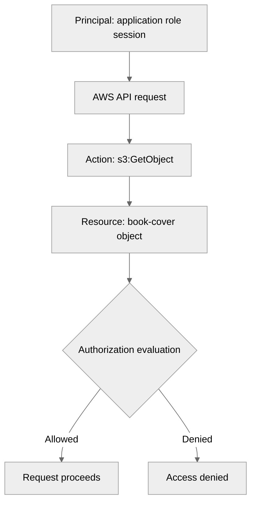
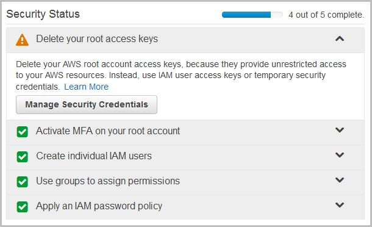
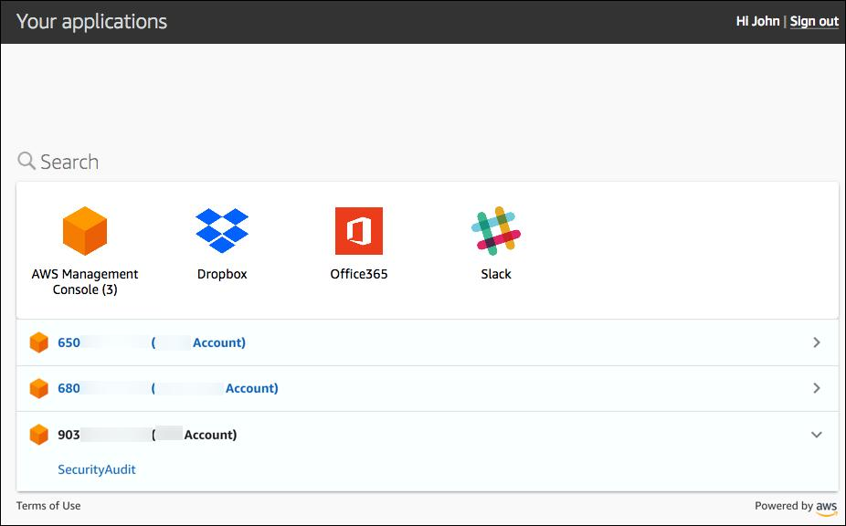
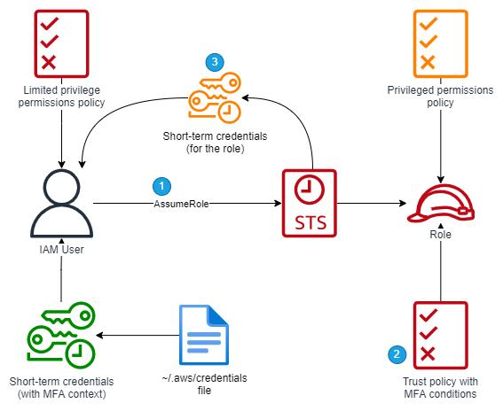
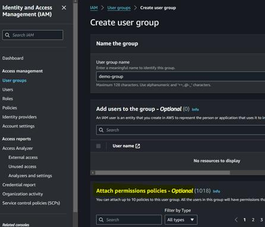

# Module 1 — AWS IAM Fundamentals

Beginner → Intermediate · Updated for modern AWS practices · Hands-on with AWS CLI and Pulumi Python

Welcome to Module 1. We'll build a solid mental model of AWS Identity and Access Management (IAM) before writing complex policies or deploying infrastructure.

As requested, there will be no quizzes, Pulumi will be our preferred infrastructure-as-code tool, and we'll focus on currently supported AWS features and security practices.

## Module 1 roadmap

**Lesson 1.1 — The AWS security model**

Identities, principals, permissions, resources, and authorization.

Starting here

**Lesson 1.2 — IAM identities**

Root user, IAM users, groups, roles, and modern workforce access.

**Lesson 1.3 — Policies and permissions**

Policy documents, actions, resources, conditions, and ARNs.

**Lesson 1.4 — Your first IAM lab**

Inspect your AWS identity, understand its permissions, and create a minimal read-only policy example.

## Lesson 1.1 — The AWS security model

### 1. What problem does IAM solve?

Imagine you're running a book recommendation application on AWS. It has:

- A developer who deploys application updates.
- A FastAPI backend that retrieves book metadata.
- An S3 bucket that stores book covers.
- A deployment pipeline that publishes new versions.
- An administrator who manages the AWS environment.

Should all five have the same access to AWS? Definitely not.

The developer might need to deploy code but shouldn't necessarily be able to delete production data. The application might need to read book covers but shouldn't be allowed to modify IAM policies. The deployment pipeline should have only the permissions required to perform its deployment.

That's the purpose of IAM: controlling who or what can perform which operations on which AWS resources under which conditions.



[docs.aws.amazon.com](https://docs.aws.amazon.com/IAM/latest/UserGuide/intro-structure.html)

IAM is a global AWS service for managing access to AWS resources. It isn't a separate login system for each service. Instead, it participates in the authorization process across services that integrate with IAM.

For example, S3, Lambda, and many other AWS services rely on IAM permissions, although individual services can also have their own authorization mechanisms.

### 2. The five concepts you must understand

* **Identity**

  An entity used to represent a user or workload. Examples include an IAM user, an IAM role, or a federated identity operating through an AWS role.

* **Principal**

  The identity or entity making a request to AWS. Depending on the request, this could be an IAM user, an assumed role session, the AWS account principal, or an AWS service.

* **Permission**

  An authorization to perform an action on a resource, subject to applicable policies and conditions. For example, `s3:GetObject` permits reading an S3 object when the request is authorized.

* **Resource**

  The AWS object being accessed, such as an S3 bucket, a Lambda function, or a DynamoDB table.

* **Policy**

  A document containing rules that help determine whether access is allowed or denied. IAM policies commonly use JSON.

These concepts fit together in a typical AWS request:




The key distinction is that authentication and authorization are different operations.

- Authentication establishes which identity or credentials are making a request.
- Authorization determines whether the requested operation is permitted.

Valid credentials do not automatically grant permission to perform every AWS action.

### 3. How AWS evaluates a request

Consider this request:

```
Application → Read a book cover from S3
```

AWS needs to establish several things:

1. Who is making the request? For example, an assumed IAM role session.
2. What action is requested? `s3:GetObject`.
3. Which resource is targeted? A particular object in an S3 bucket.
4. Which policies and authorization rules apply? This can include identity-based policies, resource-based policies, organization-level controls, and other applicable restrictions.
5. What is the authorization result? AWS allows or denies the operation.

For many AWS requests, access is denied by default unless an applicable authorization path allows it. An applicable explicit `Deny` overrides an `Allow`. The complete evaluation logic depends on the principal, resource, account relationship, and policy types involved.&#x20;


This distinction will become especially important in Module 3, when we study permissions boundaries, service control policies, resource policies, and cross-account access.

## Lesson 1.2 — IAM identities

AWS has several identity types. Understanding which ones are intended for people versus applications is essential to designing a modern AWS environment.



**1\. Root user**

The identity created when an AWS account is established. It has extensive account-level authority and access to certain account-management operations that require root credentials.

**Modern practice:** Protect it with MFA, avoid creating root access keys, and don't use it for routine development or administration.



**2\. IAM Identity Center users**

A recommended way to manage workforce access across AWS accounts. Users sign in through an access portal and receive account access through permission sets and role sessions.

**Modern practice:** Prefer centralized workforce identity and temporary credentials over creating an IAM user for every employee.



**3\. IAM roles**

Identities with permissions that can be assumed by authorized principals. A role has a trust policy describing who or what may assume it, plus permissions that define what the resulting session can do.

**Modern practice:** Use roles for AWS workloads, federated users, and CI/CD systems wherever appropriate.



**4\. IAM users and groups**

IAM users are identities with credentials associated with them; groups are collections of IAM users to which policies can be attached.

**Modern practice:** Understand them because existing AWS accounts may use them, but don't make permanent IAM users the default for new human or workload access.

AWS explicitly recommends temporary credentials and role-based access for human users and workloads. IAM users remain supported for specific use cases, but they should not be the default choice simply because they're familiar.&#x20;

### Identity types at a glance

| Identity                 | Typical purpose                                | Credentials                                                               |
| ------------------------ | ---------------------------------------------- | ------------------------------------------------------------------------- |
| Root user                | Account ownership and restricted account tasks | Long-lived account sign-in credentials                                    |
| IAM Identity Center user | Human access to AWS accounts                   | Federated or portal-based authentication, then temporary role credentials |
| IAM role                 | Workloads, federated access, delegated access  | Temporary credentials when assumed                                        |
| IAM user                 | Specific legacy or exceptional access needs    | May have a password or long-lived access keys                             |
| IAM group                | Organize IAM users and assign policies         | No independent credentials                                                |

One important detail: an IAM group is not a principal that can sign in or assume a role. It is a way to organize IAM users and attach policies to them.

For new human-access setups, we'll cover IAM Identity Center and federation in more depth in Module 5.

## Lesson 1.3 — Policies and permissions

IAM policies are the rules used to express access permissions. Most policies you'll write in this course use JSON.

Here is a minimal example that permits reading objects in one S3 bucket.

```

{
  "Version": "2012-10-17",
  "Statement": [
    {
      "Effect": "Allow",
      "Action": "s3:GetObject",
      "Resource": "arn:aws:s3:::study-books/*"
    }
  ]
}

```

Let's understand each field.

`Version`

The policy language version. `2012-10-17` is the current standard policy-language version commonly used in IAM policies. It is not a date you should update every year.

`Statement`

An array of rules. A policy can contain multiple statements, each describing different actions, resources, or conditions.

`Effect`

Usually `Allow` or `Deny`. An explicit `Deny` takes precedence over an applicable `Allow`.

`Action`

The API operation or operations being authorized. Here, `s3:GetObject` is the S3 action for retrieving an object.

`Resource`

The resource ARN to which the statement applies. The trailing `*` matches objects under the `study-books` bucket ARN.

`Condition` (optional)

Adds context-dependent requirements, such as restrictions based on tags, requested encryption settings, or the identity of the caller.

This example grants neither upload nor delete permission. It also doesn't grant permission to list the bucket. S3 bucket-level actions and object-level actions often require different resource ARNs.

For example:

- `s3:ListBucket` applies to the bucket ARN: `arn:aws:s3:::study-books`
- `s3:GetObject` applies to object ARNs: `arn:aws:s3:::study-books/*`
- `s3:PutObject` is a separate action for writing objects.

These are useful examples of why least privilege requires understanding both the action and its resource type.

### The two policy categories to learn first

### Identity-based policy

Attached to an IAM identity, such as a user or role, to grant or deny permissions.

```

IAM role
  └── Identity-based policy
        └── Allow s3:GetObject
    
```

### Resource-based policy

Attached to a supported resource, such as an S3 bucket, to define access to that resource. These policies can identify the principals that may access it.

```

S3 bucket
  └── Bucket policy
        └── Allow a specified role
    
```

We'll examine the differences, including how they interact across AWS accounts, in Module 3. For now, remember that an identity policy and a resource policy describe access from different perspectives.

## Lesson 1.4 — Your first hands-on lab

Now we'll inspect the identity your computer uses to access AWS. You don't need to create a new IAM user or generate permanent access keys for this exercise.

### Step 1 — Prepare your tools

On Windows, open PowerShell and check whether the AWS CLI and Pulumi are installed.

```
aws --version
pulumi version
```

If either command isn't recognized, consult the official installation guides:

- [Install or update the AWS CLI](https://docs.aws.amazon.com/cli/latest/userguide/getting-started-install.html)
- [Install Pulumi](https://www.pulumi.com/docs/iac/download-install/)

You'll also need an AWS account and an authorized way to access it. For human access, IAM Identity Center is a good starting point when available.

### Step 2 — Configure a modern CLI login

If your AWS environment uses IAM Identity Center, configure a named profile:

```
aws configure sso --profile study
```

Follow the prompts using the SSO start URL, region, and account access assigned to you by your AWS administrator.

Then sign in:

```
aws sso login --profile study
```

This workflow uses the AWS CLI's supported IAM Identity Center authentication mechanism rather than requiring you to create a long-lived IAM access key.

If you already have a working profile, you can skip this step.

### Step 3 — Discover your current AWS identity

Run:

```
aws sts get-caller-identity --profile study
```

You'll receive a response similar to this:

```
{
  "UserId": "AROAEXAMPLE:your-session",
  "Account": "123456789012",
  "Arn": "arn:aws:sts::123456789012:assumed-role/DeveloperRole/your-session"
}
```

The values above are illustrative, not actual credentials.

Here's how to interpret the response:

| Field     | Meaning                                        |
| --------- | ---------------------------------------------- |
| `UserId`  | Identifier for the calling identity or session |
| `Account` | AWS account ID                                 |
| `Arn`     | ARN identifying the caller                     |

Notice the ARN:

```
arn:aws:sts::123456789012:assumed-role/DeveloperRole/your-session
```

This tells you that the caller is an assumed role session. The role is `DeveloperRole`; `your-session` identifies the session.

If your output instead contains an ARN like `arn:aws:iam::123456789012:user/...`, you're calling AWS as an IAM user.

The command is useful because it establishes which credentials the CLI is actually using before you investigate permissions.&#x20;

[image](https://www.google.com/s2/favicons?domain=https://docs.aws.amazon.com\&sz=32)

AWS Command Line Interface


### Step 4 — Inspect your local AWS configuration

Run:

```
aws configure list-profiles
aws configure list --profile study
```

These commands help you understand which profiles are configured and where their configuration values originate.

Be careful not to share the contents of your AWS credentials file or any secret values. A profile name, account ID, and ARN can also be sensitive operational details in some environments.

### Step 5 — Understand why access can fail

Suppose the CLI successfully identifies you but this command fails:

```
aws s3 ls --profile study
```

That doesn't necessarily mean your login is broken.

The identity may be authenticated correctly but lack permission to list buckets. Alternatively, another applicable policy or service-specific control might prevent the operation.

The important diagnostic distinction is:

- Authentication problem: AWS cannot establish a valid identity for the request.
- Authorization problem: AWS recognizes the caller, but the requested action isn't permitted.
- Other service or configuration problem: The request may fail for reasons such as a wrong region, invalid parameters, or a service-specific restriction.

We will use this distinction throughout the course.

## 7. Where Pulumi fits into IAM

Pulumi lets you define AWS infrastructure and permissions in a programming language, including Python. Instead of manually creating every IAM resource, you can manage policies and roles as version-controlled infrastructure.

For example, a later lesson will use Pulumi to define a role and an associated least-privilege policy:

```py

import pulumi
import pulumi_aws as aws

# Illustrative policy for a later lesson.
# The role trust policy and deployment configuration
# must also be designed correctly.

read_policy = aws.iam.Policy(
    "book-cover-read-policy",
    description="Read book cover objects",
    policy=pulumi.Output.json_dumps({
        "Version": "2012-10-17",
        "Statement": [{
            "Effect": "Allow",
            "Action": ["s3:GetObject"],
            "Resource": "arn:aws:s3:::study-books/*",
        }],
    }),
)

```

This creates a managed policy definition in Pulumi; it does not attach the policy to a role or create a complete access configuration by itself. A usable deployment also needs an appropriate execution identity, correct permissions, and the remaining IAM resources.

We'll implement this properly in the DevOps module rather than deploying incomplete IAM configurations during the introductory lesson.

## Module 1 recap

By the end of this module, you should have a working mental model of these concepts:

- IAM controls access to AWS resources through identities, policies, and authorization rules.
- Authentication and authorization solve different problems.
- IAM roles and temporary credentials are preferred for most modern workforce and workload access.
- Policies describe permitted or denied actions on resources, optionally under specific conditions.
- The root user should be protected and reserved for tasks that require it.
- AWS CLI commands can reveal which identity you're using without requiring you to create a new IAM user.

For further reading, keep these official references handy:

- [What is IAM?](https://docs.aws.amazon.com/IAM/latest/UserGuide/)
- [IAM security best practices](https://docs.aws.amazon.com/IAM/latest/UserGuide/best-practices.html)
- [IAM policy and permission concepts](https://docs.aws.amazon.com/IAM/latest/UserGuide/access_policies.html)
- [AWS CLI with IAM Identity Center](https://docs.aws.amazon.com/cli/latest/userguide/cli-configure-sso.html)

Next: Module 2 — IAM Policies Deep Dive. We'll study policy syntax, ARN patterns, wildcard behavior, conditions, managed versus inline policies, and how to write precise permissions for real AWS services.
