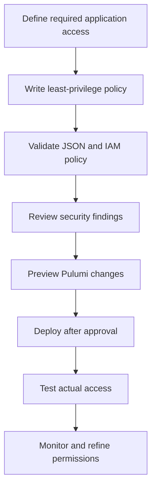

# Module 2 — IAM Policies Deep Dive

AWS IAM course · Intermediate foundations · JSON policies, resource permissions, conditions, and least privilege

In Module 1, we learned that IAM determines who can access AWS resources and what they can do. Now we'll study the mechanism that expresses those permissions: IAM policies.

By the end of this module, you'll be able to write policies for real AWS applications, understand ARN patterns, use conditions to restrict access, choose the appropriate policy type, and diagnose common policy mistakes.

We'll use AWS CLI and Pulumi with Python where practical. No quizzes, and no reliance on obsolete access-management practices.

## Module roadmap

**2.1 — Anatomy of an IAM policy**

JSON structure, statements, effects, actions, resources, and conditions.

**2.2 — ARNs and resource matching**

ARN components, wildcards, account and region fields, and service-specific resource patterns.

**2.3 — Conditions and policy variables**

Condition operators, request context, tags, and attribute-based access control.

**2.4 — Policy types and composition**

AWS-managed, customer-managed, inline, identity-based, and resource-based policies.

**2.5 — Practical policy engineering**

Build, validate, deploy, and inspect policies using AWS tools and Pulumi.

# Lesson 2.1 — Anatomy of an IAM policy

## 1. Start with a real requirement

Suppose your FastAPI book recommendation service stores book covers in an S3 bucket named `study-books`.

The application needs to:

- Read existing book-cover files.
- Never upload or delete objects.
- Access only this particular bucket's objects.

We can translate that requirement into an IAM policy.

```

{
  "Version": "2012-10-17",
  "Statement": [
    {
      "Sid": "ReadBookCovers",
      "Effect": "Allow",
      "Action": [
        "s3:GetObject"
      ],
      "Resource": "arn:aws:s3:::study-books/*"
    }
  ]
}

```

This is an identity-based policy document that can be attached to an IAM role, for example. By itself, it doesn't create an identity, establish a role's trust relationship, or attach itself to anything.

Let's examine its structure.

## 2. The policy document, field by field

### `Version`

Specifies the IAM policy language version.

```
"Version": "2012-10-17"
```

This is the standard version used in modern IAM policy documents. It is not an API version that you need to increment annually.

### `Statement`

Contains one or more individual policy statements.

```
"Statement": [
  { "...": "..." }
]
```

Each statement expresses an authorization rule. Multiple statements can target different resources or actions.

### `Sid`

An optional statement identifier.

```
"Sid": "ReadBookCovers"
```

It makes policies easier to read and maintain. It does not grant a permission by itself.

### `Effect`

Specifies `Allow` or `Deny`.

```
"Effect": "Allow"
```

An applicable explicit `Deny` overrides an applicable `Allow`. If no applicable permission grants access, the request is generally denied.

### `Action`

Identifies the AWS operation or operations.

```
"Action": ["s3:GetObject"]
```

Actions are service-specific. An S3 permission doesn't automatically grant a similar operation in DynamoDB or another service.

### `Resource`

Specifies the resource or resources to which the statement applies.

```
"Resource": "arn:aws:s3:::study-books/*"
```

The resource pattern matches objects in the named bucket. It is not the bucket ARN itself.

### `Condition`

An optional set of requirements that must be satisfied for the statement to apply.

```
"Condition": {
  "StringEquals": {
    "aws:ResourceTag/Environment": "dev"
  }
}
```

Conditions can restrict access according to request context, supported resource attributes, principal attributes, and other supported context keys. Whether a particular key is available depends on the action and service.

One subtle point: `Condition` is not always a simple extra security check. Its operators, keys, and missing-key behavior affect whether a statement matches a request. We'll cover those details in Lesson 2.3.

## Lesson 2.2 — ARNs and resource matching

An IAM policy can name the correct action and still fail because its `Resource` doesn't match the resource being accessed.

The key is to understand Amazon Resource Names (ARNs).

### 1. ARN structure

A typical ARN looks like this:

```
arn:partition:service:region:account-id:resource
```

For example:

```
arn:aws:s3:::study-books/fiction/novel.pdf
```

- PARTITION

  `aws`

  Identifies the AWS partition. Other partitions exist, including `aws-us-gov` and `aws-cn`.

- SERVICE

  `s3`

  Identifies the AWS service.

- REGION AND ACCOUNT

  Empty in this S3 ARN

  S3 bucket and object ARNs don't include a region or account ID in their standard ARN form.

- RESOURCE

  `study-books/fiction/novel.pdf`

  Identifies the bucket and object key.

ARN formats vary by service and resource type. Always consult the relevant service's authorization reference rather than assuming every ARN has every field populated.&#x20;


### 2. Bucket ARN vs. object ARN

These two ARNs look similar but represent different resources:

```
arn:aws:s3:::study-books
arn:aws:s3:::study-books/*
```

- The first identifies the bucket.
- The second matches objects inside that bucket.

That difference matters because S3 actions have different resource requirements.

| Action            | Resource pattern             |
| ----------------- | ---------------------------- |
| `s3:ListBucket`   | `arn:aws:s3:::study-books`   |
| `s3:GetObject`    | `arn:aws:s3:::study-books/*` |
| `s3:PutObject`    | `arn:aws:s3:::study-books/*` |
| `s3:DeleteObject` | `arn:aws:s3:::study-books/*` |

These are the typical resource patterns for these actions. Other requirements, such as KMS permissions for encrypted objects, may also apply. See the [S3 service authorization reference](https://docs.aws.amazon.com/service-authorization/latest/reference/list_amazons3.html).

### 3. Wildcards: useful but dangerous

Consider these patterns:

```
"Action": "s3:GetObject"
```

Allows the specified read action wherever the statement's resource pattern matches.

```
"Action": "s3:*"
```

Matches all S3 actions, subject to the statement's resource scope and other applicable authorization rules.

```
"Resource": "*"
```

Matches all resources for which the specified action is applicable.

A broad wildcard isn't automatically equivalent to administrator access: its impact depends on the actions, service, and applicable restrictions. Nevertheless, combining broad action and resource wildcards can grant excessive permissions.

Production rule: Start with specific actions and specific resource ARNs. Use wildcards only when the intended scope genuinely requires them.

### 4. ARN patterns in real applications

Suppose the application should read only files under the `covers/` prefix.

```
{
  "Effect": "Allow",
  "Action": "s3:GetObject",
  "Resource": "arn:aws:s3:::study-books/covers/*"
}
```

This narrows the matching resources to objects under that prefix.

It does not grant access to every object in the bucket, and it does not grant permission to list the bucket.

Remember that S3 uses object keys rather than a real filesystem hierarchy. Prefixes such as `covers/` are naming conventions within object keys.

## Lesson 2.3 — Conditions and policy variables

A policy can restrict access not only by what is requested, but also by the circumstances under which the request occurs.

For example, you may want to permit access only to development resources, require a specific request parameter, or restrict which principal tags can access a resource.

### 1. How a condition works

Consider this identity-based policy statement:

```

{
  "Effect": "Allow",
  "Action": "s3:GetObject",
  "Resource": "arn:aws:s3:::study-books/*",
  "Condition": {
    "StringEquals": {
      "aws:PrincipalTag/Environment": "dev"
    }
  }
}

```

This statement grants the specified permission only when the request context contains a matching principal tag.

For example, the role session must have the applicable principal tag `Environment=dev` for the condition to match. Tag propagation and availability depend on how the identity and session are configured.

The important principle is that a condition can narrow a permission that would otherwise apply.

### 2. Common condition operators

| Operator                | Purpose                                                                                       |
| ----------------------- | --------------------------------------------------------------------------------------------- |
| `StringEquals`          | Requires a string value to match                                                              |
| `StringLike`            | Matches string patterns with wildcards                                                        |
| `ArnEquals`             | Compares ARN values                                                                           |
| `ArnLike`               | Matches ARN patterns                                                                          |
| `NumericLessThanEquals` | Checks a numeric upper bound                                                                  |
| `Bool`                  | Compares Boolean values                                                                       |
| `DateGreaterThan`       | Requires a date to be later than a specified value                                            |
| `IpAddress`             | Checks whether an IP address belongs to a specified range                                     |
| `Null`                  | Checks whether a context key is absent or has no value, according to the operator's semantics |

The correct operator depends on the condition key and the data type being evaluated. The AWS documentation maintains the authoritative list of supported keys and operators.&#x20;


### 3. A subtle but important rule: missing context keys

Suppose a statement contains:

```
"Condition": {
  "StringEquals": {
    "aws:PrincipalTag/Environment": "dev"
  }
}
```

If the request context doesn't contain the specified key, the ordinary equality condition doesn't match.

This can cause unexpected denials when a tag is missing or wasn't propagated into a role session.

Negated operators and set operators have different evaluation rules, so never generalize this behavior to every possible condition.&#x20;


### 4. Policy variables

Policy variables let you reuse a policy while substituting values from the request context.

For example:

```
{
  "Effect": "Allow",
  "Action": "s3:GetObject",
  "Resource": "arn:aws:s3:::study-books/${aws:PrincipalTag/Team}/*"
}
```

If the principal has a supported `Team` tag with the value `fiction`, the resource pattern can resolve to:

```
arn:aws:s3:::study-books/fiction/*
```

This technique can support attribute-based access control (ABAC), where attributes such as team, project, or environment influence access.

However, this is safe only when the attributes are controlled appropriately, the service supports the relevant context keys, and the policy is designed for the intended resource naming scheme.

### 5. ABAC vs. RBAC

- **Role-based access control (RBAC)**

  Assign permissions according to roles or job functions.

  Example: `BookReaderRole` can read approved book objects.

- **Attribute-based access control (ABAC)**

  Use attributes such as tags to determine which resources or operations are accessible.

  Example: a developer tagged `Team=fiction` can access appropriately tagged or scoped fiction resources.

RBAC is straightforward for clearly defined job functions. ABAC can scale better when many teams need similar permissions over different resources. Real systems often combine both.

A tag is not automatically a security boundary: the permissions that allow identities to create, change, or pass tags must be designed carefully.

## Lesson 2.4 — Policy types and composition

IAM policies can be classified in two different ways. One classification describes what kind of policy it is; the other describes where it applies.

### 1. Managed policies vs. inline policies

### AWS-managed policies

Created and maintained by AWS.

- Convenient for common access patterns.
- Can be attached to multiple identities.
- AWS can update their permissions, which may change access for every attached identity.

Use when: An AWS-managed policy fits the intended access requirements and its scope is acceptable.

### Customer-managed policies

Created and maintained by you in your AWS account.

- Reusable across identities.
- Suitable for application-specific and team-specific permissions.
- Support managed policy versioning and rollback within IAM's version limits.

Use when: You need deliberate, reusable, version-controlled permission definitions.

### Inline policies

Embedded directly into one IAM user, group, or role.

- Have a one-to-one relationship with that identity.
- Cannot be reused as a single shared policy object.
- Are deleted with their associated identity.

Use when: The permissions genuinely belong to just one identity and the inline relationship is intentional.

For most reusable application permissions, a customer-managed policy is a sensible default. AWS recommends managed policies in most cases because of their reuse and centralized management advantages.

One detail worth remembering: the `Version` element inside a policy document is different from the version history of a customer-managed policy. The former identifies the policy language version; the latter tracks changes to the policy document over time.

### 2. Identity-based vs. resource-based policies

These categories describe where the policy is applied.

| Property                 | Identity-based                                           | Resource-based                                  |
| ------------------------ | -------------------------------------------------------- | ----------------------------------------------- |
| Applied to               | An IAM identity                                          | A supported AWS resource                        |
| Main question            | What can this identity do?                               | Who can access this resource, and how?          |
| Typical example          | A role policy permitting `s3:GetObject`                  | An S3 bucket policy permitting a specified role |
| Can specify `Principal`? | No, not in an ordinary identity-based permissions policy | Yes, in policy types that support it            |

A resource-based policy may permit access to a principal in another AWS account. Cross-account authorization, however, depends on the applicable rules for both accounts and the relevant resource type.

A trust policy is another important policy type: it's a resource-based policy attached to an IAM role that defines who can assume the role. We'll explore trust policies and STS in Module 4.

### 3. Why attaching multiple policies can be confusing

Suppose a role has two identity-based policies:

- Policy A allows reading S3 objects.
- Policy B allows uploading S3 objects.

For applicable identity-based `Allow` statements, permissions can combine. However, an explicit `Deny`, a permissions boundary, an organization policy, or another applicable restriction may still prevent a request.

Attaching a second policy doesn't automatically replace the first policy, nor does it cancel an explicit deny.

This is why policy review must consider the identity's complete authorization context, not just one JSON document.

## Lesson 2.5 — Practical policy engineering with Pulumi

Let's turn the earlier S3 example into infrastructure code.

The objective is to create a reusable customer-managed IAM policy that grants read access to book-cover objects. We'll use Pulumi's Python AWS provider rather than Terraform.

### 1. Project structure

```
iam-policy-lab/
├── Pulumi.yaml
├── requirements.txt
└── __main__.py
```

Create a directory and initialize a Pulumi project using the Python runtime:

```
mkdir iam-policy-lab
cd iam-policy-lab

pulumi new aws-python
```

The project template may ask for an AWS region and stack name. Choose a region suitable for your environment. IAM is global, although resources referenced by policies can be regional.

Install or update the AWS provider dependency in the project's virtual environment as needed:

```
python -m pip install --upgrade pulumi pulumi-aws
```

Use the virtual environment and dependency-management approach recommended by your project setup; pin and review dependencies before production deployments.

### 2. Define the customer-managed policy

Replace the generated program in `__main__.py` with:

```py

import json

import pulumi
import pulumi_aws as aws

book_cover_policy_document = {
    "Version": "2012-10-17",
    "Statement": [
        {
            "Sid": "ReadBookCoverObjects",
            "Effect": "Allow",
            "Action": [
                "s3:GetObject",
            ],
            "Resource": "arn:aws:s3:::study-books/covers/*",
        }
    ],
}

book_cover_policy = aws.iam.Policy(
    "book-cover-read-policy",
    name="BookCoverReadPolicy",
    description="Read book-cover objects under the covers prefix",
    policy=json.dumps(book_cover_policy_document),
)

pulumi.export("policy_arn", book_cover_policy.arn)

```

This defines an IAM customer-managed policy in Pulumi.

The policy permits `s3:GetObject` on objects whose keys begin with `covers/` in the `study-books` bucket. It doesn't create the bucket, grant `s3:ListBucket`, or attach the policy to a role.

### 3. Understand the resource

The key resource is:

```
aws.iam.Policy(...)
```

This creates a managed policy in IAM. Pulumi records the resource in its state and can plan updates when you change the declared configuration.

The JSON policy document remains an AWS IAM policy document; Pulumi doesn't replace IAM's authorization rules. It simply manages the policy as infrastructure.

### 4. Validate and preview before deployment

First, validate the AWS credentials and identity that Pulumi will use. For an SSO profile, ensure you've signed in and that your deployment environment uses the intended credentials.

Then preview the infrastructure changes:

```
pulumi preview
```

If the preview is correct and you're ready to create the managed policy:

```
pulumi up
```

Review the proposed changes and approve the deployment when appropriate. The deploying identity needs sufficient permissions to create and manage the IAM policy.

After deployment, inspect the exported policy ARN:

```
pulumi stack output policy_arn
```

Important: Creating a policy isn't the same as granting it to an application. A role must exist, its trust policy must authorize the intended workload, and the managed policy must be attached to the role. We'll build that complete role-and-policy configuration in the later workload identity lessons.

### 3. Validate the policy before deploying

A policy that parses as valid JSON can still contain incorrect permissions, invalid resource patterns, or security weaknesses.

AWS provides IAM Access Analyzer policy validation to identify syntax problems and provide additional findings against AWS best practices.&#x20;


Save the policy document to `policy.json`, then run:

```
aws accessanalyzer validate-policy `
  --policy-document file://policy.json `
  --policy-type IDENTITY_POLICY `
  --profile study
```

This requires the AWS CLI profile to be configured and the calling identity to have the required permissions for validation.

The response contains findings categorized by severity, including errors, warnings, security warnings, and suggestions. Review them rather than assuming that a successful API call means the policy is secure.

### 4. Test the policy's intended behavior

For this example, the intended permissions are:

| Operation                           | Expected from this policy alone |
| ----------------------------------- | ------------------------------- |
| Read an object under `covers/`      | Allowed by the statement        |
| Read an object under another prefix | Not allowed by the statement    |
| Upload an object                    | Not allowed by the statement    |
| Delete an object                    | Not allowed by the statement    |
| List the bucket                     | Not allowed by the statement    |

These describe the statement's contribution to authorization, not necessarily the final result for an identity with other policies.

You can use the [IAM Policy Simulator](https://docs.aws.amazon.com/IAM/latest/UserGuide/access_policies_testing-policies.html) to test policy decisions without executing real S3 operations. However, simulator results can differ from live AWS behavior, so verify important access paths in a controlled environment.&#x20;


### 5. A production-oriented policy workflow



For production systems, keep IAM policies in version control, review permission changes as part of code review, and test both allowed and denied operations. Pulumi helps manage the infrastructure lifecycle, while AWS policy validation and runtime verification address different parts of the security process.

## Module 2 — Key takeaways

- Actions and resources must match. S3 bucket operations and object operations often use different ARN patterns.
- Wildcards control scope. Broad wildcards can create excessive permissions.
- Conditions add context. Their behavior depends on the supported keys, operators, and request context.
- Policy variables enable reuse. ABAC can reduce policy duplication when attributes are governed securely.
- Managed policies support reuse. Customer-managed policies are especially useful for application-specific least-privilege access.
- Validation isn't the same as testing. Use policy validation, simulation, deployment previews, and controlled live tests together.
- Pulumi manages infrastructure, not authorization semantics. AWS still determines whether each request is allowed.

### Official references

- [IAM JSON policy elements](https://docs.aws.amazon.com/IAM/latest/UserGuide/reference_policies_elements.html)
- [AWS service authorization reference](https://docs.aws.amazon.com/service-authorization/latest/reference/reference.html)
- [IAM condition operators](https://docs.aws.amazon.com/IAM/latest/UserGuide/reference_policies_elements_condition_operators.html)
- [Managed and inline policies](https://docs.aws.amazon.com/IAM/latest/UserGuide/access_policies_managed-vs-inline.html)
- [Pulumi AWS IAM Policy resource](https://www.pulumi.com/registry/packages/aws/api-docs/iam/policy/)

Next module: Policy Evaluation and Authorization. We'll examine how identity policies, resource policies, explicit denies, permissions boundaries, session policies, SCPs, and RCPs interact—and why a request can fail even when an `Allow` statement exists.