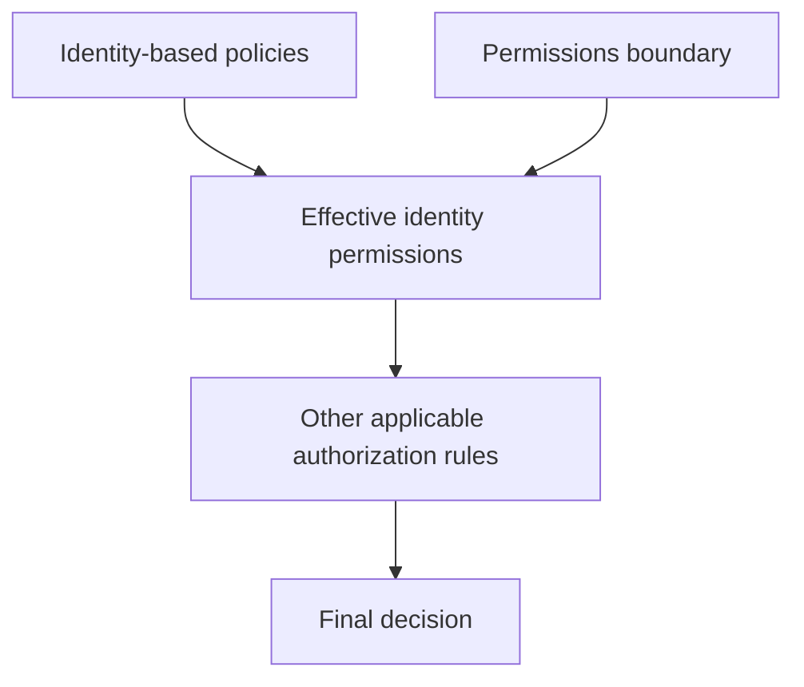
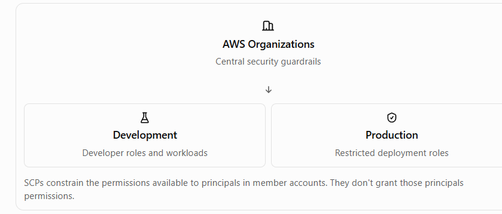
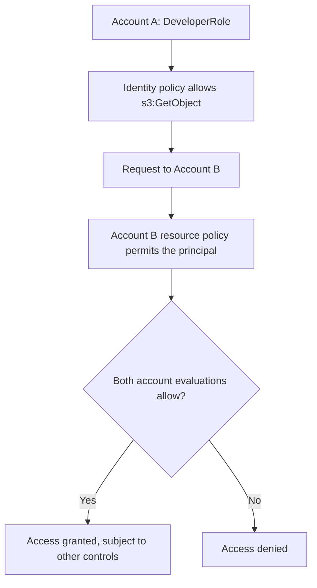

# Module 3 — IAM Policy Evaluation and Authorization

AWS IAM course · Intermediate to advanced · Authorization logic, permissions boundaries, organization guardrails, and cross-account access

In Module 2, we learned how to write IAM policies. Now we'll tackle one of the most important skills in AWS security: understanding why AWS allows or denies a request when several policies apply at the same time.

Imagine your FastAPI application has a role that allows reading S3 objects. The application still receives `AccessDenied`. Perhaps an organization policy restricts access, a permissions boundary limits the role, or the resource policy doesn't grant the access you expected.

Attaching another `Allow` policy won't necessarily solve the problem.

By the end of this module, you'll understand how to reason about those situations systematically, without resorting to `AdministratorAccess` as a troubleshooting shortcut.

## Module roadmap

**3.1 — The policy evaluation engine**
Default deny, explicit deny, identity-based policies, resource-based policies, and permission grants.

**3.2 — Permissions boundaries and session policies**

How to constrain what an identity or role session can do.

**3.3 — AWS Organizations guardrails**

Service control policies (SCPs), resource control policies (RCPs), and their effect on authorization.

**3.4 — Cross-account authorization**

How the caller's account and the resource owner's account participate in access decisions.

**3.5 — Real-world troubleshooting**

Diagnose `AccessDenied` using AWS CLI, CloudTrail, IAM Access Analyzer, and policy analysis.

# Lesson 3.1 — The policy evaluation engine

## 1. Start with the default: access is denied

Suppose your application tries to retrieve a book cover from S3.

```
Principal: BookReaderRole session
Action:    s3:GetObject
Resource:  arn:aws:s3:::study-books/covers/python.jpg
```

AWS evaluates the applicable authorization rules for that request.

The basic mental model is:

- An applicable `Allow` can grant permission.
- An applicable explicit `Deny` overrides an `Allow`.
- If no applicable authorization grants the requested access, the request is generally denied.
- Additional policy types can constrain or affect the final decision.

This is why IAM authorization is not simply a search for the word `Allow` in one policy.

## 2. The first three outcomes

**Allowed**

An applicable policy grants the action on the resource, and no applicable rule or authorization constraint prevents the request.

**Implicit deny**

No applicable permission grants the request. For example, a role can read S3 objects but has no permission to delete them.

**Explicit deny**

An applicable policy explicitly denies the request. An applicable explicit deny takes precedence over an allow.

### Example A — Implicit deny

The role has this policy:

```
{
  "Effect": "Allow",
  "Action": "s3:GetObject",
  "Resource": "arn:aws:s3:::study-books/*"
}
```

The application attempts:

```
s3:DeleteObject
```

The policy doesn't grant deletion. Assuming no other applicable authorization grants the action, the request is denied.

No explicit `Deny` statement is necessary.

### Example B — Explicit deny

Now suppose the role has both statements:

```
[
  {
    "Effect": "Allow",
    "Action": "s3:*",
    "Resource": "arn:aws:s3:::study-books/*"
  },
  {
    "Effect": "Deny",
    "Action": "s3:DeleteObject",
    "Resource": "arn:aws:s3:::study-books/*"
  }
]
```

The first statement is broad, but the second explicitly denies deletion of matching objects. The deletion request is denied.

The practical lesson is that adding more permissions cannot override an applicable explicit deny.

## 3. Identity policies and resource policies: an important distinction

These two policy types can both grant access, but they don't behave identically in every situation.

### Same-account access

Suppose the role and S3 bucket belong to the same AWS account.

- An identity-based policy can grant the role permission to read an object.
- A bucket policy can grant access to the role.
- Either can provide an authorization path in many same-account cases, subject to the applicable policy-evaluation rules and service-specific requirements.
- An applicable explicit deny still overrides an allow.

AWS documents a union-style evaluation for identity-based and resource-based permissions in common same-account cases. However, permissions boundaries, session policies, and the exact principal named in a resource policy introduce important nuances.&#x20;


### Why the principal matters

A bucket policy that grants access directly to an assumed-role session can behave differently from one that grants access to the IAM role ARN.

For example, these are different principal forms:

```
IAM role:
arn:aws:iam::123456789012:role/BookReaderRole

Assumed-role session:
arn:aws:sts::123456789012:assumed-role/BookReaderRole/session-name
```

A resource policy granting access directly to a role session principal can bypass certain implicit-deny limitations from identity policies, permissions boundaries, or session policies in specific same-account situations. An explicit deny still applies.

This is an advanced but important exception: don't assume every resource-based `Allow` is constrained in precisely the same way. Always check the principal type and AWS's evaluation rules for the specific request.

## Lesson 3.2 — Permissions boundaries and session policies

These features are especially useful when you need to grant permissions while preventing identities from exceeding a defined limit.

### 1. Permissions boundaries

A permissions boundary is a managed policy that defines the maximum permissions an IAM user or role can receive through identity-based policies.

Imagine that a development team is allowed to create application roles, but security engineers don't want those roles to have unrestricted access.



Consider this example:

- The role's identity policy allows `s3:GetObject` and `s3:DeleteObject`.
- Its permissions boundary allows only `s3:GetObject` on the relevant resources.

The boundary prevents the identity-based policy from granting `s3:DeleteObject` permission. The role can read matching objects, but it cannot delete them through that identity-policy authorization path.

The core rule is:

 
$$
\text{Effective identity permissions} \subseteq \text{Identity policy permissions}
$$


More precisely, the identity-based permissions must be allowed by the boundary as well. Other policy types and principal-specific evaluation rules can complicate the overall result.

A permissions boundary does not grant permissions by itself. If the role has no identity-based policy allowing `s3:GetObject`, adding a boundary that allows it doesn't make reading possible.

### 2. How to define a boundary in Pulumi

You can create a managed policy and associate it with an IAM role as its permissions boundary.

```py

import json
import pulumi_aws as aws

boundary_document = {
    "Version": "2012-10-17",
    "Statement": [
        {
            "Effect": "Allow",
            "Action": [
                "s3:GetObject",
            ],
            "Resource": "arn:aws:s3:::study-books/*",
        }
    ],
}

boundary_policy = aws.iam.Policy(
    "book-reader-boundary",
    name="BookReaderBoundary",
    policy=json.dumps(boundary_document),
)

# Attach this boundary when defining the role:
#
# role = aws.iam.Role(
#     "book-reader-role",
#     assume_role_policy=trust_policy_json,
#     permissions_boundary=boundary_policy.arn,
# )

```

The role example is illustrative because `trust_policy_json` must be defined correctly for the intended principal. A real deployment should also manage the role's identity-based permissions and any required resource policies.

Permissions boundaries are particularly useful for delegated IAM administration, where a team can create roles without being able to grant those roles arbitrary permissions.

### 3. Session policies

A session policy is passed when creating a temporary session, such as through AWS STS `AssumeRole`.

It further restricts the permissions available to that session in the usual identity-policy evaluation path.

Suppose the role allows:

```
Read all objects in study-books
```

But a particular temporary session receives a session policy allowing reads only under:

```
study-books/covers/*
```

That session is restricted to the narrower permission scope, subject to the full authorization rules.

Session policies are useful when different callers need temporary, request-specific restrictions without changing the underlying role's policy.

The distinction is:

| Feature                       | Permissions boundary                               | Session policy                             |
| ----------------------------- | -------------------------------------------------- | ------------------------------------------ |
| Purpose                       | Set a maximum permission scope for an IAM identity | Restrict a particular temporary session    |
| Attached or supplied          | Associated with an IAM user or role                | Supplied when creating a supported session |
| Grants permissions by itself? | No                                                 | No                                         |
| Typical use                   | Delegated role creation and guardrails             | Temporary, narrower access                 |

Both have important exceptions when resource-based policies grant permissions directly to particular principal types. See AWS's [policy evaluation documentation](https://docs.aws.amazon.com/IAM/latest/UserGuide/reference_policies_evaluation-logic.html).

## Lesson 3.3 — AWS Organizations guardrails

When an organization has multiple AWS accounts, IAM policies alone aren't always sufficient to enforce central security requirements.

For example, your company might require that:

- Production accounts cannot use unapproved AWS services.
- Developers cannot modify organization-level security controls.
- Resources in member accounts cannot be accessed by unauthorized external principals.
- Central security restrictions remain effective even when a local administrator has broad IAM permissions.

AWS Organizations provides two important authorization policy types: service control policies (SCPs) and resource control policies (RCPs).&#x20;


### 1. Service control policies (SCPs)

An SCP defines the maximum permissions available to principals in an organization's member accounts.

Think of it as an organization-level guardrail around what IAM identities can do.




Suppose an IAM role has this policy:

```
{
  "Effect": "Allow",
  "Action": "ec2:*",
  "Resource": "*"
}
```

An applicable SCP can restrict the role's effective permissions, even though its identity policy allows broad EC2 access.

A key detail: SCPs do not grant permissions and do not apply to principals in the Organizations management account in the same way they apply to member accounts. Service-linked roles also have special treatment.

SCPs should be treated as guardrails, not as a replacement for IAM identity and resource policies.&#x20;


### 2. Resource control policies (RCPs)

RCPs constrain the maximum permissions available for resources in member accounts.

The practical difference is the focus:

- SCP: What can principals in member accounts do?
- RCP: What access can resources in member accounts permit?

For example, a central security team might use an RCP to limit access to supported resources in its organization's accounts, including requests from external principals.

RCPs don't grant permissions. The applicable identity-based or resource-based policies must still provide the required authorization. RCPs are available only when the organization has all features enabled, and their effects depend on supported services and resource types.&#x20;


### 3. Why an IAM administrator may still be denied

Imagine a production role has `AdministratorAccess` but the organization's applicable SCP doesn't allow a particular action.

The role's broad identity policy isn't sufficient to overcome that organization-level restriction.

The same general principle applies when an applicable RCP restricts access to the target resource.

When diagnosing these cases, inspect the account's organizational context instead of assuming the role's attached policies tell the entire story.

## Lesson 3.4 — Cross-account authorization

Cross-account access occurs when a principal in one AWS account requests access to a resource owned by another account.

This is common in organizations that separate production workloads, shared services, security tooling, and development environments.

### 1. A two-account example

Suppose:

- Account A: `111111111111` — the account containing a developer role.
- Account B: `222222222222` — the account containing an S3 bucket.

The developer role in Account A needs to read selected files in Account B.




For ordinary cross-account resource access, the caller's account must authorize the request, and the resource-owning account must also authorize it. Applicable organization guardrails and other service-specific restrictions must still be satisfied.&#x20;


### 2. The caller's identity policy

In Account A, the role needs a policy allowing the required action on the external resource.

For example:

```json
{
  "Version": "2012-10-17",
  "Statement": [
    {
      "Effect": "Allow",
      "Action": "s3:GetObject",
      "Resource": "arn:aws:s3:::shared-book-library/covers/*"
    }
  ]
}
```

This expresses the caller-side permission. It does not, on its own, authorize access in Account B.

### 3. The resource owner's bucket policy

In Account B, the bucket policy can allow the specified role from Account A.

For example:

```json
{
  "Version": "2012-10-17",
  "Statement": [
    {
      "Effect": "Allow",
      "Principal": {
        "AWS": "arn:aws:iam::111111111111:role/DeveloperRole"
      },
      "Action": "s3:GetObject",
      "Resource": "arn:aws:s3:::shared-book-library/covers/*"
    }
  ]
}
```

This is a resource-based policy example for the bucket owner. In a real deployment, the role ARN must be correct, the role must be authorized on the caller side, and any additional restrictions must be satisfied.

### 4. Cross-account access through role assumption

An alternative is to let the developer assume a role in Account B.

In this model:

1. Account B creates a role with a trust policy that allows the intended principal from Account A to assume it.
2. Account A grants its principal permission to call `sts:AssumeRole` on that role.
3. The caller assumes the role and receives temporary credentials.
4. The role's permissions govern the resulting session's access, subject to applicable restrictions.

This pattern is often easier to manage than granting direct cross-account access to many individual resources. We'll cover the trust policy, STS, external IDs, and role chaining in Module 4.

## Lesson 3.5 — Troubleshooting `AccessDenied`

The most valuable practical skill in this module is finding the actual reason an AWS request failed.

Imagine your application reports:

```
An error occurred (AccessDenied) when calling
the GetObject operation: Access Denied
```

Don't immediately attach `AdministratorAccess`. Use a structured investigation.

### Step 1 — Confirm the identity

```
aws sts get-caller-identity --profile study
```

Confirm the account and ARN are what you expect. The application may be using a different profile, role, or credential source than your terminal.

### Step 2 — Identify the exact request

Write down:

- The AWS action, such as `s3:GetObject`.
- The exact resource ARN.
- The caller's ARN and account.
- Whether the request is same-account or cross-account.
- Any relevant request context, such as tags, region, encryption settings, or network conditions.

This makes it easier to find the applicable policy statements.

### Step 3 — Inspect the relevant policies

Review the role's identity policies and, when applicable, its permissions boundary, session policy, resource policy, SCP, and RCP.

For an IAM role, you can inspect attached managed policies with:

```sh
aws iam list-attached-role-policies `
  --role-name BookReaderRole `
  --profile study
```

And inline policies with:

```sh
aws iam list-role-policies `
  --role-name BookReaderRole `
  --profile study
```

These commands require sufficient IAM permissions. They inspect the role's policies, but they do not reveal every organization-level or service-specific control that might affect a request.

### Step 4 — Check the role's boundary

Retrieve the role:

```sh
aws iam get-role `
  --role-name BookReaderRole `
  --profile study
```

Inspect the `PermissionsBoundary` field if present.

A boundary that doesn't allow the requested action can constrain the permissions granted by identity-based policies.

### Step 5 — Inspect the resource policy

For an S3 bucket, when you have the required permissions:

```sh
aws s3api get-bucket-policy `
  --bucket shared-book-library `
  --profile study
```

Check the `Principal`, `Action`, `Resource`, and `Condition` elements, along with any applicable explicit denies.

This command works only if a bucket policy exists and your identity is authorized to retrieve it.

### Step 6 — Use policy analysis and audit logs

**IAM Policy Simulator**

Useful for evaluating supported policy scenarios and identifying how selected policies affect a request. It isn't a perfect reproduction of every live service authorization path.

**IAM Access Analyzer**

Helps validate policies and identify unintended external access. Some findings and policy-analysis features depend on the analyzer type and configuration.

**AWS CloudTrail**

Provides event records for supported API activity. Review the relevant event for the principal, action, resource, timestamp, and any available error details.

Some AWS authorization failures include enhanced error messages identifying an explicit deny or an organization-level restriction. Availability and detail vary by service and account context, so absence of a detailed message does not prove that a particular policy is responsible.

Official references:

- [Policy evaluation logic](https://docs.aws.amazon.com/IAM/latest/UserGuide/reference_policies_evaluation-logic.html)
- [Cross-account policy evaluation](https://docs.aws.amazon.com/IAM/latest/UserGuide/reference_policies_evaluation-logic-cross-account.html)
- [IAM Policy Simulator](https://docs.aws.amazon.com/IAM/latest/UserGuide/access_policies_testing-policies.html)
- [IAM Access Analyzer](https://docs.aws.amazon.com/IAM/latest/UserGuide/what-is-access-analyzer.html)
- [AWS CloudTrail](https://docs.aws.amazon.com/awscloudtrail/latest/userguide/cloudtrail-user-guide.html)

## Module 3 — Practical summary

Keep these relationships in mind when designing or troubleshooting AWS permissions.

| Policy type           | Main role in authorization                                   |
| --------------------- | ------------------------------------------------------------ |
| Identity-based policy | Grants permissions to an IAM identity                        |
| Resource-based policy | Grants access through a supported resource's policy          |
| Permissions boundary  | Limits permissions an identity-based policy can grant        |
| Session policy        | Restricts permissions for a temporary session                |
| SCP                   | Sets permission guardrails for principals in member accounts |
| RCP                   | Sets permission guardrails for resources in member accounts  |

The table describes the primary purpose of each policy type, not every evaluation exception. The actual decision depends on the request, the principal, the resource, and the applicable AWS authorization rules.&#x20;


The most important principles are:

- An explicit deny overrides an applicable allow.
- A permissions boundary doesn't grant permissions by itself.
- SCPs and RCPs are guardrails, not permission grants.
- Cross-account access generally requires authorization on both sides.
- Resource-based policies can have important principal-specific evaluation exceptions.
- An `AccessDenied` error should trigger a policy investigation, not an automatic increase in permissions.

## What's next?

Module 4 — IAM Roles, STS, and Temporary Credentials

We'll explore how roles actually work, including trust policies, `AssumeRole`, temporary security credentials, role chaining, external IDs, and cross-account role assumption.

We'll also build a complete role with Pulumi Python, configure its trust relationship correctly, attach least-privilege permissions, and verify the resulting access using the AWS CLI.