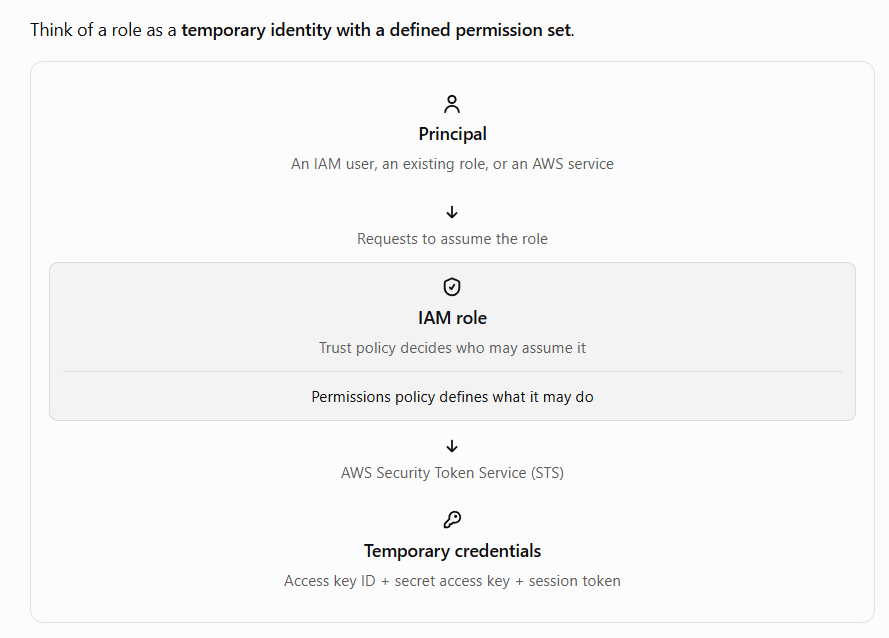
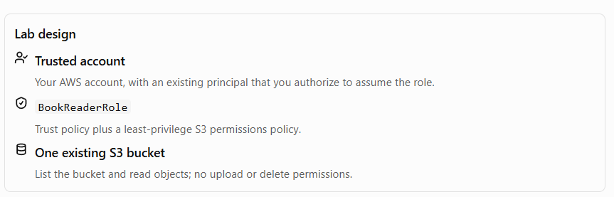
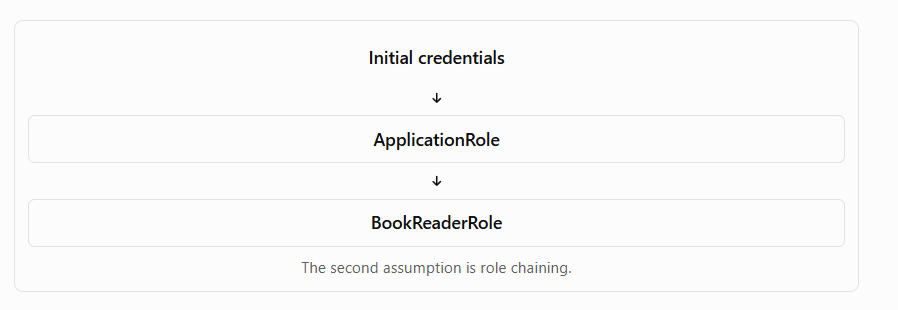
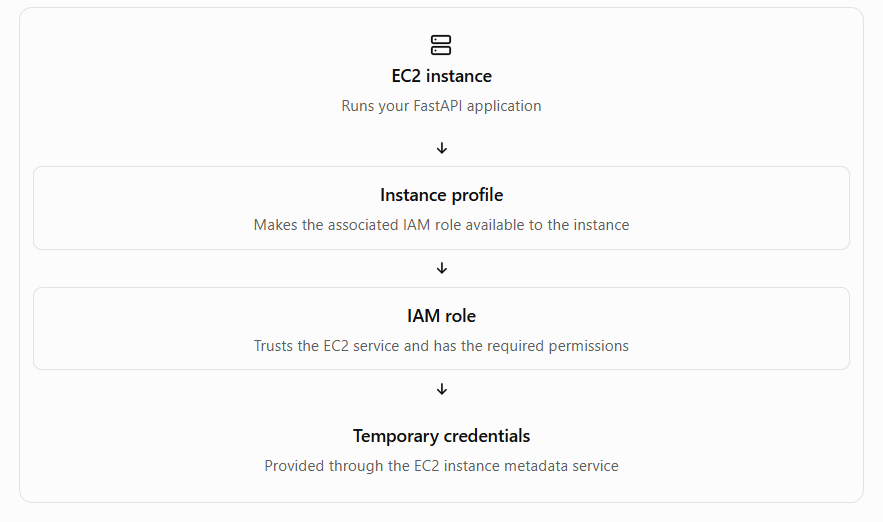

# Module 4 — IAM Roles, STS, and Temporary Credentials

In this module, you'll learn how AWS identities obtain temporary permissions without relying on long-lived access keys. We'll use Pulumi with Python to create an IAM role, configure its trust policy, attach least-privilege permissions, and test the result using the AWS CLI.

No quizzes—just explanations, practical examples, and a hands-on lab.

## What you'll learn

- How IAM roles differ from IAM users and policies
- How trust policies control who can assume a role
- How AWS STS issues temporary security credentials
- How `AssumeRole` works, including role chaining
- How to use external IDs for third-party access
- How to configure and test a role with Pulumi Python
- How cross-account role assumption works

## 1. The central idea: a role is an identity you can assume

An IAM role is an AWS identity with a set of permissions, but unlike a typical IAM user, it isn't intended to have permanent passwords or access keys of its own. A trusted principal assumes the role and receives temporary credentials.




The principal doesn't automatically gain access just because a role exists. The trust relationship must permit assumption, and the role's permissions must allow the requested operation. Other applicable policies and organization controls can further restrict access.

### Roles versus users

| Feature               | IAM user                                           | IAM role                                                            |
| --------------------- | -------------------------------------------------- | ------------------------------------------------------------------- |
| Long-lived identity   | Yes                                                | Yes, as a role definition                                           |
| Permanent access keys | Possible                                           | No permanent role access keys                                       |
| Temporary credentials | Possible through supported flows                   | Core operating model                                                |
| Intended use          | Legacy or specific cases requiring a user identity | AWS services, workloads, federated humans, and cross-account access |

For new human access, prefer federation through IAM Identity Center where appropriate. For applications running on AWS, use the relevant service's role-based credentials instead of embedding access keys in code.

## 2. Trust policy versus permissions policy

This is the most important distinction in the module.

An IAM role has two separate policy concerns:

### Trust policy

Who can assume this role?

- Uses the `Principal` element.
- Commonly allows `sts:AssumeRole`.
- Is attached to the role itself as its trust relationship.

### Permissions policy
  What can the role do after it is assumed?
- Specifies allowed or denied AWS API actions.
- Identifies the resources those actions apply to.
- Is attached to the role or otherwise supplied through supported policy mechanisms.

Suppose you create a role called `BookReaderRole`.

Its trust policy might allow one existing IAM role to assume it. Its permissions policy might allow reading objects from a particular S3 bucket. These are independent decisions: being trusted to assume a role does not automatically mean the caller has permission to perform S3 operations.

AWS documents these as separate parts of role configuration

### A trust policy example

This example trusts one specific existing IAM role. Replace the example account ID and role name with your own values.

```
{
  "Version": "2012-10-17",
  "Statement": [
    {
      "Effect": "Allow",
      "Principal": {
        "AWS": "arn:aws:iam::123456789012:role/DeveloperRole"
      },
      "Action": "sts:AssumeRole"
    }
  ]
}
```

Notice what this policy does not contain: `s3:GetObject`. That action belongs in the role's permissions policy, not its trust policy.

Important: the trusted principal must also have permission to call `sts:AssumeRole` on the target role. In a cross-account scenario, the target account's trust policy and the caller's permissions both matter.&#x20;


## 3. AWS STS and temporary credentials

AWS Security Token Service (STS) issues temporary security credentials. For an assumed role, the credentials contain three pieces:

- Access key ID — identifies the temporary credential.
- Secret access key — signs AWS requests.
- Session token — accompanies the temporary credentials.

The credentials expire. They are not permanent keys stored on the role. This reduces the risk associated with distributing long-lived credentials to applications or people.

### The `AssumeRole` operation

A simplified sequence looks like this:

1. Your CLI or application authenticates using its existing credentials.
2. It requests `sts:AssumeRole` for the target role.
3. AWS checks the trust relationship and applicable authorization rules.
4. STS returns temporary credentials if the request is authorized.
5. Your CLI or application uses those credentials to call other AWS services.

The command-line version looks like this:

```sh
aws sts assume-role \
  --role-arn arn:aws:iam::123456789012:role/BookReaderRole \
  --role-session-name book-reader-lab \
  --profile study
```

The result includes credential values. Don't paste that output into chat, commit it to Git, or save it in source code. For the hands-on lab below, we'll use an AWS CLI role profile so the CLI can manage the credentials for us.

### How long do credentials last?

An ordinary assumed-role session can be configured for 15 minutes up to the role's configured maximum session duration, which can be as long as 12 hours. The default requested duration is generally one hour. However, role chaining—assuming a role using credentials that already represent an assumed role—is limited to a maximum one-hour session.

Use a duration appropriate to the task rather than maximizing it by default.

## 4. Hands-on lab: build an S3 reader role with Pulumi

We'll create a role named `BookReaderRole` with permission to list a single S3 bucket and read its objects.



This lab assumes you have an AWS account, a working AWS CLI profile named `study`, and permission to create IAM roles and policies. It also assumes the S3 bucket already exists.

### Step 1 — Create a Pulumi project

In PowerShell:

```sh
mkdir iam-role-lab
cd iam-role-lab

pulumi new aws-python
```

Follow the prompts to initialize the project. Select a development stack, such as `dev`, and configure a region if prompted.

If you need to configure the AWS profile used by Pulumi, set the environment variable in the same PowerShell session:

```sh
export AWS_PROFILE="study"
aws sts get-caller-identity --profile study
```

The last command confirms which AWS identity the profile currently uses. Don't proceed until it succeeds.

Install or update the project dependencies according to the generated `requirements.txt`. The project needs `pulumi` and `pulumi-aws`.

### Step 2 — Configure the lab inputs

Choose an existing S3 bucket you own or are authorized to use. Set the bucket name and your AWS account ID as Pulumi configuration:

```
pulumi config set bucketName YOUR-EXISTING-BUCKET-NAME
pulumi config set trustedAccountId 123456789012
```

Replace both example values. The account ID is 12 digits, without hyphens.

For this lab, the role's trust policy delegates trust to principals in that AWS account. It does not mean that every principal in the account automatically receives permission to assume the role. We'll authorize the caller separately.

### Step 3 — Define the role and its permissions

Replace the generated `__main__.py` with the following:

```python

import json

import pulumi
import pulumi_aws as aws

config = pulumi.Config()

bucket_name = config.require("bucketName")
trusted_account_id = config.require("trustedAccountId")

# Who is trusted to assume the role?
trust_policy = {
    "Version": "2012-10-17",
    "Statement": [
        {
            "Effect": "Allow",
            "Principal": {
                "AWS": f"arn:aws:iam::{trusted_account_id}:root"
            },
            "Action": "sts:AssumeRole",
        }
    ],
}

book_reader_role = aws.iam.Role(
    "book-reader-role",
    name="BookReaderRole",
    description="Read-only access to one S3 bucket for the IAM lab",
    assume_role_policy=json.dumps(trust_policy),
    max_session_duration=3600,
    tags={
        "Purpose": "IAM-training",
        "Access": "ReadOnly",
    },
)

# What can the role do after it is assumed?
reader_policy_document = {
    "Version": "2012-10-17",
    "Statement": [
        {
            "Sid": "ListOnlyTheChosenBucket",
            "Effect": "Allow",
            "Action": ["s3:ListBucket"],
            "Resource": f"arn:aws:s3:::{bucket_name}",
        },
        {
            "Sid": "ReadObjectsInTheChosenBucket",
            "Effect": "Allow",
            "Action": ["s3:GetObject"],
            "Resource": f"arn:aws:s3:::{bucket_name}/*",
        },
    ],
}

reader_policy = aws.iam.Policy(
    "book-reader-policy",
    name="BookReaderS3ReadPolicy",
    description="List one bucket and read its objects",
    policy=json.dumps(reader_policy_document),
)

# Use a dedicated attachment resource to associate the policy.
role_policy_attachment = aws.iam.RolePolicyAttachment(
    "book-reader-policy-attachment",
    role=book_reader_role.name,
    policy_arn=reader_policy.arn,
)

pulumi.export("roleArn", book_reader_role.arn)
pulumi.export("policyArn", reader_policy.arn)
pulumi.export("bucketName", bucket_name)

```

The example uses Pulumi's `aws.iam.Role`, `aws.iam.Policy`, and `aws.iam.RolePolicyAttachment` resources. The separate attachment resource avoids managing the same role-policy attachment through two competing mechanisms.&#x20;


### Step 4 — Preview and deploy

First inspect the planned changes:

```
pulumi preview
```

If the preview is what you expect, deploy:

```
pulumi up
```

Review the changes and approve the deployment. Pulumi should output the role ARN, policy ARN, and bucket name.

Security check: the example's trust policy trusts the account, so an existing principal in that account also needs an identity-based policy granting `sts:AssumeRole` on this specific role. This is deliberate: trust and caller permission are two distinct requirements.

### Step 5 — Authorize your current principal to assume the role

Attach a policy like the following to the existing IAM user or IAM role used by your `study` profile, using your administrator-approved IAM workflow. Do not attach it to an arbitrary principal just to make the test work.

Replace the example account ID with your own, and use the exact role ARN exported by Pulumi.

```
{
  "Version": "2012-10-17",
  "Statement": [
    {
      "Effect": "Allow",
      "Action": "sts:AssumeRole",
      "Resource": "arn:aws:iam::123456789012:role/BookReaderRole"
    }
  ]
}
```

This is the caller-side identity policy. It grants permission to request the role; it does not grant S3 access directly. The role's own permissions policy governs the S3 operations after assumption. Other applicable policies can still deny the request.&#x20;


If your `study` profile is managed by IAM Identity Center or your organization, you may need an administrator to update the relevant permission set or role rather than attaching a policy directly to an individual user.

### Step 6 — Configure a role profile in the AWS CLI

Get the role ARN:

```
pulumi stack output roleArn
```

Open your AWS CLI configuration file:

```
notepad "$HOME\.aws\config"
```

Add a profile section, replacing the role ARN and region with your actual values:

```
[profile book-reader]
role_arn = arn:aws:iam::123456789012:role/BookReaderRole
source_profile = study
role_session_name = book-reader-lab
region = us-east-1
```

Keep your existing `study` profile configuration. The `source_profile` tells the CLI which profile to use to obtain the credentials that will request the role session.

Now test the assumed identity:

```
aws sts get-caller-identity --profile book-reader
```

The returned ARN should identify an assumed-role session, typically in a form similar to:

```
arn:aws:sts::123456789012:assumed-role/BookReaderRole/book-reader-lab
```

That is evidence that the CLI is using the role session rather than making the request directly as the original identity.

### Step 7 — Test the permissions

Try listing objects in the configured bucket:

```
aws s3api list-objects-v2 `
  --bucket YOUR-EXISTING-BUCKET-NAME `
  --max-items 5 `
  --profile book-reader
```

If the bucket contains objects, test reading one object by specifying its actual key:

```
aws s3api get-object `
  --bucket YOUR-EXISTING-BUCKET-NAME `
  --key "example.txt" `
  --outfile ".\example.txt" `
  --profile book-reader
```

Replace `example.txt` with a real object key.

The role should be able to list the bucket and read objects, subject to other applicable access controls. It should not have permission to upload or delete objects.

For example, try an operation that the policy does not grant:

```
aws s3api put-object `
  --bucket YOUR-EXISTING-BUCKET-NAME `
  --key "should-not-upload.txt" `
  --body ".\example.txt" `
  --profile book-reader
```

If the role is otherwise correctly configured, this operation should be denied. Do not interpret a denial by itself as proof that your policy is correct; check which identity is active and whether other policies affect the request.

If a command fails unexpectedly, check the role ARN, bucket name, profile configuration, caller-side `sts:AssumeRole` permission, trust policy, and any bucket policy or organization-level restrictions.

## 5. Two important concepts: role chaining and external IDs

### Role chaining

Imagine an application first assumes `ApplicationRole` and then assumes `BookReaderRole`.




Role chaining is useful for delegated access across services and accounts. Remember that a chained session cannot exceed one hour, even if the target role permits a longer maximum duration.
### External IDs

An external ID is an additional value that a third-party integration can be required to provide when assuming a role. It is especially useful when you grant a vendor or SaaS provider access to your AWS account.

For example, a role trust policy can require:

```
"Condition": {
  "StringEquals": {
    "sts:ExternalId": "your-unique-customer-reference"
  }
}
```

The caller must then supply the matching external ID in its `AssumeRole` request.

An external ID is not a password or a substitute for a secure trust policy. It helps mitigate the confused deputy problem when a third party serves multiple customers. In real integrations, follow the provider's documented external-ID process rather than copying a public example value.&#x20;


## 6. Clean up the lab

When you're finished, remove the resources created by this Pulumi stack:

```
pulumi destroy
```

Review the proposed changes before approving. This removes the role and policy resources managed by this stack; it does not delete your pre-existing S3 bucket.

Also remove the `book-reader` profile from your AWS CLI configuration if you no longer need it.

## 7. Key takeaways

- Trust policy: who can assume the role.
- Permissions policy: what the assumed role can do.
- STS: issues temporary credentials for the role session.
- Caller-side permission: allows the caller to request `sts:AssumeRole`.
- Role chaining: assuming a role using an existing role session, with a one-hour maximum for the chained session.
- External ID: an additional condition useful for third-party cross-account access.

Official references for further reading:

- [AWS IAM roles](https://docs.aws.amazon.com/IAM/latest/UserGuide/id_roles.html)
- [AWS STS AssumeRole API](https://docs.aws.amazon.com/STS/latest/APIReference/API_AssumeRole.html)
- [Create a role for access to AWS resources](https://docs.aws.amazon.com/IAM/latest/UserGuide/id_roles_create_for-user.html)
- [Pulumi AWS IAM Role resource](https://www.pulumi.com/registry/packages/aws/api-docs/iam/role/)

Next module — Module 5: IAM Roles for AWS Services and Workloads. We'll examine how EC2, Lambda, and other workloads obtain credentials through roles, why embedded access keys are a poor default, and how to configure workload access safely.

---


**@ME:** Before going ahead, check the module 4 is covering the following topics. if something is missing, try to cover it as an attachment to this module:

```
Module 4 — IAM Roles, STS, and Temporary Credentials

Trust policies vs. permission policies
AssumeRole and AWS Security Token Service (STS)
Temporary access key, secret key, and session token
Role chaining and session duration
External IDs and the confused deputy problem
Cross-account role assumption
Instance profiles and workload identity Lab: Assume a role with the AWS CLI and access a resource using temporary credentials.
```

---

I've checked your checklist against the Module 4 material we've covered. Most topics are already included, but two areas need more depth: instance profiles and workload identity, and the differences between cross-account role assumption and service-based workload access. The hands-on lab also needs a small clarification to ensure it explicitly demonstrates temporary credentials being used to access an AWS resource.
I'll add the missing material below as an attachment to Module 4, keeping the existing module intact.

### Module 4 coverage audit

Required topic|	Status|	What needs attention|
----|---|---|
Trust policies vs. permission policies|	Covered|	Both were explained and implemented in Pulumi.|
AssumeRole and AWS STS|	Covered|	Includes the request flow and CLI command.|
Temporary access key, secret key, and session token|	Covered|	All three credential components were explained.|
Role chaining and session duration|	Covered|	Includes the one-hour role-chaining limit.|
External IDs and confused deputy problem|	Covered|	Includes the trust-policy condition and its purpose.|
Cross-account role assumption|	Covered|	The fundamentals are present; more practical detail is useful.|
Instance profiles and workload identity|	Needs expansion|	Instance profiles and credentials for AWS workloads need dedicated coverage.|
Assume a role and access a resource using temporary credentials|	Partially covered|	The CLI profile lab covers this flow, but we should explicitly verify the temporary identity and resource access.|

### Attachment A — Instance Profiles and Workload Identity
#### A1. Why workloads need IAM roles
Suppose you deploy your FastAPI book recommendation service to an Amazon EC2 instance. The application needs to download book metadata from S3.
One approach would be to put an AWS access key and secret key in an environment file. But that creates a long-lived secret that can leak through source control, backups, logs, or machine access.
The preferred approach is to give the EC2 workload an IAM role and let AWS supply temporary credentials.




**What is an instance profile?**

An instance profile is a container for an IAM role that EC2 instances can use. When you associate an instance profile with an instance, the role becomes available to applications on that instance through the EC2 instance metadata service.
Important distinctions:
- An IAM role defines the identity and its permissions.
- The instance profile connects the role to an EC2 instance.
- The EC2 metadata service provides temporary credentials to authorized workloads.
- AWS manages credential rotation; your application should use a supported SDK credential provider rather than manually managing keys.
An instance profile is specific to EC2. Lambda functions, ECS tasks, and EKS workloads use different role-association mechanisms.

#### A2. Workload identity across AWS services
Different compute services obtain their workload permissions in different ways.
Workload|	Identity mechanism|	How credentials are obtained|
---|---|---
EC2|	IAM role via instance profile|	EC2 instance metadata service|
Lambda|	Lambda execution role|	AWS-managed execution environment and SDK credential chain|
ECS task|	Task IAM role|	ECS container credential provider|
EKS pod|	EKS Pod Identity or IAM Roles for Service Accounts (IRSA)|	Pod-associated role credentials|
External CI/CD system|	Federation using OIDC, where supported|	STS exchanges the federated identity for temporary role credentials|

The right choice depends on where the workload runs. Don't create a static IAM user for every application simply because each application needs AWS access.

For EKS, distinguish the role associated with the worker node from the role associated with the individual pod. Giving every pod the node's broad permissions defeats workload isolation.

AWS references:
- IAM roles for EC2
- Lambda execution roles
- ECS task IAM roles
- EKS Pod Identity
- IAM Roles for Service Accounts

#### A3. Security considerations for workload identity

When configuring workload roles, follow these principles:
1. Use least privilege. Give each application only the AWS permissions it needs.
2. Separate workloads. A book-reader service and a deployment service should generally have different roles.
3. Protect credential delivery. On EC2, require IMDSv2 where appropriate and prevent untrusted processes from accessing instance credentials.
4. Avoid static credentials. Use the SDK's default credential provider chain or the service-specific credential provider.
5. Review trust policies. Limit which services, accounts, and identities can assume each role.
For example, a Python application running on EC2 can use the AWS SDK without explicitly providing keys:

```python
import boto3

s3 = boto3.client("s3")

response = s3.list_objects_v2(
    Bucket="study-books",
    MaxKeys=5,
)

for item in response.get("Contents", []):
    print(item["Key"])
```


Boto3 searches its supported credential providers. When the application is running on a correctly configured EC2 instance and no higher-priority credentials override the instance role, it can retrieve temporary credentials automatically.
Don't configure a static access key in the application just to make this example work.

### Attachment B — Cross-account role assumption in more detail
Let's distinguish two architectures that are easy to confuse.

#### Pattern 1: Direct cross-account resource access
An IAM role in Account A receives permission to access an S3 bucket in Account B. The bucket policy in Account B grants the role access.

```
Account A                         Account B
Application role ────────────────► S3 bucket
Identity policy                   Bucket policy
```

This can work well when a resource policy is the natural place to manage access.

#### Pattern 2: Assume a role in the resource-owning account
The application in Account A assumes a role defined in Account B. The assumed role has permissions to access the bucket.

```
Account A                         Account B
Application role ── AssumeRole ──► Reader role ──► S3 bucket
                                  Trust policy     Permissions policy
```

This pattern is useful when the resource-owning account wants to manage a clear, dedicated permission boundary for external access.
In either design, check organization guardrails, encryption permissions, resource policies, and service-specific requirements.

#### A practical trust-policy pattern
For cross-account access, the target role's trust policy might name a specific role from Account A:

```json
{
  "Version": "2012-10-17",
  "Statement": [
    {
      "Effect": "Allow",
      "Principal": {
        "AWS": "arn:aws:iam::111111111111:role/ApplicationRole"
      },
      "Action": "sts:AssumeRole"
    }
  ]
}
```

Account B owns the target role. Account A owns the calling role. The calling role also needs permission to assume the target role.

For third-party access, consider whether an external ID is needed. For applications running in AWS, prefer service-specific role associations when those are available rather than chaining roles without a clear reason.

### Attachment C — Complete the temporary-credentials lab
The original lab already sets up a Pulumi-managed role, attaches a permissions policy, and configures a role profile. This attachment makes the credential verification explicit.

#### C1. Verify the assumed role
With the book-reader profile configured:
```sh
aws sts get-caller-identity --profile book-reader
```

Verify that the returned ARN contains an assumed-role identity, for example:
```
arn:aws:sts::123456789012:assumed-role/BookReaderRole/book-reader-lab
```


This confirms that the CLI is making the call using the assumed role session.

#### C2. Access an S3 resource
Use the profile to list objects:
```sh
aws s3api list-objects-v2 `
  --bucket YOUR-EXISTING-BUCKET-NAME `
  --max-items 5 `
  --profile book-reader
```

Then retrieve an existing object:
```sh
aws s3api get-object `
  --bucket YOUR-EXISTING-BUCKET-NAME `
  --key "covers/example.jpg" `
  --outfile ".\example.jpg" `
  --profile book-reader
```


Replace the bucket and object key with real values. The role needs s3:ListBucket for listing and s3:GetObject for retrieving the object, as configured in the original lab.

#### C3. Understand where the credentials are stored
With this profile:
```INI
[profile book-reader]
role_arn = arn:aws:iam::123456789012:role/BookReaderRole
source_profile = study
role_session_name = book-reader-lab
region = us-east-1
```

the AWS CLI uses the study profile to obtain source credentials and request the role session. The CLI manages the temporary credentials for the book-reader profile.

You don't need to manually copy the returned access key, secret key, or session token into a credentials file.

If you want to inspect the credential resolution process, you can run:
```sh
aws configure list --profile book-reader
```

This helps identify the configuration and credential sources used by the CLI, although it doesn't display every detail of the temporary credential lifecycle.

#### C4. What you've now covered
With these attachments, Module 4 covers all eight topics in your checklist:
- Trust policies vs. permissions policies
- AssumeRole and AWS STS
- Temporary access key, secret key, and session token
- Role chaining and session duration
- External IDs and the confused deputy problem
- Cross-account role assumption
- Instance profiles and workload identity
- A practical CLI lab that assumes a role and accesses an AWS resource using temporary credentials

The module is now complete. The natural next topic is Module 5 — IAM Identity Center, workforce access, and federation, covering how people authenticate to AWS without relying on individually managed long-lived IAM user credentials.