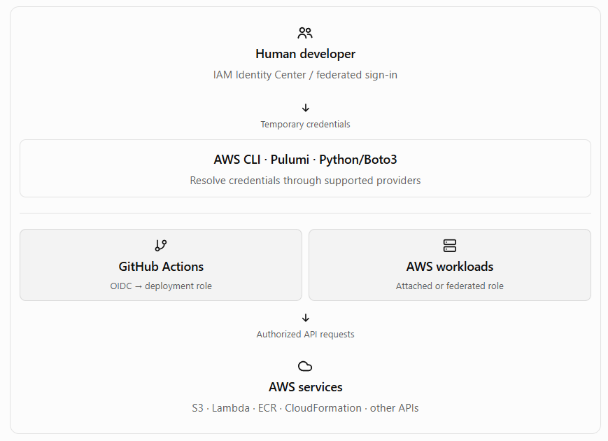
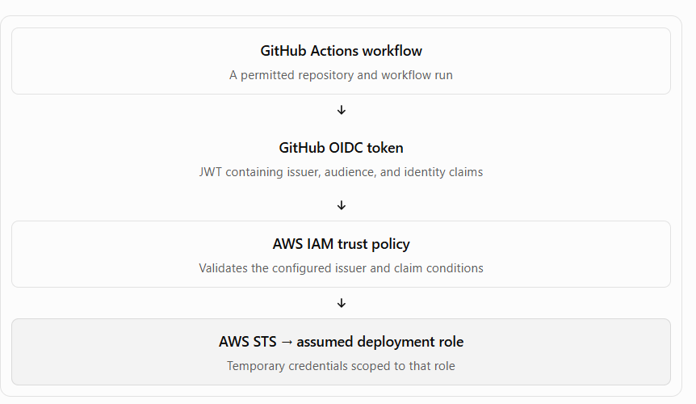
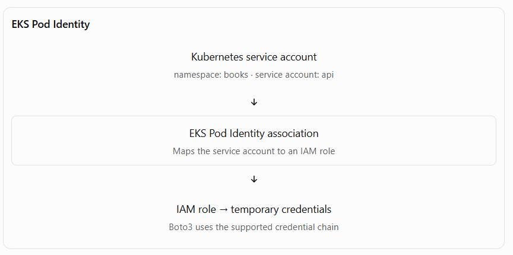
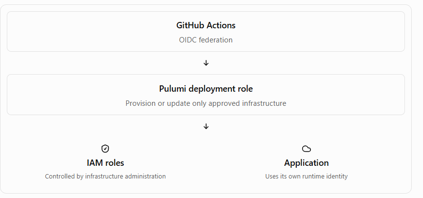

# Module 6 — IAM for Developers and DevOps

Advanced practical course · AWS IAM · Python/Boto3 · Pulumi · GitHub Actions · Kubernetes

The central principle of this module is: applications and automation should obtain temporary, narrowly scoped AWS credentials through an appropriate identity mechanism instead of relying on long-lived access keys.

We'll connect IAM to everyday developer and DevOps workflows, then build a CI/CD pipeline that deploys an application without storing permanent AWS access keys in GitHub repository secrets.

As requested, this module contains no quizzes, uses Pulumi instead of Terraform, and prioritizes current AWS-supported practices.

## Learning objectives

By the end of this module, you'll understand how to:

- Configure AWS CLI profiles and the credential provider chain.
- Use IAM credentials securely with Python and Boto3.
- Assign roles to EC2 instances, Lambda functions, and other workloads.
- Configure GitHub Actions OIDC federation.
- Separate CI build permissions from deployment permissions.
- Authenticate workloads running in Amazon EKS using EKS Pod Identity or IRSA.
- Use Pulumi with appropriate AWS deployment identities.
- Troubleshoot credential resolution and `AccessDenied` failures.

## 1. The developer identity model

Different actors need different identities. A human developer, a CI pipeline, and a running application should not all share the same AWS access key.



Human developer

IAM Identity Center / federated sign-in

Temporary credentials

AWS CLI · Pulumi · Python/Boto3

Resolve credentials through supported providers

GitHub Actions

OIDC → deployment role

AWS workloads

Attached or federated role

Authorized API requests

AWS services

S3 · Lambda · ECR · CloudFormation · other APIs

Notice that there is no single shared credential for all these actors. Each receives credentials appropriate to its execution environment, and each identity has its own permissions.

## 2. AWS CLI profiles and credential provider chains

### 2.1 What is an AWS CLI profile?

A profile is a named collection of AWS CLI configuration settings. It can specify the AWS account and role to use, default Region, output format, and the method used to obtain credentials.

For example, you might use:

- `dev` — development account.
- `staging` — staging deployment role.
- `prod-readonly` — read-only production access.

On Windows, the AWS CLI normally stores configuration in:

```
%UserProfile%\.aws\config
%UserProfile%\.aws\credentials
```

The `config` file contains profile configuration, while `credentials` can contain credentials. IAM Identity Center profiles generally use the configuration file and cached authentication state rather than storing permanent access keys in the credentials file.&#x20;


### 2.2 Prefer IAM Identity Center for human developers

Install the current AWS CLI v2, then configure a profile for your organization's IAM Identity Center access:

```sh
aws configure sso --profile dev
```

Follow the prompts for your organization's SSO session, account, and assigned role. Then authenticate:

```sh
aws sso login --profile dev
```

Verify the identity:

```sh
aws sts get-caller-identity --profile dev
```

Example output:

```json
{
  "UserId": "AROAXXXXXXXXXXXXXXXX:developer-session",
  "Account": "123456789012",
  "Arn": "arn:aws:sts::123456789012:assumed-role/DeveloperRole/developer-session"
}
```

The values above are illustrative. An assumed-role ARN indicates that the request is operating through a role session, rather than directly as a long-lived IAM user.

Important: `aws sts get-caller-identity` tells you which identity signed the request. It does not prove that the identity has permission to perform every operation.

### 2.3 Profiles can assume roles

Suppose you sign in to a development account but need to access a separate account's staging environment.

A role profile can use your existing `dev` profile as the source identity:

```INI
[profile staging]
role_arn = arn:aws:iam::222233334444:role/StagingOperatorRole
source_profile = dev
role_session_name = staging-developer
region = us-east-1
```

This configuration belongs in the AWS CLI `config` file. The source profile must be able to obtain credentials, and the target role's trust policy must permit the role assumption. The resulting session is governed by the role's applicable permissions and other relevant authorization controls.&#x20;


Run:

```sh
aws sts get-caller-identity --profile staging
```

Use a named profile explicitly when possible:

```sh
aws s3 ls --profile staging
aws ec2 describe-instances --profile staging --region us-east-1
```

This is safer than casually switching between production and development identities in a shared terminal.

### 2.4 How the credential provider chain works

The AWS CLI and SDKs can obtain credentials from several sources. The exact order and behavior depend on the tool, SDK version, profile configuration, and explicitly configured providers.

For Boto3, common sources include:

1. Explicit credentials passed directly to a Boto3 session or client.
2. Credentials configured through supported environment variables.
3. Shared credentials and configuration files, including profiles.
4. Role-based providers such as web identity or role assumption, depending on configuration.
5. Container credential providers.
6. EC2 instance metadata credentials.

This is a conceptual overview, not a universal fixed ordering for every provider. In particular, web-identity, container, and instance-role providers depend on the environment and configuration.

The key operational rule is that a higher-priority credential source can cause your application to use an identity other than the one you intended.

For example, a developer might expect a Boto3 script to use an EC2 instance role, but a leftover `AWS_ACCESS_KEY_ID` environment variable can cause the script to use another credential source instead.

Inspect the CLI configuration:

```
aws configure list
aws configure list-profiles
```

Check which identity is actually being used:

```
aws sts get-caller-identity
```

When testing a profile explicitly:

```
aws sts get-caller-identity --profile dev
```

Avoid printing secrets or dumping your entire environment into logs.

## 3. IAM with Python and Boto3

Boto3 is the AWS SDK for Python. It signs AWS API requests using credentials obtained through its credential providers.

### 3.1 Install the SDK

```
py -m pip install boto3
```

For a project managed with `uv`:

```
uv add boto3
```

### 3.2 Use the default credential chain

Create `whoami.py`:

```py

import boto3


def main() -> None:
    session = boto3.Session()
    sts = session.client("sts")

    identity = sts.get_caller_identity()

    print(f"Account: {identity['Account']}")
    print(f"ARN:     {identity['Arn']}")


if __name__ == "__main__":
    main()

```

Run it with your selected profile:

```
$env:AWS_PROFILE = "dev"
python whoami.py
```

Or specify the profile directly in code:

```py
import boto3

session = boto3.Session(profile_name="dev")
s3 = session.client("s3")

for bucket in s3.list_buckets()["Buckets"]:
    print(bucket["Name"])
```

The second example requires permission to list the account's buckets. Having permission to read an individual object's contents does not automatically grant permission to list every bucket.

For reusable applications, I recommend accepting a profile through local development configuration rather than hardcoding a particular developer's identity.

### 3.3 Why you should avoid embedding credentials

Avoid this pattern:

```py
import boto3

# Do not hardcode credentials in application source.
session = boto3.Session(
    aws_access_key_id="AKIA...",
    aws_secret_access_key="...",
)
```

Hardcoded credentials can leak through source control, container images, logs, or copied files.

Instead, let Boto3 obtain credentials from the appropriate environment:

```py
import boto3

s3 = boto3.client("s3")
```

That same application code can use different credential sources depending on where it runs:

| Execution environment | Preferred credential approach            |
| --------------------- | ---------------------------------------- |
| Developer workstation | IAM Identity Center profile              |
| EC2 application       | EC2 instance role                        |
| Lambda function       | Lambda execution role                    |
| GitHub Actions        | OIDC-assumed role                        |
| EKS application       | EKS Pod Identity where suitable, or IRSA |

Boto3 can refresh credentials automatically when supported by its provider. Do not copy temporary credentials into application configuration just to make them persist.

## 4. IAM roles for EC2, Lambda, and other workloads

A workload role is an IAM role assumed by an AWS service or an identity mechanism associated with that workload. Its trust policy determines who can assume it; its permissions policies determine what it can do.

### 4.1 EC2 instance roles

An EC2 application that needs to read from S3 should receive an instance role with access limited to the required bucket or objects.

The flow is:

1. Create an IAM role that trusts `ec2.amazonaws.com`.
2. Attach a policy granting the application's required S3 actions.
3. Associate the role through an EC2 instance profile.
4. Let the AWS SDK obtain temporary credentials through instance metadata.

An instance profile is the EC2 mechanism that carries the IAM role. You don't need to put AWS access keys in the instance's environment or source code.&#x20;


### 4.2 Lambda execution roles

A Lambda function uses an execution role when it accesses AWS services.

For example, a function that reads a particular S3 prefix might need:

- `s3:GetObject` for the relevant object ARNs.
- CloudWatch Logs permissions for its own logging.
- Additional permissions only if its implementation needs other AWS services.

The role's trust policy must allow the Lambda service principal, `lambda.amazonaws.com`, to assume it. Lambda assumes the execution role for the function, so the function ordinarily should not manually assume its own execution role.&#x20;


### 4.3 Other workloads

The same principle applies to ECS tasks, containerized applications, and other AWS-integrated execution environments. Choose the identity mechanism designed for that environment instead of distributing a permanent credential to every container.

One important distinction: for ECS, task roles provide application permissions, whereas task execution roles provide permissions needed by the ECS agent for operations such as pulling images and delivering logs. They should not be conflated.

## 5. GitHub Actions OIDC federation

This is the most important section for the module's main lab.

### 5.1 What problem does OIDC solve?

A traditional CI/CD workflow might store an AWS access key and secret key in GitHub repository secrets. Anyone who can expose those values may be able to use them outside the workflow, potentially until the credentials are revoked.

With OpenID Connect (OIDC), GitHub issues a short-lived identity token for a workflow run. AWS validates that token against a configured identity provider and issues temporary AWS credentials for an IAM role.



GitHub Actions workflow

A permitted repository and workflow run

GitHub OIDC token

JWT containing issuer, audience, and identity claims

AWS IAM trust policy

Validates the configured issuer and claim conditions

AWS STS → assumed deployment role

Temporary credentials scoped to that role

GitHub documents this flow specifically for AWS, and AWS recommends OIDC federation to avoid storing long-lived credentials in external applications.&#x20;


### 5.2 Configure the trust relationship

AWS must trust GitHub's OIDC issuer:

```
https://token.actions.githubusercontent.com
```

The role trust policy should constrain both the audience and the subject (`sub`) claim. For example, for a repository named `OWNER/REPOSITORY`, a branch-specific trust policy can look like this:

```json

{
  "Version": "2012-10-17",
  "Statement": [
    {
      "Effect": "Allow",
      "Principal": {
        "Federated": "arn:aws:iam::123456789012:oidc-provider/token.actions.githubusercontent.com"
      },
      "Action": "sts:AssumeRoleWithWebIdentity",
      "Condition": {
        "StringEquals": {
          "token.actions.githubusercontent.com:aud": "sts.amazonaws.com",
          "token.actions.githubusercontent.com:sub": "repo:OWNER/REPOSITORY:ref:refs/heads/main"
        }
      }
    }
  ]
}

```

Replace the account ID and repository placeholders with your actual values. The OIDC provider must exist in the AWS account.

This policy allows the designated repository's `main` branch to assume the role, provided the remaining token validation requirements are met. A workflow triggered from a different branch will not match this subject condition.

Production warning: Don't use a wildcard subject such as `repo:OWNER/REPOSITORY:*` without understanding the additional workflows and execution contexts it trusts. If you deploy through GitHub Environments, the subject claim can take a different form, such as `repo:OWNER/REPOSITORY:environment:production`; design the trust condition to match the actual, intended deployment context.

### 5.3 What permissions does the role need?

The trust policy above only controls who can assume the role. It does not grant deployment permissions by itself.

For example, a role that updates a Lambda function may need permissions for the relevant Lambda API operations, the deployment artifact in S3, and possibly `iam:PassRole` to pass a specific execution role to Lambda.

That last permission is particularly sensitive. Scope it to the intended role and, where applicable, constrain it with `iam:PassedToService`. Do not give a CI role unrestricted `iam:PassRole` or broad IAM administration simply to make a deployment succeed.

## 6. The main lab — Deploy with Pulumi and GitHub Actions without AWS access keys

We'll build the infrastructure with Pulumi's Python SDK and configure AWS to trust GitHub Actions through OIDC. This lab separates infrastructure provisioning from application deployment and avoids permanent AWS access keys in repository secrets.

### 6.1 Prerequisites

- An AWS sandbox account.
- A GitHub repository with a protected `main` branch.
- Python and Pulumi CLI installed locally.
- A working AWS administrator or delegated infrastructure-management identity for the initial setup.
- A Pulumi backend, such as Pulumi Cloud or a properly configured self-managed backend.

The bootstrap identity is used only to establish the trust relationship and provision the initial resources. The CI workflow will use the dedicated deployment role afterward.

### 6.2 Configure the project

Create a Pulumi Python project:

```sh
mkdir iam-cicd-lab
cd iam-cicd-lab

pulumi new aws-python
```

Choose a stack and Region appropriate for your sandbox. The following example assumes the AWS provider is configured for the intended account and Region.

Install or update the project dependencies through the package manager used by your generated project. For a `uv`-managed project, for example:

```
uv add pulumi pulumi-aws
```

### 6.3 Create the GitHub OIDC provider and deployment role

The following `__main__.py` is an illustrative, deployable starting point for the identity resources. It creates the GitHub OIDC provider, a role restricted to the repository's `main` branch, and a narrowly scoped policy for writing artifacts to one existing S3 bucket.

It deliberately does not grant broad IAM administration or unrestricted access to AWS.

```py

import json

import pulumi
import pulumi_aws as aws

config = pulumi.Config()

account_id = config.require("accountId")
github_owner = config.require("githubOwner")
github_repo = config.require("githubRepo")
artifact_bucket = config.require("artifactBucket")

region = aws.get_region().name

# GitHub's public OIDC issuer.
github_oidc = aws.iam.OpenIdConnectProvider(
    "github-oidc",
    url="https://token.actions.githubusercontent.com",
    client_id_lists=["sts.amazonaws.com"],
)

# Only this repository's main branch may assume the role.
trust_policy = pulumi.Output.all(
    github_oidc.arn
).apply(
    lambda values: json.dumps({
        "Version": "2012-10-17",
        "Statement": [{
            "Effect": "Allow",
            "Principal": {"Federated": values[0]},
            "Action": "sts:AssumeRoleWithWebIdentity",
            "Condition": {
                "StringEquals": {
                    "token.actions.githubusercontent.com:aud":
                        "sts.amazonaws.com",
                    "token.actions.githubusercontent.com:sub":
                        f"repo:{github_owner}/{github_repo}:ref:refs/heads/main",
                }
            },
        }],
    })
)

deployment_role = aws.iam.Role(
    "github-deployment-role",
    name="github-artifact-deployer",
    assume_role_policy=trust_policy,
    description="GitHub Actions role for uploading deployment artifacts",
    tags={
        "ManagedBy": "Pulumi",
        "Purpose": "GitHubActionsDeployment",
    },
)

artifact_policy = aws.iam.RolePolicy(
    "github-artifact-policy",
    role=deployment_role.id,
    policy=pulumi.Output.json_dumps({
        "Version": "2012-10-17",
        "Statement": [{
            "Effect": "Allow",
            "Action": [
                "s3:PutObject",
            ],
            "Resource": f"arn:aws:s3:::{artifact_bucket}/releases/*",
        }],
    }),
)

pulumi.export("deploymentRoleArn", deployment_role.arn)
pulumi.export("region", region)

```

Configure the stack:

```
pulumi config set accountId 123456789012
pulumi config set githubOwner YOUR_GITHUB_OWNER
pulumi config set githubRepo YOUR_REPOSITORY
pulumi config set artifactBucket YOUR_EXISTING_ARTIFACT_BUCKET
```

Replace every placeholder before running this example.

Important details:

- The artifact bucket must already exist; this example does not create it.
- The deployment role can upload objects under `releases/`, but this policy alone does not grant bucket listing, deletion, Lambda deployment, or permission to create arbitrary AWS resources.
- The bootstrap identity needs permission to create the OIDC provider, role, and policy.
- The initial Pulumi deployment must run under that bootstrap identity, not under the GitHub role being created.
- If the bucket uses a customer-managed KMS key, additional narrowly scoped KMS permissions may be necessary.
- Keep a separate infrastructure-management role for changes to IAM itself. Do not give every application deployment pipeline permission to rewrite its own trust policy.

This uses Pulumi's current AWS IAM resources.&#x20;


### 6.4 Deploy the identity resources

After configuring a valid bootstrap AWS profile:

```sh
$env:AWS_PROFILE = "dev"

aws sts get-caller-identity
pulumi preview
pulumi up
```

Review the proposed changes before approving the update.

Copy the exported deployment role ARN:

```
pulumi stack output deploymentRoleArn
```

You'll use that ARN in the workflow. This deployment establishes the identity foundation; it does not yet configure the GitHub workflow or grant application deployment permissions.

### 6.5 Create the GitHub Actions workflow

Create `.github/workflows/deploy.yml` in the application repository:

```

name: Deploy artifacts

on:
  push:
    branches:
      - main

permissions:
  contents: read
  id-token: write

jobs:
  deploy:
    runs-on: ubuntu-latest

    steps:
      - name: Check out source
        uses: actions/checkout@v4

      - name: Configure AWS credentials using OIDC
        uses: aws-actions/configure-aws-credentials@v4
        with:
          role-to-assume: arn:aws:iam::123456789012:role/github-artifact-deployer
          aws-region: us-east-1
          role-session-name: github-artifact-deploy

      - name: Verify AWS identity
        run: aws sts get-caller-identity

      - name: Upload release artifacts
        run: |
          aws s3 cp ./dist/ \
            s3://YOUR_EXISTING_ARTIFACT_BUCKET/releases/ \
            --recursive

```

Update the role ARN, Region, bucket name, and artifact directory for your environment. The example assumes the repository builds the `dist/` directory before the upload step; add the appropriate build and test steps for your application.

The `configure-aws-credentials` action exchanges the GitHub OIDC token for temporary AWS credentials. No `AWS_ACCESS_KEY_ID` or `AWS_SECRET_ACCESS_KEY` repository secrets are needed.

For production, pin third-party actions to reviewed full commit SHAs rather than relying solely on mutable version tags, and restrict deployment permissions to the smallest required scope.

### 6.6 What happens during deployment?

1. GitHub starts the workflow following a push to `main`.
2. The workflow requests a GitHub-issued OIDC token. The `id-token: write` permission allows the job to request the token; it does not grant AWS resource permissions on its own.
3. AWS STS validates the token and the role's trust conditions.
4. STS returns temporary credentials for the assumed deployment role.
5. The AWS CLI signs S3 API requests using those credentials.
6. IAM evaluates the requested action, resource ARN, and all applicable authorization controls.

If the workflow attempts to write outside `releases/`, the policy shown above does not grant that access. A different branch also fails the role's `sub` condition. These are useful security properties, not errors to work around by granting administrator access.

### 6.7 Extending the lab to deploy a real application

For a Lambda deployment, you'll need to add permissions appropriate to the deployment method, such as updating a specific Lambda function and reading its artifact. If the deployment changes the function's execution role, `iam:PassRole` must be carefully scoped to that role and the Lambda service.

For a containerized service, the deployment might instead require pushing an image to ECR and updating an ECS service. That calls for a different, purpose-specific permission set.

The correct policy depends on the actual resources Pulumi manages and the deployment mechanism. A policy that is sufficient for uploading files is not automatically sufficient for deploying Lambda, ECS, or EKS.

## 7. EKS workload identity — Pod Identity vs. IRSA

When a FastAPI application runs inside Amazon EKS and needs to access S3 or DynamoDB, it should use a workload-specific IAM role rather than inherit broad permissions from the worker node.

AWS supports two primary mechanisms: EKS Pod Identity and IAM Roles for Service Accounts (IRSA). AWS recommends considering EKS Pod Identity whenever it meets the workload's requirements.&#x20;



### EKS Pod Identity

Kubernetes service account

namespace: books · service account: api

EKS Pod Identity association

Maps the service account to an IAM role

IAM role → temporary credentials

Boto3 uses the supported credential chain

### 7.1 EKS Pod Identity

The setup requires:

1. An EKS cluster with the Pod Identity Agent installed, unless the cluster's operating mode already provides the necessary integration.
2. An IAM role whose trust policy allows the `pods.eks.amazonaws.com` service principal to perform the required Pod Identity role-assumption operations.
3. An IAM permissions policy granting the application only the AWS actions it needs.
4. A Pod Identity association mapping the Kubernetes namespace and service account to that role.

The association is managed through EKS. The application then uses the AWS SDK's default credential chain to obtain its temporary credentials.&#x20;


### 7.2 IRSA

IRSA is still a supported option, particularly when its integration model or environment compatibility is useful.

It uses the EKS cluster's OIDC issuer and a projected Kubernetes service-account token. An IAM role trust policy constrains the cluster's identity provider and the intended service account. The AWS SDK exchanges the token through STS for temporary credentials.

Unlike EKS Pod Identity, IRSA depends on an IAM OIDC provider configuration for each relevant cluster.

| Consideration       | EKS Pod Identity                                   | IRSA                                                       |
| ------------------- | -------------------------------------------------- | ---------------------------------------------------------- |
| Trust model         | EKS service principal                              | Cluster OIDC provider                                      |
| Association         | Managed through EKS                                | IAM role and Kubernetes service account configuration      |
| AWS SDK             | Default credential chain                           | Default chain with web-identity support                    |
| Cross-cluster reuse | Simplified role trust configuration                | Trust policy must account for each cluster's OIDC identity |
| Best fit            | Default starting point for supported EKS workloads | Compatibility or requirements that favor IRSA              |

Both mechanisms require careful isolation of pod credentials. In particular, restrict unnecessary access to EC2 instance metadata so a compromised pod cannot obtain worker-node credentials.

## 8. Pulumi execution identities and deployment roles

Pulumi introduces an important distinction: the identity running Pulumi is not necessarily the identity used by the deployed application.

Consider three separate identities:

- Infrastructure operator: Creates and updates IAM roles, networking, databases, and application infrastructure.
- CI deployment role: Runs an approved Pulumi deployment through GitHub Actions.
- Application execution role: Used by the running Lambda function, EC2 application, ECS task, or EKS workload.

These identities should not automatically share the same permissions.

**A recommended deployment structure**



GitHub Actions

OIDC federation

Pulumi deployment role

Provision or update only approved infrastructure

IAM roles

Controlled by infrastructure administration

Application

Uses its own runtime identity

For Pulumi, the AWS provider can use the standard AWS credential chain. When the CI workflow has already assumed the deployment role, Pulumi can use those temporary credentials without another permanent key.

However, a role that can create arbitrary IAM roles and policies has much greater privilege than one that can update an existing application. In mature environments, keep IAM bootstrap and security-boundary changes behind a separately controlled deployment path.

If you use Pulumi Cloud, you also need to authenticate Pulumi itself. That is a separate concern from AWS authentication. Pulumi's current GitHub Actions documentation supports exchanging GitHub OIDC tokens for short-lived Pulumi credentials, and Pulumi ESC can provide cloud credentials to workflows.&#x20;


This can eliminate both permanent AWS credentials and a long-lived Pulumi access-token secret, provided you configure the relevant trust relationships and backend.

## 9. Common failures and how to troubleshoot them

| Symptom                                                   | What to inspect                                                                                                                |
| --------------------------------------------------------- | ------------------------------------------------------------------------------------------------------------------------------ |
| `Unable to locate credentials`                            | Credential provider configuration, active profile, environment, or workload identity setup                                     |
| `ExpiredToken`                                            | Whether temporary credentials have expired and whether the provider can refresh them                                           |
| `AccessDenied` on S3                                      | Effective identity, action, bucket/object ARN, resource policy, and applicable permission boundaries or organization policies  |
| `Not authorized to perform sts:AssumeRoleWithWebIdentity` | OIDC provider, audience, subject condition, and role trust policy                                                              |
| `AccessDenied` for `iam:PassRole`                         | Whether the deployment role can pass the exact execution role to the intended AWS service                                      |
| Pulumi deployment fails despite successful AWS login      | Whether the active role can manage every resource and operation in the Pulumi plan                                             |
| EKS pod cannot access AWS                                 | Service account association, IAM role permissions, Pod Identity Agent or IRSA configuration, SDK version, and credential chain |

A useful diagnostic sequence is:

```
aws configure list
aws sts get-caller-identity
pulumi whoami
pulumi preview
```

Run these in the same environment and under the same configuration used for the failing operation. `pulumi whoami` identifies the Pulumi backend identity; `aws sts get-caller-identity` identifies the AWS identity. They answer different questions.

## 10. Production checklist

Before using this architecture for real deployments, verify the following:

- No permanent AWS access keys are stored in GitHub repository secrets.
- GitHub OIDC trust is limited to the intended repository, branch, or protected deployment environment.
- The workflow has only the GitHub token permissions it requires.
- AWS deployment permissions are scoped to the required resources and actions.
- `iam:PassRole` is constrained to specific execution roles where needed.
- Infrastructure administration is separated from ordinary application deployment.
- Applications use their own runtime roles rather than deployment credentials.
- EKS workloads use Pod Identity or IRSA with least privilege.
- Logs and CloudTrail provide sufficient evidence to investigate deployment activity.
- Third-party GitHub Actions are pinned to reviewed versions or commit SHAs.
- Pulumi state and secrets are protected with appropriate access controls and encryption.

## Module 6 summary

The most important lesson is that credential management and authorization are separate concerns. OIDC, IAM Identity Center, EC2 instance profiles, Lambda execution roles, and EKS workload identity help establish who the caller is. IAM policies then control what that caller can do.

For the capstone, the next logical step is to extend the artifact-upload lab into a complete Pulumi-managed application deployment, including the target AWS resources, a dedicated runtime role, separate preview and production workflows, and an auditable least-privilege permission model.