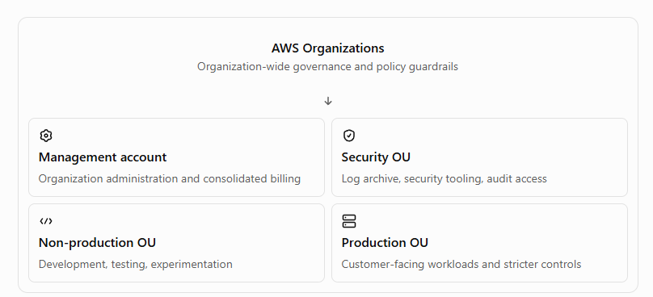
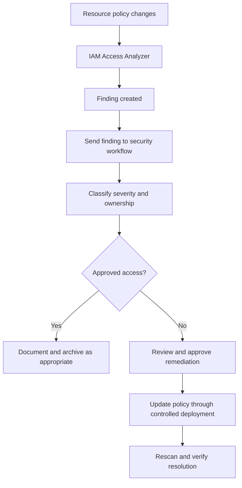
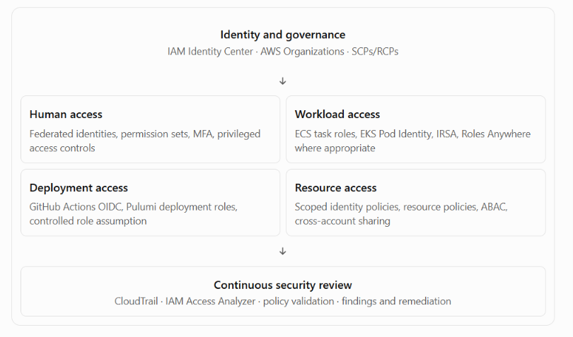

# Module 8 — Advanced IAM Architecture

Advanced · Production architecture · Pulumi with Python · AWS security best practices

This final module brings the earlier IAM concepts together into an architecture you could use for a real multi-account AWS environment. We'll focus on designing boundaries between teams and workloads, managing access at scale, and preventing excessive permissions without making deployments unnecessarily difficult.

As requested, this module contains no quizzes and uses Pulumi instead of Terraform wherever practical. We'll use the AWS CLI and Python/Boto3 for operations that are better expressed as direct API calls.

## Learning objectives

By the end of this module, you'll understand how to:

- Organize AWS accounts and identities around security boundaries.
- Apply organization-wide guardrails without replacing account-level IAM policies.
- Share resources safely across accounts.
- Scale attribute-based access control (ABAC).
- Give containers and Kubernetes workloads AWS credentials without embedding long-lived keys.
- Use IAM Roles Anywhere for supported external workloads.
- Investigate Access Analyzer findings and automate safe remediation.
- Review an IAM architecture for production readiness and understand its trade-offs.

## Module map

8.1

Multi-account AWS Organizations

Account boundaries, organizational units, management and security accounts.

8.2

Permission guardrails and delegated administration

SCPs, RCPs, permission boundaries, and administrative separation.

8.3

Cross-account resource sharing

Role assumption, resource policies, and AWS RAM.

8.4

ABAC at scale

Principal tags, resource tags, session tags, and governance.

8.5

Container and Kubernetes identity

ECS task roles, EKS Pod Identity, and IRSA.

8.6

IAM Roles Anywhere

X.509 certificates and temporary AWS credentials for external workloads.

8.7

Access Analyzer and automated remediation

Findings, validation, monitoring, and controlled remediation.

8.8

Production security review

Threat modeling, design trade-offs, and a Pulumi capstone.

# 8.1 Multi-account AWS Organizations design

## Why multiple AWS accounts?

An AWS account is more than a billing container. It provides an important security boundary, with its own resources, IAM identities, quotas, and account-level administration.

In a small environment, one account might host everything. In a production organization, separating environments and security responsibilities across accounts helps reduce the impact of compromised credentials, mistakes, and overly broad permissions.

Consider this architecture:



AWS Organizations

Organization-wide governance and policy guardrails

Management account

Organization administration and consolidated billing

Security OU

Log archive, security tooling, audit access

Non-production OU

Development, testing, experimentation

Production OU

Customer-facing workloads and stricter controls

An OU (organizational unit) is a grouping of accounts. You attach supported organization policies to an OU to apply guardrails to its member accounts.

### Recommended account responsibilities

| Account or group | Responsibility                                                      |
| ---------------- | ------------------------------------------------------------------- |
| Management       | Organization configuration, account governance, billing             |
| Security tooling | Security services, findings aggregation, delegated administration   |
| Log archive      | Centralized security and audit logs                                 |
| Development      | Developer experimentation and test workloads                        |
| Staging          | Pre-production validation                                           |
| Production       | Customer workloads with tighter deployment controls                 |
| Shared services  | Shared networking, DNS, and other centrally operated infrastructure |

These are logical roles, not mandatory account names or a requirement to create every account on day one.

### Protect the management account

The management account deserves special treatment because its administrative capabilities affect the organization itself.

Recommended controls:

- Restrict access to a very small set of authorized administrators.
- Do not run ordinary application workloads there.
- Use a separate, auditable administrative workflow.
- Delegate security and other service responsibilities to member accounts when supported.
- Protect the management account root user and avoid routine root-user use.
- Test organization-level policies before applying them broadly.

AWS explicitly recommends restricting management-account access and delegating responsibilities to member accounts where possible.&#x20;

[image](https://www.google.com/s2/favicons?domain=https://docs.aws.amazon.com\&sz=32)

AWS Organizations


## How does an administrator access the member accounts?

For human users, a modern pattern is to use IAM Identity Center with an external identity provider where appropriate. Assign permission sets to users or groups and target AWS accounts.

For automation, use dedicated workload or deployment roles with temporary credentials.

```
Human identity provider
          |
          v
IAM Identity Center
          |
          +---- Developer permission set ----> Dev account
          |
          +---- Read-only permission set ----> Production account

GitHub Actions -- OIDC --> Deployment role --> Target account
```

The important design principle is that human access and automated workload access should be independently scoped and audited.

## Organization guardrails versus account permissions

Suppose a developer has an identity policy that allows deleting an S3 bucket. An organization policy can restrict that action, so the developer's account-level permissions alone are not sufficient to authorize it.

This brings us to a critical distinction: organization policies are guardrails, not ordinary permission grants. We'll examine the exact behavior in the next section.

# 8.2 Permission guardrails and delegated administration

Production IAM architecture normally combines several policy layers. Each solves a different problem.

| Mechanism                     | Main purpose                                                                       |
| ----------------------------- | ---------------------------------------------------------------------------------- |
| Identity-based policy         | Grant permissions to a user, group, or role                                        |
| Resource-based policy         | Grant access through a supported resource's policy                                 |
| Permissions boundary          | Limit permissions an identity-based policy can grant to an IAM user or role        |
| Session policy                | Further restrict a particular role session                                         |
| Service control policy (SCP)  | Set maximum available permissions for principals in affected organization accounts |
| Resource control policy (RCP) | Set organization-level maximum permissions on supported resources                  |
| Explicit Deny                 | Reject a request when the applicable policy evaluation includes that denial        |

These mechanisms are not interchangeable, and the exact evaluation depends on the principal type, resource, and service.

## SCPs: organization-wide guardrails

An SCP does not grant permissions. It defines the maximum permissions available to principals in member accounts.

For example, suppose an organization wants to prevent deletion of a protected S3 bucket. A simplified SCP might be:

```

{
  "Version": "2012-10-17",
  "Statement": [
    {
      "Sid": "DenyDeletingProtectedBucket",
      "Effect": "Deny",
      "Action": "s3:DeleteBucket",
      "Resource": "arn:aws:s3:::company-production-logs"
    }
  ]
}

```

This explicit Deny blocks the matching action, subject to the applicable AWS policy-evaluation rules. Attaching this SCP does not give anyone permission to read or manage S3.

Important: SCPs do not restrict principals in the AWS Organizations management account in the same way they restrict member-account principals. Do not rely on an SCP attached to the organization root as your sole protection for management-account identities.

### SCP design recommendations

- Use explicit Deny guardrails for carefully chosen organization-wide prohibitions.
- Use Allow-list SCP designs only when you understand their operational impact and have thoroughly tested required service permissions.
- Keep emergency recovery and security-response procedures in mind.
- Test policy changes in a non-production OU before wider deployment.
- Remember that SCPs constrain permissions but do not replace identity-based policies or resource policies.

## RCPs: guardrails on supported resources

Resource control policies add a complementary layer by setting a maximum permission boundary for resources in member accounts, for supported AWS services and resource types.

A useful way to think about the distinction:

- SCP: What may principals in this account do?
- RCP: What permissions may be exercised on resources protected by this organization policy?

RCP support and exceptions are service-specific. Verify the current AWS documentation before designing a control around a particular resource.

## Delegated administration

Delegated administration allows a member account to administer a supported AWS service on behalf of the organization, instead of concentrating all service administration in the management account.

A typical arrangement is:

```
Management account
  └── Authorizes supported service integration
       └── Security tooling account
            └── Administers the service across the organization
```

Do not confuse delegation with giving the security account unrestricted access to every member account. The service's delegation model and the permissions of any roles involved still matter.

For example, a security team may need to aggregate findings centrally without needing the ability to modify application resources in production.

### Common production failure

An organization attaches an SCP that blocks a service action used by its deployment pipeline. The pipeline's IAM role still has an Allow policy, but deployments fail.

The fix is not automatically to grant AdministratorAccess. Instead:

1. Identify the denied API action and target resource.
2. Identify which account and principal made the request.
3. Check the effective organization guardrails.
4. Determine whether the restriction is intentional.
5. Change the narrowest appropriate policy, if authorized.

# 8.3 Cross-account resource sharing

There are two major patterns for giving one AWS account access to another account's resources.

- **Pattern A: Assume a role in the resource-owning account**

    The consuming identity calls STS `AssumeRole`, receives temporary credentials, and acts using the assumed role's permissions.

- **Pattern B: Share a resource directly**

    A supported resource policy or AWS Resource Access Manager (AWS RAM) share allows an identity in another account to access a resource without necessarily assuming a role in the owning account.

## Pattern A: cross-account role assumption

Suppose account A runs an application and account B owns a bucket containing shared book covers.

The application assumes a role in account B that allows reading objects from that bucket.

```

Account A                                  Account B
---------                                  ---------
Application role
     |
     | sts:AssumeRole
     v
Role trust policy -----------------------> Accepts account A's role
                                               |
                                               v
                                          Role permissions
                                               |
                                               v
                                          Read permitted S3 objects

```

Two independent permissions are important:

1. The target role's trust policy must allow the calling principal to assume the role.
2. The caller must be authorized to call `sts:AssumeRole`, and the assumed role must have the necessary permissions.

Cross-account requests are subject to the relevant policies and guardrails in both accounts.

An illustrative target role trust policy is:

```

{
  "Version": "2012-10-17",
  "Statement": [
    {
      "Effect": "Allow",
      "Principal": {
        "AWS": "arn:aws:iam::111122223333:role/BookApiRole"
      },
      "Action": "sts:AssumeRole"
    }
  ]
}

```

Here, account `111122223333` is illustrative. Replace it with your actual account ID and role ARN.

Avoid trusting an entire account or using a broad wildcard principal when a specific role can be trusted instead.

## Pattern B: AWS RAM

AWS RAM is useful for sharing supported resources such as subnets, resource configurations, and other service resources across accounts.

A resource share specifies the resources, recipient principals, and applicable managed permissions. For supported resources, organization-wide or OU-level sharing can reduce the need to enumerate every account.&#x20;

[image](https://www.google.com/s2/favicons?domain=https://docs.aws.amazon.com\&sz=32)

AWS Resource Access Manager

+1


A recipient still needs the appropriate identity permissions. A RAM share does not automatically give every user in the recipient account unlimited access.

Use RAM when the service supports the resource-sharing model you need. Use a resource-based policy or a cross-account role when that is the supported or more appropriate pattern.

Important distinction: S3 bucket sharing, KMS key policies, RAM-managed resources, and cross-account role assumption have different authorization details. Do not assume one generic cross-account configuration works for all AWS services.

# 8.4 ABAC at scale

Attribute-based access control (ABAC) uses attributes—often represented by tags—to determine which resources a principal can access.

RBAC generally grants permissions based on roles such as `Developer`, `Operator`, or `Auditor`. ABAC can use those roles too, but it adds contextual attributes such as team, environment, project, and data classification.

## Why ABAC helps at scale

Imagine an organization with 50 teams, 200 applications, and thousands of AWS resources.

With a purely resource-specific approach, administrators may need to maintain many policies as teams and applications grow. ABAC can reduce that policy proliferation by using a consistent set of attributes.

Example resource tags:

| Resource    | Team     | Environment |
| ----------- | -------- | ----------- |
| S3 bucket A | books    | dev         |
| S3 bucket B | payments | prod        |
| S3 bucket C | books    | prod        |

A workload associated with the `books` team should not automatically gain access to `payments` resources.

## A tag-based policy

The following illustrative policy allows operations on objects in buckets whose object-resource tags match the principal's `team` and `environment` principal tags. The exact service and action support for tag-based conditions must be checked before deployment.

```

{
  "Version": "2012-10-17",
  "Statement": [
    {
      "Sid": "AllowMatchingTaggedObjects",
      "Effect": "Allow",
      "Action": [
        "s3:GetObject",
        "s3:PutObject"
      ],
      "Resource": "arn:aws:s3:::company-data/*",
      "Condition": {
        "StringEquals": {
          "s3:ExistingObjectTag/team": "${aws:PrincipalTag/team}",
          "s3:ExistingObjectTag/environment": "${aws:PrincipalTag/environment}"
        }
      }
    }
  ]
}

```

This is a conceptual example of matching principal and object tags. `s3:ExistingObjectTag` has service-specific limitations, including limitations around using object tags to authorize `PutObject`. Do not use this policy unchanged as a general-purpose S3 write policy.

For a real design, check the action-specific S3 authorization reference and consider separate policies for reading, writing, and tagging objects. Bucket-level operations such as `s3:ListBucket` also require separate treatment.

## Where do principal tags come from?

Principal tags can come from IAM role tags, session tags, or other supported identity mechanisms. The critical issue is not just how tags are attached—it's who is authorized to control them.

If a developer can change their own team tag from `books` to `payments`, the policy may grant access to the wrong team's data.

A secure ABAC implementation therefore needs:

- Controlled creation and modification of principal tags.
- Controlled resource tagging and tag-key conventions.
- Restrictions against modifying authorization-sensitive tags without approval.
- Validation that required attributes are present.
- Explicit treatment of missing or malformed tags.
- Testing for privilege escalation through tag manipulation.

AWS documents ABAC patterns and condition keys in its [IAM tags and access-control guidance](https://docs.aws.amazon.com/IAM/latest/UserGuide/access_iam-tags.html).

## ABAC with EKS Pod Identity

EKS Pod Identity can provide session tags that identify attributes such as the cluster, namespace, and Kubernetes service account. These can support policies that scale across workloads without requiring a separate hard-coded policy for every service account.&#x20;

[image](https://www.google.com/s2/favicons?domain=https://docs.aws.amazon.com\&sz=32)

Amazon EKS

+1


For example, a role might permit access to resources associated with a particular namespace or workload class. The policy must still validate the attributes and constrain the resources and actions appropriately.

Production rule: Use ABAC to simplify policy management, not to replace identity governance. Poorly governed tags can turn a compact policy into a large privilege-escalation risk.

# 8.5 Workload identity for containers and Kubernetes

Applications need AWS credentials to call AWS APIs. A container should not need a developer's permanent AWS access key to do that.

The goal is to give each workload its own identity, short-lived credentials, and only the permissions it needs.

## Amazon ECS

For Amazon ECS, distinguish between two roles:

- Task execution role: Used by the ECS agent and platform for tasks such as pulling images from private ECR repositories and sending logs, as applicable.
- Task role: Used by application code running inside the task to access AWS services.

For example, a FastAPI container might need to read book metadata from DynamoDB and store generated files in a specific S3 bucket. Its task role should grant only those operations.

Do not put application permissions indiscriminately on the task execution role.

## Amazon EKS: Pod Identity vs. IRSA

AWS supports two principal patterns for delivering IAM credentials to EKS workloads:

- **EKS Pod Identity** (Preferred for supported new workloads)

    Associates an IAM role with a Kubernetes service account through the EKS Pod Identity mechanism. It uses the EKS Pod Identity Agent on supported worker nodes and the `pods.eks.amazonaws.com` service principal in the role trust policy.

- **IAM Roles for Service Accounts (IRSA)**

    Uses the cluster's OIDC identity provider and web-identity federation to associate a Kubernetes service account with an IAM role.

AWS recommends EKS Pod Identity when appropriate for supported workloads. IRSA remains a valid, supported choice for existing systems and cases where Pod Identity's constraints or integration model do not fit.&#x20;

[image](https://www.google.com/s2/favicons?domain=https://docs.aws.amazon.com\&sz=32)

Amazon EKS

+2


### Example: EKS Pod Identity trust policy

A simplified trust policy for an EKS Pod Identity role looks like this:

```

{
  "Version": "2012-10-17",
  "Statement": [
    {
      "Effect": "Allow",
      "Principal": {
        "Service": "pods.eks.amazonaws.com"
      },
      "Action": [
        "sts:AssumeRole",
        "sts:TagSession"
      ]
    }
  ]
}

```

This establishes the EKS Pod Identity service as the trusted principal. In production, also consider the relevant `aws:SourceAccount` and `aws:SourceArn` confused-deputy protections where supported, and validate the trust configuration against AWS's current EKS guidance.

The role's permission policy is separate. For example, it could grant read-only access to a specific S3 bucket's objects.

### Important isolation considerations

1. Assign different roles to workloads with materially different permissions.
2. Restrict unnecessary access to EC2 instance metadata credentials.
3. Do not assume that Kubernetes namespace boundaries alone provide AWS authorization.
4. Keep the AWS SDK updated and ensure it supports the chosen credential mechanism.
5. Use a separate role for infrastructure components that require elevated AWS permissions.
6. For cross-account access, use an explicit, narrowly scoped role-assumption design.

### What about Kubernetes outside EKS?

EKS Pod Identity is not a general-purpose identity mechanism for arbitrary Kubernetes clusters. It is an EKS feature with specific support requirements.

For a self-managed Kubernetes cluster, external cluster, or workload running on another platform, choose an identity mechanism supported by that environment. Depending on the architecture, options may include OIDC federation, IAM Roles Anywhere, or an explicitly assumed role through a supported credential flow.

Avoid legacy credential-proxy patterns that distribute node-role credentials to arbitrary pods.

# 8.6 IAM Roles Anywhere for external workloads

IAM Roles Anywhere allows supported workloads outside AWS to obtain temporary AWS credentials using X.509 certificates issued by a trusted certificate authority.

This is useful for:

- On-premises servers.
- Datacenter applications.
- Supported external build agents.
- Workloads running outside AWS that need access to AWS APIs.

It does not require embedding permanent IAM access keys in the application.

## How the credential flow works

```

External workload
       |
       | X.509 certificate + private key
       v
IAM Roles Anywhere
       |
       | Validate trust anchor and role authorization
       v
STS temporary AWS credentials
       |
       v
AWS API (S3, DynamoDB, etc.)

```

The key components are:

- **Trust anchor:** Identifies the trusted certificate authority.
- **Profile:** Defines the IAM roles that may be assumed and can constrain session permissions.
- **IAM role:** Contains the trust policy and permissions for the resulting session.
- **Credential helper:** Obtains temporary credentials using the supported Roles Anywhere flow.

AWS documents the trust anchor, profile, certificate, and role requirements in its [IAM Roles Anywhere introduction](https://docs.aws.amazon.com/rolesanywhere/latest/userguide/introduction.html).&#x20;

[image](https://www.google.com/s2/favicons?domain=https://docs.aws.amazon.com\&sz=32)

IAM Roles Anywhere

+1


## Security design

Treat the certificate's private key as a high-value credential. A valid certificate and its associated private key can enable credential acquisition, subject to the configured trust and role restrictions.

Use:

- A controlled certificate issuance and revocation process.
- Short-lived AWS credentials.
- Narrowly scoped IAM roles.
- Explicit role trust conditions where appropriate.
- Secure private-key storage and rotation.
- Auditing of role sessions and API activity.

Do not assume that certificate authentication automatically restricts a workload to a single role. Roles Anywhere has an account-level trust boundary, so role trust policies and profiles must be configured carefully to prevent unintended role assumption.

When not to use it: If the workload already runs on an AWS service with a native workload identity mechanism, prefer that native mechanism unless there is a concrete reason to use Roles Anywhere.

# 8.7 IAM Access Analyzer and automated remediation

IAM Access Analyzer helps you identify unintended access, review unused permissions, validate policies, and generate policy recommendations from observed activity.

It is not just a tool for finding public S3 buckets. Its capabilities include several distinct types of analysis.&#x20;

[image](https://www.google.com/s2/favicons?domain=https://docs.aws.amazon.com\&sz=32)

AWS Identity and Access Management

+1


## Types of analysis

| Capability           | What it helps you discover                                                      |
| -------------------- | ------------------------------------------------------------------------------- |
| External access      | Supported resources shared outside your defined zone of trust                   |
| Internal access      | Access paths to selected critical resources within your account or organization |
| Unused access        | Unused roles, credentials, and permissions                                      |
| Policy validation    | Policy syntax issues and security recommendations                               |
| Custom policy checks | Whether a policy change violates specified access rules                         |
| Policy generation    | Suggested IAM policies based on CloudTrail activity                             |

External and internal resource analysis is Regional, so enable external access analyzers in each Region where you need coverage. Unused access analysis does not require a separate analyzer in every Region.&#x20;

[image](https://www.google.com/s2/favicons?domain=https://docs.aws.amazon.com\&sz=32)

AWS Identity and Access Management

+1


## Example: an unintended public resource policy

Suppose someone modifies a supported resource policy to grant public access to data that should remain private.

A secure response pipeline might be:



The important distinction is between detecting a problem and changing production permissions. An automated workflow should not blindly remove every external grant: some cross-account sharing is intentional.

AWS provides a [documented remediation process](https://docs.aws.amazon.com/IAM/latest/UserGuide/access-analyzer-findings-remediate.html) for external, internal, and unused-access findings.&#x20;

[image](https://www.google.com/s2/favicons?domain=https://docs.aws.amazon.com\&sz=32)

AWS Identity and Access Management

+1


## Automated remediation design

A production workflow should include the following controls:

1. Detection: Collect relevant findings centrally.
2. Classification: Determine the resource type, severity, environment, and owner.
3. Validation: Check whether the finding corresponds to an approved integration.
4. Authorization: Ensure the remediation identity is allowed to make the specific change.
5. Change management: Create a reviewed policy change or use an approved automatic action for narrowly defined cases.
6. Verification: Confirm the resource policy has changed and the finding is resolved.
7. Audit: Record the original finding, change, approval, and outcome.

For high-risk changes, require human approval. For low-risk, well-understood cases, automated remediation can be appropriate.

### A practical CLI investigation

Use the AWS CLI to list active findings:

```
aws accessanalyzer list-findings \
  --analyzer-arn "$ANALYZER_ARN" \
  --filter '{"status":{"eq":["ACTIVE"]}}' \
  --region us-east-1
```

Replace the environment variable with the ARN of an existing analyzer. The example uses `us-east-1`; run it in the appropriate Region for your external or internal access analyzer.

To inspect a particular finding:

```
aws accessanalyzer get-finding \
  --analyzer-arn "$ANALYZER_ARN" \
  --id "$FINDING_ID" \
  --region us-east-1
```

Use the returned details to identify the affected resource, external principal, and permissions. Avoid making changes until you have determined whether the access is legitimate.

## Where Pulumi fits

Pulumi can define the desired state of supported IAM resources, policies, and related infrastructure. The same workflow can run policy validation and automated tests before deployment.

For example, a CI pipeline can:

- Run static checks on IAM policy JSON.
- Validate policies with IAM Access Analyzer.
- Compare changes against approved least-privilege rules.
- Deploy approved changes with Pulumi.
- Recheck the resulting AWS configuration.

Use direct AWS API calls for finding retrieval or remediation operations that are not conveniently managed as declarative resources. Keep remediation code idempotent, narrowly scoped, and auditable.

# 8.8 Production security review and design trade-offs

The final section ties the module together into a repeatable architecture review.

## Recommended architecture



Identity and governance

IAM Identity Center · AWS Organizations · SCPs/RCPs

Human access

Federated identities, permission sets, MFA, privileged access controls

Workload access

ECS task roles, EKS Pod Identity, IRSA, Roles Anywhere where appropriate

Deployment access

GitHub Actions OIDC, Pulumi deployment roles, controlled role assumption

Resource access

Scoped identity policies, resource policies, ABAC, cross-account sharing

Continuous security review

CloudTrail · IAM Access Analyzer · policy validation · findings and remediation

## Security review checklist

Use this checklist when evaluating an existing AWS environment or reviewing a new design.

### Production readiness review

0/19 reviewed

**Organization and accounts**

Management account has minimal administrative use and restricted access.

Development, staging, production, and security responsibilities are appropriately separated.

SCPs and RCPs are tested and applied at the intended organizational scope.

Delegated administrators have only the required service-level responsibilities.

**Identity and permissions**

Human access uses an approved federation and permission-set workflow where practical.

Workloads use temporary credentials instead of embedded long-lived AWS access keys.

Cross-account role trust is scoped to intended principals.

Policies are least-privilege and avoid unnecessary wildcards.

Sensitive tags cannot be changed by unauthorized principals.

**Workload and resource access**

ECS execution roles and application task roles are separated.

EKS workloads use an appropriate supported identity mechanism.

Resource-sharing grants are documented and periodically reviewed.

Sensitive resources have appropriate encryption and key permissions.

External workloads use a supported credential mechanism and protected private keys.

**Detection and operations**

Access Analyzer covers the relevant Regions and accounts.

Critical policy changes receive validation and review.

Findings have owners, response procedures, and remediation records.

Emergency access and recovery processes are documented and tested.

Pulumi changes are reviewed, version-controlled, and applied through controlled identities.

Reset reviewCopy checklist

## Common architecture trade-offs

| Decision                      | Benefits                                                  | Trade-off                                                            |
| ----------------------------- | --------------------------------------------------------- | -------------------------------------------------------------------- |
| More AWS accounts             | Stronger separation and independent guardrails            | More operational overhead                                            |
| Centralized administration    | Consistent governance and auditability                    | Requires careful delegation and ownership                            |
| ABAC                          | Scales across many resources and teams                    | Depends on reliable attribute governance                             |
| EKS Pod Identity              | Simplified role association and reusable trust model      | Requires supported EKS infrastructure and agent configuration        |
| IRSA                          | Mature OIDC federation model with broad existing adoption | Requires cluster OIDC configuration and per-cluster trust management |
| Cross-account role assumption | Clear identity and permission boundary                    | Adds role-trust and session-management complexity                    |
| Automated remediation         | Faster response and consistent handling                   | Incorrect automation can disrupt production                          |
| Strict allow-list guardrails  | Strong restriction of available permissions               | May interfere with legitimate service operations if incomplete       |

## Capstone: Secure a FastAPI book service with Pulumi

The final exercise is to design a secure deployment for a FastAPI application that stores book metadata and files in AWS.

The architecture should include:

- A dedicated workload account and separate non-production environment.
- A narrowly scoped application role.
- Temporary workload credentials.
- A deployment role assumed by GitHub Actions through OIDC.
- Pulumi-managed IAM resources and the supporting infrastructure.
- A security workflow that reviews Access Analyzer findings.
- An audit and troubleshooting procedure for denied requests.

The deployment identity should not automatically inherit the application's runtime permissions, and the application should not be able to modify the IAM configuration that governs its own privileges.

For the Pulumi implementation, use a supported AWS provider version and pin dependencies. Before applying organization-wide policies, verify the required permissions and test their effect in a sandbox or dedicated non-production account.

## Module 8 summary

The central idea behind advanced IAM architecture is that no single policy or service provides the entire security model.

- AWS Organizations establishes account-level governance boundaries.
- SCPs and RCPs constrain permissions within their respective scopes.
- Cross-account roles and AWS RAM enable controlled sharing.
- ABAC helps scale authorization when attributes are trustworthy.
- Native workload identity avoids distributing long-lived credentials.
- IAM Roles Anywhere extends temporary role credentials to supported external workloads.
- IAM Access Analyzer supports ongoing access analysis and policy improvement.
- Pulumi and controlled deployment pipelines help maintain these policies consistently.

A mature implementation combines preventive guardrails, narrowly scoped identity permissions, temporary credentials, continuous detection, and a tested recovery process. That combination is what turns IAM from a collection of JSON policies into a maintainable security architecture.

### Official AWS references

- [AWS Organizations management-account best practices](https://docs.aws.amazon.com/organizations/latest/userguide/orgs_best-practices_mgmt-acct.html)
- [AWS Resource Access Manager](https://docs.aws.amazon.com/ram/latest/userguide/)
- [IAM ABAC and tags](https://docs.aws.amazon.com/IAM/latest/UserGuide/access_iam-tags.html)
- [EKS Pod Identity](https://docs.aws.amazon.com/eks/latest/userguide/pod-identities.html)
- [IAM Roles Anywhere](https://docs.aws.amazon.com/rolesanywhere/latest/userguide/introduction.html)
- [IAM Access Analyzer](https://docs.aws.amazon.com/IAM/latest/UserGuide/what-is-access-analyzer.html)

These references provide the service-specific details to consult when implementing the architecture, particularly for policy evaluation, supported resources, and feature limitations.