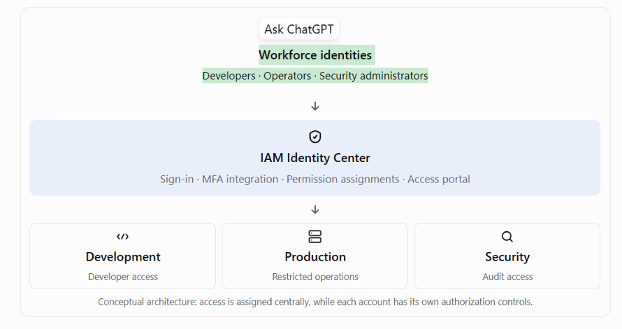
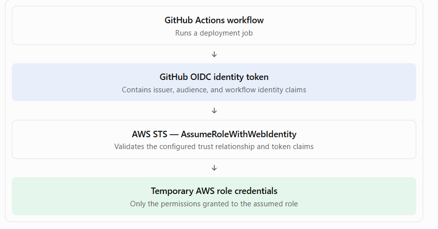
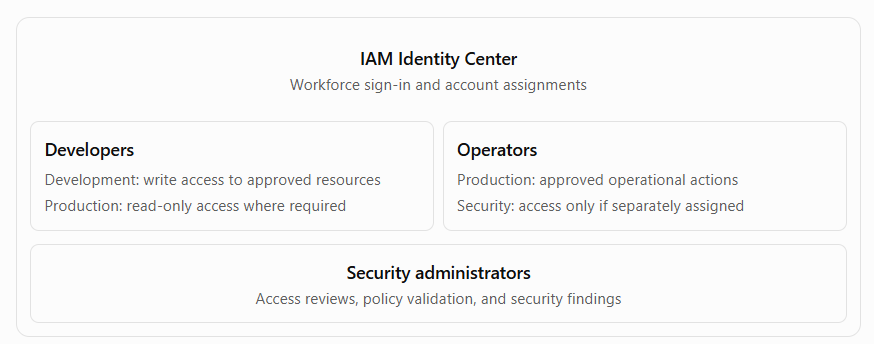

# Module 5 — Identity Management and Security

AWS IAM course · Intermediate to advanced · Security-focused hands-on labs · Pulumi where applicable

## Module objectives

By the end of this module, you'll understand how to manage human identities, secure privileged access, federate external identities into AWS, protect credentials, and reduce the risk of privilege escalation.

We'll build a developer/operator access model that separates everyday development from production operations, then audit it for excessive permissions.

This module uses modern AWS security practices:

- IAM Identity Center for centralized workforce access.
- Federation instead of creating unnecessary IAM users for human employees.
- Temporary credentials instead of long-lived access keys wherever possible.
- MFA and strong root-user protection for sensitive access.
- Least privilege and permission guardrails to limit damage from compromised identities.
- Delegated administration to separate responsibilities across AWS accounts.

We won't use legacy IAM-user-centric workforce designs as the default. IAM users and access keys remain relevant for specific cases, but we'll explain when they are appropriate.

## Lesson 1 — IAM Identity Center and workforce identity

### 1.1 The problem IAM Identity Center solves

Imagine your organization has three teams:

- Developers deploy and debug applications.
- Operators investigate production incidents.
- Security administrators manage access policies and investigate suspicious activity.

Suppose your organization has five AWS accounts: management, security, development, staging, and production.

Without centralized workforce identity management, you could end up maintaining separate user accounts, credentials, and permissions in each AWS account. This creates duplicated administration and makes employee onboarding, offboarding, and access reviews harder.

AWS IAM Identity Center addresses this problem by providing a centralized way to manage workforce access to multiple AWS accounts and supported applications.



### 1.2 How the main components fit together

| Component              | Responsibility                                                         |
| ---------------------- | ---------------------------------------------------------------------- |
| Identity source        | Stores or supplies workforce identities and groups                     |
| IAM Identity Center    | Coordinates access to AWS accounts and supported applications          |
| Permission set         | Defines the permissions and session settings for an assigned AWS role  |
| AWS account assignment | Connects a user or group to an account and a permission set            |
| IAM role               | Provides the account-level identity used for the resulting AWS session |
| Temporary credentials  | Let the authenticated person make authorized AWS API requests          |

A permission set is particularly important. It is the reusable definition of what a workforce identity can do in an AWS account. IAM Identity Center provisions the corresponding IAM role and policies into the assigned account.

For example, you could assign:

- `DeveloperAccess` to the development account.
- `ReadOnlyAccess` to the production account for developers who need visibility but should not make changes.
- `OperatorAccess` to designated operators in production.
- A tightly controlled security role to the security team.

The exact permissions should be customized for your workloads rather than granting broad administrator access by default.

### 1.3 Identity sources: where do users come from?

IAM Identity Center supports different identity-source arrangements.

| Identity source                  | Best suited for                                                                        |
| -------------------------------- | -------------------------------------------------------------------------------------- |
| Identity Center directory        | Organizations that want to manage workforce identities directly in IAM Identity Center |
| External identity provider (IdP) | Organizations already using a provider such as Microsoft Entra ID or Okta              |
| Active Directory                 | Organizations that need an existing supported directory integration                    |

For an organization with an existing corporate identity provider, the typical flow is:

1. An employee signs in through the organization's identity provider.
2. The provider authenticates the employee and applies its sign-in controls.
3. IAM Identity Center establishes the workforce sign-in session.
4. The employee selects an assigned AWS account and role.
5. AWS issues temporary credentials for authorized API access.

External identity sources can use SAML 2.0 for authentication and SCIM for user and group provisioning. SCIM is not an authentication protocol; it helps synchronize identity information.

### 1.4 Authentication is not authorization

These are separate security decisions.

- **Authentication:** Is this really the employee who claims to be signing in?
- **Authorization:** Is this employee allowed to perform the requested AWS operation?

For example, a developer might successfully sign in using corporate credentials and MFA but still be denied permission to delete a production database.

That's expected. Strong authentication doesn't automatically grant authorization.

Similarly, assigning a user to an AWS account doesn't necessarily grant every permission in that account. Their assigned permission set determines the access provided through that assignment.

### 1.5 Configure workforce access

For a real AWS environment, the high-level configuration process is:

1. Use an AWS Organizations organization and enable an organization instance of IAM Identity Center. This is AWS's recommended arrangement for centralized multi-account workforce access.
2. Choose the identity source and configure the appropriate authentication and provisioning integration.
3. Create groups such as `Developers`, `Operators`, and `SecurityAuditors`.
4. Create permission sets appropriate to each job function.
5. Assign the groups to specific AWS accounts and permission sets.
6. Verify console access and AWS CLI access, including that each identity receives only its intended permissions.

An organization instance is the right choice for centralized account access; account instances are intended for narrower, isolated application use cases.

## Lesson 2 — SAML, OIDC, and federation

Federation lets AWS trust an external identity system instead of requiring a separate AWS password for every person or workload.

The two protocols you need to distinguish are SAML 2.0 and OpenID Connect (OIDC).

**SAML 2.0 — commonly used for workforce federation**

An identity provider authenticates a person and sends a signed SAML assertion to a relying service. In AWS workforce access, IAM Identity Center can use SAML federation to connect an existing corporate identity provider to AWS access.

**OIDC — commonly used for modern application and workload federation**

OIDC builds on OAuth 2.0 and uses identity tokens to communicate authentication information. AWS can trust an OIDC identity provider to issue temporary role credentials when the role's trust policy and the token's claims satisfy the configured conditions.

### 2.1 SAML versus OIDC

| Characteristic       | SAML 2.0                               | OIDC                                       |
| -------------------- | -------------------------------------- | ------------------------------------------ |
| Common format        | XML                                    | JSON-based tokens, commonly JWTs           |
| Typical identity use | Enterprise workforce SSO               | Web/mobile sign-in and workload federation |
| AWS example          | Corporate IdP with IAM Identity Center | GitHub Actions assuming an AWS role        |
| Main trust evidence  | Signed SAML assertion                  | Signed OIDC token and validated claims     |

These are common patterns, not rigid restrictions. SAML and OIDC can both be used in different federation architectures.

### 2.2 OIDC for GitHub Actions

This is especially important for DevOps.

A common but risky CI/CD design stores an AWS access key and secret in repository secrets. Those credentials can remain valid outside a particular workflow and require careful rotation.

With OIDC federation, GitHub Actions can request an identity token for a workflow and exchange that identity for temporary AWS role credentials.



For this arrangement, you need:

- An IAM OIDC provider configured for the appropriate issuer.
- An IAM role with a restrictive trust policy.
- A permissions policy granting only the deployment operations required.
- A GitHub workflow with the necessary `id-token: write` permission.
- Conditions restricting which repository, branch, tag, or deployment environment can assume the role.

A role trust policy should not indiscriminately trust every repository or workflow from a broad issuer. For GitHub, conditions on the `sub` and `aud` claims are important safeguards. A production deployment should use claim restrictions appropriate to its release process.

Example trust-policy structure (replace the account ID and repository details with your own):

```json

{
  "Version": "2012-10-17",
  "Statement": [
    {
      "Effect": "Allow",
      "Principal": {
        "Federated": "arn:aws:iam::123456789012:oidc-provider/token.actions.githubusercontent.com"
      },
      "Action": "sts:AssumeRoleWithWebIdentity",
      "Condition": {
        "StringEquals": {
          "token.actions.githubusercontent.com:aud": "sts.amazonaws.com",
          "token.actions.githubusercontent.com:sub": "repo:example-org/book-api:ref:refs/heads/main"
        }
      }
    }
  ]
}

```

This example trusts a specific repository and branch. It does not grant deployment permissions by itself: the assumed role also needs an appropriate permissions policy.

For an actual deployment, protect the trusted branch and review who can change the workflow. If the workflow uses a GitHub Environment, the `sub` claim may have a different format; the trust policy must match the actual token claims.

## Lesson 3 — Multi-factor authentication (MFA)

### 3.1 What MFA protects against

Passwords can be stolen through phishing, reused across services, or exposed in data breaches. MFA adds another verification factor, reducing the risk that a stolen password alone will be enough.

Common options include:

- **Passkeys and security keys:** Phishing-resistant options based on public-key cryptography.
- **Authenticator apps:** Generate time-based one-time passwords (TOTP).
- **Other supported MFA devices:** Availability depends on the identity system and authentication configuration.

For privileged access, prefer phishing-resistant methods where supported. An MFA prompt is not automatically phishing-resistant simply because it involves a second factor.

### 3.2 Where MFA should be configured

MFA requirements depend on the type of identity:

| Identity                           | Where to enforce or configure MFA                       |
| ---------------------------------- | ------------------------------------------------------- |
| IAM Identity Center directory user | IAM Identity Center authentication settings             |
| External IdP user                  | Corporate IdP, with appropriate AWS federation settings |
| Direct IAM user                    | IAM user MFA configuration and relevant policy controls |
| Root user                          | Root-user MFA settings                                  |

An important distinction: if workforce authentication happens through an external IdP, configuring MFA for the built-in IAM Identity Center directory does not automatically configure MFA for that external provider. The external provider's settings govern its authentication process.

### 3.3 Avoid assuming MFA is a universal IAM condition

An IAM policy can use the `aws:MultiFactorAuthPresent` condition key in supported request contexts. However, this is not a universal way to enforce MFA for every kind of federated session or service request.

For example, a console sign-in through an external IdP and a subsequent AWS API call using federated credentials are different stages. The AWS request context might not expose the MFA information in the way you expect.

Therefore:

1. Enforce workforce MFA at the correct identity provider.
2. Use phishing-resistant methods for privileged users when feasible.
3. Test IAM MFA conditions against the actual credential type and API path.
4. Avoid applying a blanket MFA-deny policy without understanding its effect on automation and federated sessions.

## Lesson 4 — Root-user protection

The AWS account root user is the identity associated with the account's original sign-up email address. It has exceptionally broad privileges and should not be used for everyday administration.

### 4.1 Root-user security baseline

1. Use a strong, unique root password and secure the account recovery process.
2. Enable root-user MFA; prefer a phishing-resistant method where supported.
3. Do not create or use root access keys for routine API operations.
4. Do not share root credentials among team members.
5. Use dedicated administrative identities for ordinary AWS management.
6. Monitor root-user activity and investigate unexpected use.
7. For member accounts in AWS Organizations, consider removing root credentials where the current AWS account and feature support the root-access management model.

Some account-management and recovery tasks still require the root user. This is why root protection and recovery planning are both necessary.

AWS now supports centrally managing root access for eligible member accounts in an organization, including removing root credentials and using supported privileged recovery mechanisms. This is not the same as deleting the AWS account itself. Check the current feature prerequisites before adopting it.&#x20;


### 4.2 Root user versus an administrator role

An administrator role is not identical to the root user.

An administrator role can have broad permissions, but it is still subject to applicable IAM policies and higher-level organizational restrictions. The root user has special account-level capabilities and should be reserved for tasks that genuinely require it.

**Production rule:** use a dedicated administrative role for normal operations and keep root access tightly controlled.

## Lesson 5 — Access-key lifecycle and credential hygiene

An AWS access key consists of an access key ID and a secret access key. Depending on the credential type, requests may also use a session token.

An important distinction:

- **Long-term IAM access keys** are credentials associated with an IAM user and remain valid until deactivated or deleted.
- **Temporary credentials** are issued through supported AWS security-token workflows and have an expiration time.

For human access and AWS workloads, temporary credentials are generally the preferred design.

### 5.1 Choose the right credential mechanism

| Use case                                               | Preferred approach                                                                              |
| ------------------------------------------------------ | ----------------------------------------------------------------------------------------------- |
| Human developer using the AWS CLI                      | IAM Identity Center and `aws configure sso`                                                     |
| GitHub Actions deployment                              | OIDC federation and an assumed IAM role                                                         |
| EC2 workload                                           | IAM role through an instance profile                                                            |
| Lambda function                                        | Lambda execution role                                                                           |
| EKS workload                                           | EKS Pod Identity or IRSA, depending on compatibility and requirements                           |
| External workload outside AWS                          | Evaluate workload federation or IAM Roles Anywhere where appropriate                            |
| Legacy integration that requires long-term credentials | Dedicated IAM user, narrowly scoped permissions, secure storage, and a rotation/revocation plan |

These are starting points, not a substitute for checking the supported identity mechanisms of the specific AWS service.

### 5.2 Why temporary credentials are safer

Temporary credentials reduce the time window during which leaked credentials can be used. They also avoid manually distributing a permanent access key to every workload.

However, expiration does not make a credential harmless while it is valid. A stolen session credential can still be abused until it expires or is otherwise invalidated through an applicable mechanism.

### 5.3 Set up an AWS CLI workforce profile

For an IAM Identity Center user, the CLI can use the SSO login flow instead of a manually configured long-term IAM access key.

First, configure a profile:

```
aws configure sso --profile development
```

Follow the prompts to configure your IAM Identity Center start URL, AWS Region, account, and assigned role.

Then sign in:

```
aws sso login --profile development
```

Check the identity used by the CLI:

```
aws sts get-caller-identity --profile development
```

The response contains the AWS account ID, principal ARN, and user ID associated with the active credentials.

You can then run a command against a service for which that identity has permission, for example:

```
aws s3 ls --profile development
```

This command will succeed only if the selected identity has the necessary access.

### 5.4 If long-term access keys are unavoidable

Treat key management as a lifecycle, not a one-time configuration task.

- **Create**

  Issue a key only for a justified use case. Give the identity the minimum necessary permissions.

- **Store**

  Use an appropriate secrets manager or secure credential store. Never commit secret keys to Git, container images, logs, or source code.

- **Monitor**

  Review last-used information, relevant CloudTrail events, and anomalous API activity.

- **Rotate or replace**

  Where rotation is required, establish a replacement credential, validate the consumer, migrate it, and retire the old credential.

- **Revoke**

  Deactivate or delete credentials that are no longer needed, and respond promptly to suspected exposure.

Do not rotate keys blindly on an arbitrary schedule without identifying their consumers. A rotation that breaks a production integration is not a good credential-management process.

For a suspected leak, revoke or deactivate the exposed credential promptly, investigate its use, and remediate the underlying exposure. Deleting a key does not undo actions performed with it.

## Lesson 6 — Least privilege and privilege escalation risks

### 6.1 What least privilege means

Least privilege means giving an identity only the permissions required to perform its intended tasks.

Consider a developer who needs to deploy a FastAPI application and inspect application logs. The developer probably needs access to certain deployment resources, logging operations, and perhaps read-only infrastructure information. They do not automatically need permission to modify IAM trust policies, create arbitrary users, or grant themselves administrator access.

A useful access model separates:

- **Development:** Modify development resources and inspect their logs.
- **Operations:** Diagnose and manage approved production resources.
- **Security administration:** Review identities, policies, and security findings.
- **Organization administration:** Manage account structure and organization-wide guardrails.

Separate job functions help reduce the consequences of compromised credentials and accidental changes.

### 6.2 Broad permissions are dangerous

These policy elements are common sources of excessive access:

```json
{
  "Effect": "Allow",
  "Action": "*",
  "Resource": "*"
}
```

This grants all actions covered by the policy statement on all matching resources, subject to other applicable controls. It is often far broader than an ordinary developer or application requires.

Another example:

```json
{
  "Effect": "Allow",
  "Action": [
    "iam:*"
  ],
  "Resource": "*"
}
```

This allows a wide range of IAM management operations. Depending on the permissions and other controls, such access can enable an identity to change policies, create privileged identities, or alter trust relationships.

Do not confuse an AWS managed policy with a safe policy. AWS managed policies can be useful starting points, but their permissions may be broader than a particular job needs.

### 6.3 Common privilege escalation patterns

Privilege escalation happens when a principal uses its current permissions to obtain more powerful access than intended.

Common patterns include:

- **Policy modification:** An identity can modify a policy attached to a more privileged role.
- **Role assumption:** An identity can assume a powerful role because its trust relationship is too broad or improperly controlled.
- **PassRole abuse:** An identity can pass a privileged role to a service and cause that service to perform operations with the role's permissions.
- **Credential creation:** An identity can create access keys or users for a more privileged principal.
- **Permission-boundary weaknesses:** A boundary is incorrectly configured, or a principal can modify or remove the restrictions intended to constrain it.
- **Indirect privilege escalation:** An identity can modify a deployment pipeline, function, or other execution mechanism that operates with more powerful permissions.

The risk is not limited to `AdministratorAccess`. A collection of individually reasonable permissions can become dangerous when combined.

### 6.4 Practical prevention techniques

| Risk                             | Defensive approach                                                                |
| -------------------------------- | --------------------------------------------------------------------------------- |
| Unnecessary IAM administration   | Remove IAM write permissions from routine developer roles                         |
| Unrestricted role assumption     | Restrict both the caller's permissions and the target role's trust policy         |
| Dangerous `iam:PassRole`         | Restrict the role ARN and, where appropriate, the target service using conditions |
| Self-service privilege expansion | Restrict policy, boundary, and trust-policy modification                          |
| Overly broad permissions         | Use action- and resource-specific policies where supported                        |
| Public or cross-account exposure | Review IAM Access Analyzer findings                                               |
| Permissions that grow over time  | Review actual access patterns and update policies periodically                    |

### 6.5 Permission boundaries are guardrails, not grants

A permissions boundary sets the maximum permissions that an IAM user or role can receive through identity-based policies. It does not grant permissions by itself.

For example, a developer might receive a policy allowing several EC2 operations. If the role's boundary excludes those operations, the identity-based `Allow` alone is not sufficient.

A boundary is useful for delegated administration, but it must be designed carefully. A principal that can modify the boundary or escape the intended role-assumption restrictions may undermine the guardrail.

Also, don't assume that a boundary automatically restricts every form of resource-based grant in every scenario. The interaction depends on the type of principal, policy, and resource-based authorization involved.

### 6.6 Audit permissions with IAM Access Analyzer

IAM Access Analyzer provides tools for evaluating policies and identifying access that may be broader than intended.

Use it to:

- Validate IAM policies against security recommendations.
- Identify supported public and cross-account access exposures.
- Review external access findings.
- Generate policy suggestions based on observed activity where supported.
- Investigate whether access to a resource is broader than the intended trust boundary.

A generated policy is a starting point for review, not a guarantee of least privilege. Activity that wasn't observed during the analysis window may still be necessary for scheduled jobs, disaster recovery, or rare administrative operations.&#x20;


## Lesson 7 — Delegated administration

Delegated administration allows a designated member account or administrator to manage specific responsibilities without requiring broad access to the AWS Organizations management account.

This is an important organizational security principle: centralize control, but minimize the number of identities that require the highest level of privilege.

### 7.1 IAM Identity Center delegated administration

IAM Identity Center supports delegating many administrative tasks to a registered member account in an AWS organization.

A typical design is:

- The management account retains the most sensitive organization-level responsibilities.
- A designated security or identity account manages delegated IAM Identity Center administration.
- Identity administrators maintain approved users, groups, and permission assignments.
- Workload account administrators manage application-specific resources and roles within their scope.

AWS recommends limiting management-account access and using dedicated permission sets for its privileged tasks. Delegated administrators cannot perform every management-account operation; there are important boundaries, including restrictions on permission sets provisioned into the management account.&#x20;


### 7.2 Delegation is not unrestricted administration

Delegation must be designed around the exact capabilities needed.

For example, an identity administrator might need to assign an approved `DeveloperAccess` permission set to the development account. They should not automatically be able to create a new permission set with arbitrary administrator permissions and assign it to production.

A secure delegation design restricts:

1. Which accounts can be managed.
2. Which permission sets can be assigned.
3. Who can modify groups and group memberships.
4. Who can change identity-provider settings and provisioning credentials.
5. Which administrative changes must be logged and reviewed.

The identity provider itself is part of the security boundary. Someone who can add themselves to a privileged group may gain access even if they cannot directly edit AWS IAM policies.

## Lesson 8 — Hands-on lab: Developer/operator access model

We'll now combine the module's concepts into a practical access design.

### 8.1 Target architecture

The organization has three AWS accounts:

- `development`: Developers build and test the application.
- `production`: Operators maintain the production service.
- `security`: Security administrators review access and investigate findings.

We'll use IAM Identity Center for human access and Pulumi with Python for infrastructure as code.



For this lab, we'll separate two tasks:

1. Use IAM Identity Center to manage workforce access and permission-set assignments.
2. Use Pulumi to define, deploy, and review IAM policies and supporting roles.

This separation matters because a Pulumi-managed IAM role is not automatically a workforce identity, and creating an IAM policy does not automatically assign it to an IAM Identity Center user.

### 8.2 Define the access requirements

We'll start with the intended permissions before writing code.

| Capability                                  | Developer             | Operator                 |
| ------------------------------------------- | --------------------- | ------------------------ |
| Read application logs                       | Yes                   | Yes                      |
| Inspect application infrastructure          | Yes                   | Yes                      |
| Deploy application updates                  | Development only      | As approved              |
| Modify production infrastructure            | No by default         | Only approved operations |
| Change IAM policies and trust relationships | No                    | No by default            |
| Create new privileged identities            | No                    | No                       |
| Review security findings                    | As explicitly granted | As explicitly granted    |

These are design requirements, not AWS-managed job titles. The exact actions and resources must be chosen for the services your application uses.

### 8.3 Prepare Pulumi

Install the Pulumi CLI and configure an AWS profile that has permission to deploy the lab's IAM resources. Use an isolated sandbox account, not your production account.

For a Python project:

```sh
mkdir iam-security-lab
cd iam-security-lab

pulumi new aws-python
```

If prompted, choose a suitable project and stack name. Configure the AWS region and authenticate using your chosen AWS credential mechanism.

For a local development machine, an IAM Identity Center profile is a good option:

```sh
aws configure sso --profile iam-lab
aws sso login --profile iam-lab

$env:AWS_PROFILE = "iam-lab"
aws sts get-caller-identity
```

The identity returned by the last command should be the identity you intend to use for infrastructure deployment. It needs sufficient permissions to create the lab resources; a routine developer role shouldn't automatically be granted those permissions.

### 8.4 Define a restricted policy with Pulumi

The following example creates a managed policy that grants read-only access to CloudWatch Logs. It is a reusable policy definition, not a complete IAM Identity Center setup.

Place the code in `__main__.py` in your Pulumi project:

```py

import pulumi
import pulumi_aws as aws

logs_read_only = aws.iam.Policy(
    "developer-logs-read-only",
    description=(
        "Read-only access to CloudWatch Logs "
        "for application troubleshooting"
    ),
    policy=pulumi.Output.json_dumps({
        "Version": "2012-10-17",
        "Statement": [
            {
                "Sid": "ReadCloudWatchLogs",
                "Effect": "Allow",
                "Action": [
                    "logs:DescribeLogGroups",
                    "logs:DescribeLogStreams",
                    "logs:GetLogEvents",
                    "logs:FilterLogEvents",
                ],
                "Resource": "*",
            }
        ],
    }),
)

pulumi.export("logs_read_only_policy_arn", logs_read_only.arn)

```

Install the AWS provider if the project doesn't already have it:

```sh
python -m pip install pulumi pulumi-aws
```

Review the proposed changes:

```sh
pulumi preview
```

Deploy them when the preview is correct:

```sh
pulumi up
```

Inspect the exported policy ARN:

```sh
pulumi stack output logs_read_only_policy_arn
```

Security note: The policy uses `"Resource": "*"` because the listed CloudWatch Logs read operations have varying resource-level authorization support and some discovery operations require broader scope. Where the service supports resource-level permissions, narrow access to the relevant log groups and streams. Also consider whether log contents might contain sensitive information.

### 8.5 Connect the policy to a human access model

In an organization instance of IAM Identity Center:

1. Create or select the developer group.
2. Create a developer permission set.
3. Include the approved log-reading permissions and any additional permissions required for the development workflow.
4. Assign the permission set to the developer group in the development account.
5. Assign a separate, more restrictive permission set for production read-only access if developers need production visibility.
6. Confirm that the user can read the intended logs but cannot modify IAM policies or production resources.

For a simple lab, you can create the permission set and assignments in the console. In a larger environment, Pulumi's AWS provider also exposes IAM Identity Center resources such as permission sets and account assignments. The organization instance and AWS Organizations prerequisites still apply.

Do not attach the example policy to a privileged role merely to make the lab work. First decide which identity should receive the permissions and in which account.

### 8.6 Audit the resulting permissions

Use the IAM console and IAM Access Analyzer to review the resulting policies and access paths.

Focus on these questions:

- Does the developer have any unnecessary `iam:*` permissions?
- Can the developer change a policy attached to a more privileged role?
- Can the developer pass a powerful role to a service using `iam:PassRole`?
- Does the operator role trust unintended principals?
- Can either identity modify the controls that are meant to restrict it?
- Are production assignments narrower than development assignments?
- Are unused or excessively broad permissions still present?

Validate policies before deployment and inspect unexpected access findings. For policies that require deeper analysis, use the IAM Policy Simulator and service-specific authorization documentation as complementary tools.

### 8.7 Extend the lab with an operator policy

An operator often needs to inspect production logs and monitor service health without being able to change identity permissions. You can define a separate policy rather than expanding the developer policy.

For example, this policy permits reading CloudWatch metrics and describing alarms:

```py

import pulumi
import pulumi_aws as aws

operator_monitoring = aws.iam.Policy(
    "operator-monitoring-read-only",
    description="Read monitoring data for operations",
    policy=pulumi.Output.json_dumps({
        "Version": "2012-10-17",
        "Statement": [
            {
                "Effect": "Allow",
                "Action": [
                    "cloudwatch:ListMetrics",
                    "cloudwatch:GetMetricData",
                    "cloudwatch:DescribeAlarms",
                ],
                "Resource": "*",
            }
        ],
    }),
)

pulumi.export(
    "operator_monitoring_policy_arn",
    operator_monitoring.arn,
)
```

Run `pulumi preview` before applying the changes. This policy is only a monitoring example; it doesn't grant permission to restart services, modify infrastructure, or resolve every operational incident. Those capabilities should be added deliberately, using the narrowest supported permissions.

### 8.8 What to do when the audit finds excessive access

Use this remediation workflow:

1. Identify the principal. Determine which user, role, permission set, or workload receives the permission.
2. Trace the grant. Find the identity policy, resource policy, permission set, or other applicable policy that grants the access.
3. Check dependencies. Establish whether the permission is used by deployments, scheduled tasks, incident response, or other workflows.
4. Reduce access. Update the policy in Pulumi, keeping the change in source control.
5. Validate and deploy. Review the Pulumi preview, apply the change, and verify both required operations and expected denials.
6. Monitor and document. Review relevant logs and access findings, and record the reason for any remaining broad permissions.

Avoid removing permissions solely because they were not used during a short observation period. Confirm that the identity doesn't need them for infrequent but important tasks.

## Module 5 — Final security checklist

Use this checklist when reviewing an AWS environment.

### Security review

- **Workforce identity**
  IAM Identity Center or an appropriate federation mechanism is used for human access.

- **MFA**

  Privileged access is protected by appropriate MFA, preferably phishing-resistant methods where supported.

- **Root account**

  Root credentials are secured, MFA is enabled, and routine operations use dedicated identities.

- **Credentials**

  Long-term access keys are avoided where possible, and remaining keys have owners and a lifecycle plan.

- **Least privilege**

  Developer, operator, and security permissions are separated and scoped to actual responsibilities.

- **Privilege escalation**

  IAM policy changes, PassRole, role assumption, and permission-boundary modification are reviewed.

- **Delegated administration**

  Administrative responsibilities are delegated narrowly, keeping management-account access limited.

- **Auditing**

  Policies are validated and access findings are reviewed, with remediation tracked in source control.

## Official documentation

These are the primary references for the module. AWS may update service features and console workflows, so use the current documentation when implementing the lab.

- [IAM Identity Center — User Guide](https://docs.aws.amazon.com/singlesignon/latest/userguide/what-is.html)
- [External identity providers and federation](https://docs.aws.amazon.com/singlesignon/latest/userguide/manage-your-identity-source-idp.html)
- [MFA for AWS](https://docs.aws.amazon.com/IAM/latest/UserGuide/id_credentials_mfa.html)
- [Root-user security best practices](https://docs.aws.amazon.com/IAM/latest/UserGuide/root-user-best-practices.html)
- [IAM security best practices](https://docs.aws.amazon.com/IAM/latest/UserGuide/best-practices.html)
- [IAM Identity Center delegated administration](https://docs.aws.amazon.com/singlesignon/latest/userguide/delegated-admin.html)
- [Pulumi AWS IAM Policy resource](https://www.pulumi.com/registry/packages/aws/api-docs/iam/policy/)

Module outcome: You now have the foundations for a secure workforce access model, an understanding of federation and credential hygiene, and a Pulumi-based starting point for defining and auditing least-privilege policies. The next step in the course is to connect these security controls to the advanced IAM architecture and multi-account authorization patterns covered in Module 8.