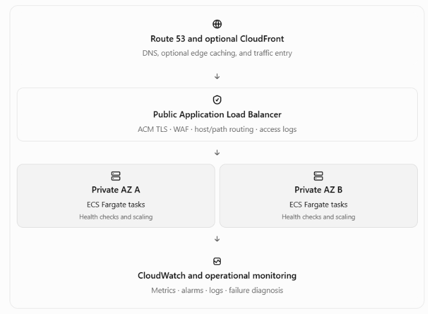

# AWS Load Balancing — Complete Course Outline

8 modules · Beginner to advanced · Pulumi · Bash · Hands-on labs

## Course objectives

This course teaches you how to design, deploy, secure, scale, and troubleshoot load-balancing solutions on AWS, from basic application traffic distribution to production-grade, multi-AZ and multi-region architectures.

By the end, you will be able to:

- Choose between Application Load Balancer (ALB), Network Load Balancer (NLB), Gateway Load Balancer (GWLB), and Classic Load Balancer.
- Provision load balancers, listeners, target groups, and related infrastructure using Pulumi with Python.
- Deploy and expose containerized applications running on Amazon ECS and Amazon EKS.
- Configure TLS, health checks, routing rules, security controls, and autoscaling.
- Monitor traffic, troubleshoot failures, and optimize cost and availability.
- Design production architectures using AWS Global Accelerator, Route 53, and multi-region routing.

## Module 1 — Load Balancing Fundamentals and AWS Architecture

- Load-balancing concepts: traffic distribution, availability, scalability, and fault tolerance.
- Layer 4 versus Layer 7 load balancing.
- AWS Elastic Load Balancing (ELB) architecture and its managed-service model.
- ALB versus NLB versus GWLB versus Classic Load Balancer.
- Listeners, listener rules, target groups, targets, and health checks.
- Availability Zones, cross-zone load balancing, and high availability.
- Public versus internal load balancers.
- Load balancing versus reverse proxies, API gateways, and DNS-based routing.

Labs

- Install and configure AWS CLI, Pulumi, Python, and Docker.
- Deploy a small HTTP application on EC2 instances in multiple Availability Zones.
- Explore AWS load-balancing resources using the AWS CLI and management console.
- Inspect application traffic, instance health, and failure behavior before introducing a load balancer.

## Module 2 — Application Load Balancer (ALB) and HTTP Routing

- ALB architecture, listeners, listener rules, and target groups.
- HTTP and HTTPS listeners.
- Host-based, path-based, header-based, query-string, and source-IP routing.
- Listener rule priorities, conditions, actions, and default rules.
- Forwarding to multiple target groups and weighted routing.
- Redirect and fixed-response actions.
- Target types: instance, IP, and Lambda.
- HTTP/1.1, HTTP/2, gRPC, and WebSocket considerations.
- ALB attributes, connection behavior, and access logging.

Labs

- Create an ALB, target groups, listeners, and routing rules using Pulumi Python.
- Deploy two backend services and route requests by hostname and URL path.
- Configure HTTP-to-HTTPS redirection and fixed responses.
- Implement weighted forwarding between two application versions.
- Test routing behavior with `curl` and inspect target health using the AWS CLI.

## Module 3 — Network Load Balancer (NLB) and Gateway Load Balancer (GWLB)

- NLB architecture and Layer 4 traffic distribution.
- TCP, TLS, and UDP listeners.
- Static IP addresses, Elastic IP addresses, and zonal endpoints.
- Client IP preservation, proxy protocol v2, and source-address considerations.
- NLB target groups, health checks, and cross-zone load balancing.
- TLS termination versus TCP pass-through.
- Gateway Load Balancer architecture and GENEVE encapsulation.
- Deploying transparent network appliances such as firewalls and inspection systems.
- Choosing ALB, NLB, or GWLB for performance, protocol, and security requirements.

Labs

- Provision an NLB with Pulumi and expose a TCP-based application.
- Configure TCP and TLS listeners and validate connectivity using Bash tools.
- Test client IP preservation and target health.
- Build a conceptual GWLB inspection architecture and examine its routing requirements.

## Module 4 — Health Checks, Resilience, and Traffic Management

- Target group health-check protocols, paths, ports, intervals, thresholds, and timeouts.
- Healthy, unhealthy, initial, draining, and unused target states.
- ALB slow start, deregistration delay, and connection draining.
- NLB fail-open behavior and its operational implications.
- Availability Zone health and zonal traffic distribution.
- Cross-zone load balancing behavior and trade-offs.
- Handling application startup, graceful shutdown, and deployment interruptions.
- Troubleshooting unhealthy targets, connection resets, timeouts, and failed health checks.

Labs

- Configure application-specific health endpoints and health-check thresholds.
- Simulate backend failures and observe load-balancer target states.
- Deploy a replacement backend without intentionally interrupting active traffic.
- Test graceful shutdown, connection draining, and recovery after failure.
- Diagnose unhealthy targets using AWS CLI output and application logs.

## Module 5 — TLS, Security, and Private Networking

- TLS termination, HTTPS listeners, and end-to-end encryption.
- AWS Certificate Manager (ACM) certificates and certificate renewal.
- TLS policies, SNI, and multiple certificates on a listener.
- ALB and NLB security-group behavior and network access controls.
- Security groups, network ACLs, routing, and subnet placement.
- AWS WAF integration with ALB and supported application architectures.
- Mutual TLS (mTLS) support and client authentication considerations.
- Private load balancers, internal services, and private connectivity.
- Protecting load balancers from unauthorized access and direct-target bypass.
- Logging, encryption, and security auditing.

Labs

- Request or import an ACM certificate and configure an HTTPS listener.
- Restrict access to an ALB using security groups.
- Deploy a private backend behind a public-facing ALB.
- Configure AWS WAF protections for common HTTP attack patterns.
- Test TLS connectivity, certificate presentation, and access restrictions using Bash.

## Module 6 — Load Balancing with Amazon ECS and Amazon EKS

- ALB integration with ECS services and task-based target registration.
- ECS Fargate and ECS on EC2 behind load balancers.
- Dynamic host-port mapping and IP target groups.
- ECS deployment health, minimum healthy percentages, and traffic shifting.
- EKS Services: ClusterIP, NodePort, and LoadBalancer.
- AWS Load Balancer Controller architecture and prerequisites.
- Kubernetes Ingress with ALB and AWS Load Balancer Controller.
- NLB integration with Kubernetes services and supported target modes.
- Readiness probes versus load-balancer health checks.
- Container autoscaling, draining, and rolling deployments.
- Load balancing for private applications and microservices.

Labs

- Deploy a FastAPI container to ECS Fargate behind an ALB using Pulumi.
- Configure target registration, health checks, and service autoscaling.
- Deploy an application to EKS and expose it through an ALB using Kubernetes Ingress.
- Configure an NLB-backed Kubernetes Service.
- Test rolling deployments and diagnose mismatches between application readiness and target health.

## Module 7 — Observability, Performance, and Cost Optimization

- Amazon CloudWatch metrics for ALB, NLB, and target groups.
- Request counts, latency, connection counts, healthy hosts, and HTTP errors.
- ALB access logs and NLB access and connection logs.
- CloudWatch alarms, dashboards, and operational notifications.
- AWS CloudTrail events for load-balancer configuration changes.
- AWS Config and security monitoring considerations.
- Load testing with tools such as `hey`, `wrk`, or `k6`.
- Understanding load-balancer capacity, connection behavior, and traffic patterns.
- Load Balancer Capacity Units (LCUs), NLCUs, and pricing considerations.
- Identifying bottlenecks in application instances, containers, networking, and databases.
- Troubleshooting elevated latency, 4xx/5xx responses, TLS failures, and connection exhaustion.

Labs

- Build CloudWatch dashboards and alarms using Pulumi.
- Enable access logging and analyze request patterns.
- Generate HTTP traffic with a Bash-based load-testing workflow.
- Correlate latency, target health, and application resource utilization.
- Investigate simulated 502/503 errors and optimize the deployment based on observed metrics.

## Module 8 — Production Architecture, Global Traffic, and Capstone

- Reference architectures for highly available web applications, APIs, and microservices.
- Multi-AZ load-balancer design and failure-domain planning.
- Route 53 routing policies: weighted, latency-based, failover, and geolocation.
- Route 53 health checks and DNS failover limitations.
- AWS Global Accelerator versus Route 53 for global traffic distribution.
- Multi-region application architecture and regional recovery strategies.
- ALB weighted target groups and deployment strategies such as blue-green and canary releases.
- Integrating load balancing with Auto Scaling, ECS, EKS, CloudFront, and AWS WAF.
- Infrastructure-as-code design: Pulumi components, stack configuration, outputs, and secrets.
- Production troubleshooting, operational runbooks, security reviews, and cost governance.

Capstone lab — Production-ready web application

Build a complete application deployment with the following architecture:

Capstone implementation tasks:

- Provision the required networking and load-balancing resources with Pulumi Python.
- Deploy an ECS Fargate application across two Availability Zones.
- Configure HTTPS, health checks, listener rules, and private backend access.
- Add autoscaling, CloudWatch alarms, and access logging.
- Perform a rolling or blue-green deployment and validate traffic continuity.
- Simulate target failures and verify recovery.
- Document the architecture, security boundaries, operational runbook, and cost considerations.

## Recommended learning sequence

| Stage                       | Modules | Main outcome                                          |
| --------------------------- | ------- | ----------------------------------------------------- |
| Foundations                 | 1–2     | Understand ELB and build an ALB-based web application |
| Network and reliability     | 3–4     | Handle Layer 4 traffic and target failures            |
| Security and containers     | 5–6     | Deploy secure, containerized applications             |
| Operations and architecture | 7–8     | Monitor, optimize, and design production systems      |

Technology baseline: AWS CLI, Pulumi with Python, Bash, Docker, EC2, ECS Fargate, EKS, ACM, CloudWatch, Route 53, and AWS WAF.

All labs use Bash commands and scripts rather than PowerShell. Pulumi is the primary infrastructure-as-code tool; Terraform is not required. No exams or quizzes are included.