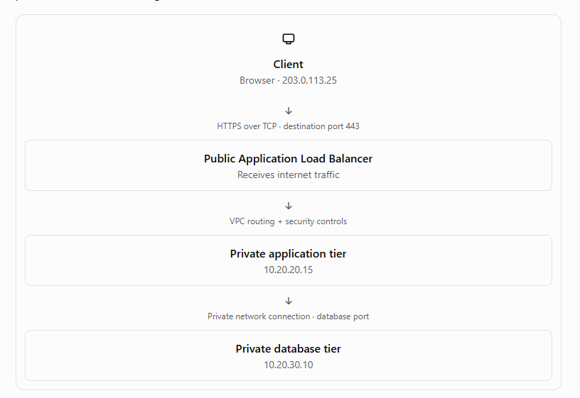
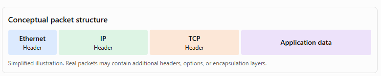
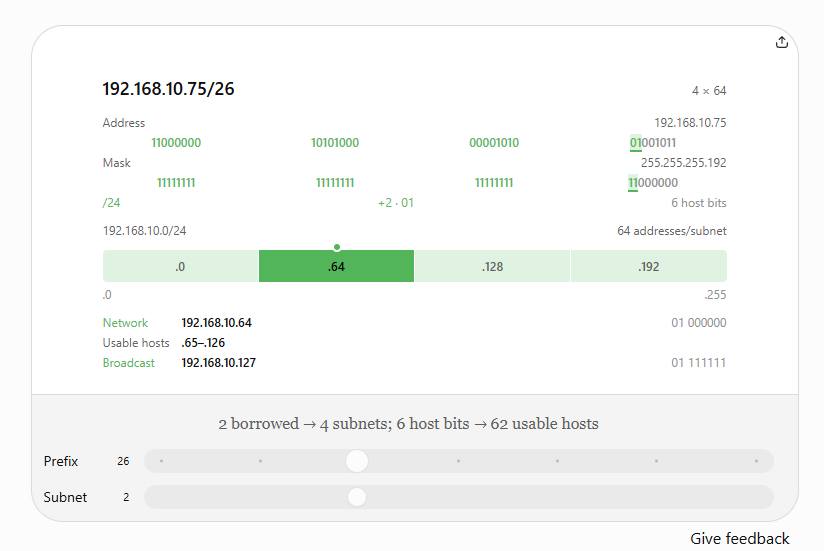
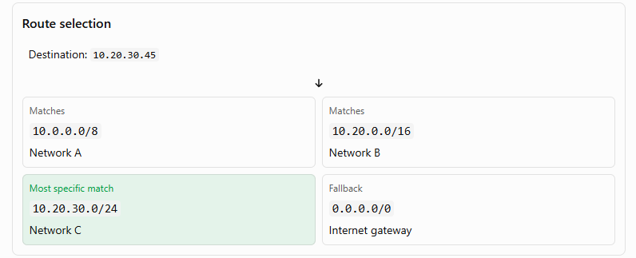
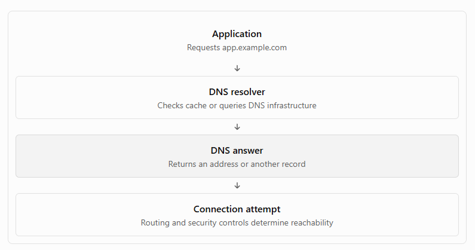
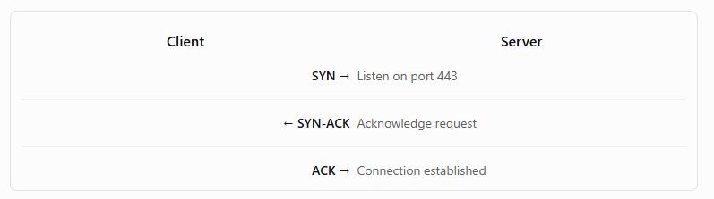
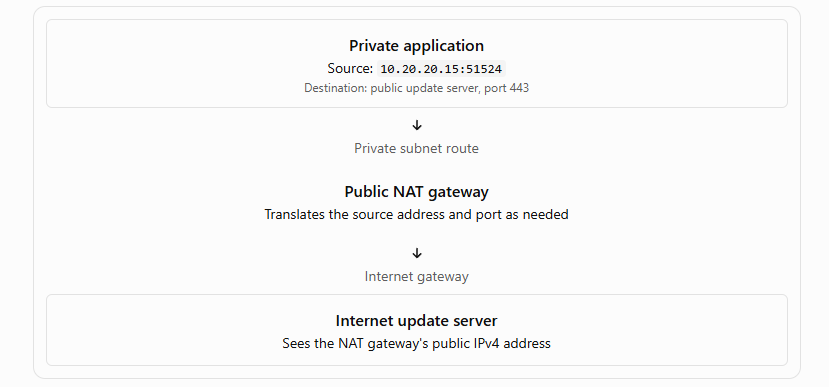
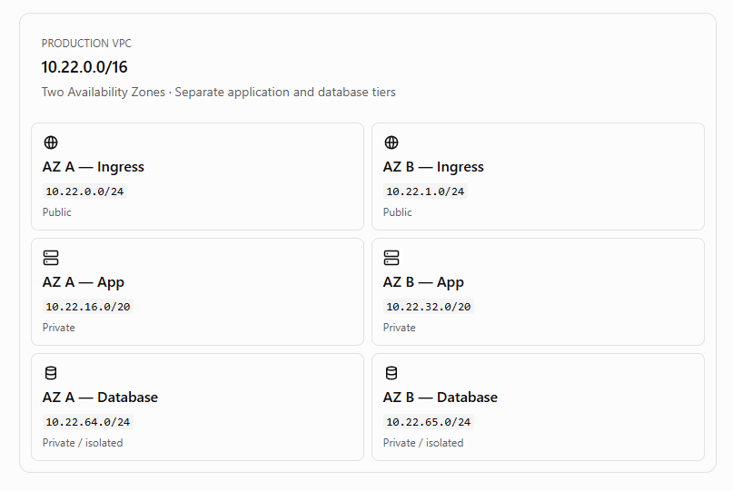

# Module 1 — Networking Foundations for AWS

AWS VPC Course · Module 1 of 16 · Foundations

This module builds the networking knowledge you'll need to design and troubleshoot AWS VPCs. We'll start with how packets travel between applications, learn how IP addressing and routing work, and then connect those concepts to AWS architecture.

We'll use practical examples and a hands-on addressing lab, with no quizzes. For infrastructure as code, we'll use Pulumi with Python whenever implementation is appropriate.

## 1. Learning objectives

By the end of this module, you should be able to:

- Explain how application data travels through the TCP/IP stack.
- Calculate IPv4 subnets, usable address ranges, and CIDR boundaries.
- Understand IPv6 addressing and the differences between public and private addresses.
- Predict which route a packet follows using longest-prefix matching.
- Explain DNS, ARP, TCP, UDP, ICMP, NAT, MTU, and firewall behavior.
- Map traditional networking concepts to AWS VPCs, subnets, route tables, security groups, and network ACLs.
- Design non-overlapping IP address ranges for development, staging, production, and shared services.

## 2. The big picture: how networking works

Imagine a SaaS application deployed on AWS:

- A browser sends an HTTPS request.
- A public load balancer receives the connection.
- An application server processes the request.
- A database returns the requested data.

The application works only if every network layer cooperates: name resolution, addressing, routing, transport protocols, and traffic filtering.



Client

Browser · 203.0.113.25

HTTPS over TCP · destination port 443

Public Application Load Balancer

Receives internet traffic

VPC routing + security controls

Private application tier

10.20.20.15

Private network connection · database port

Private database tier

10.20.30.10

Illustrative addresses and architecture. The documentation address 203.0.113.25 is not a real client address.

The critical idea is that having an IP address does not guarantee connectivity. A packet must have a valid destination, a viable route, permission to pass through the relevant controls, and a service listening on the destination port.

## 3. TCP/IP and the OSI model

The OSI model describes networking in seven conceptual layers. The TCP/IP model groups the same general functionality into a smaller number of layers.

| OSI layer       | Main responsibility                                | Examples                                              |
| --------------- | -------------------------------------------------- | ----------------------------------------------------- |
| 7. Application  | Application protocols                              | HTTP, HTTPS, DNS                                      |
| 6. Presentation | Data representation, encoding, encryption concepts | TLS, character encoding                               |
| 5. Session      | Managing logical conversations                     | Session management                                    |
| 4. Transport    | End-to-end communication between processes         | TCP, UDP                                              |
| 3. Network      | Logical addressing and routing                     | IPv4, IPv6, ICMP                                      |
| 2. Data link    | Communication on a local link                      | Ethernet, MAC addresses, ARP-related local resolution |
| 1. Physical     | Transmission of bits                               | Cables, radio, signaling                              |

TLS doesn't fit neatly into just one OSI layer in real implementations. DNS can use UDP or TCP, and modern protocols such as HTTP/3 use QUIC over UDP. The OSI model is a troubleshooting framework, not a rigid description of every protocol.

### The practical TCP/IP model

**Application**

* HTTP, DNS, TLS

**Transport**

* TCP or UDP ports

**Internet**

* IP addresses and routing

**Link**
* Local delivery and link-layer framing

Consider a browser connecting to `https://app.example.com`.

1. Application: The browser prepares an HTTP request.
2. Transport: TCP establishes a connection to destination port 443, unless the application uses another transport such as QUIC.
3. Internet: IP provides source and destination addresses.
4. Link: The device transmits the packet over its current network link.

At the receiving end, the process is reversed so the application can interpret the request.

### Encapsulation: what happens to the data?



Each layer adds information needed by the next part of the journey.

Conceptual packet structure

Ethernet

Header

IP

Header

TCP

Header

Application data

Simplified illustration. Real packets may contain additional headers, options, or encapsulation layers.

The units have different names:

- Application data: the message being sent.
- TCP segment or UDP datagram: transport-layer unit.
- IP packet: network-layer unit.
- Ethernet frame: link-layer unit.

This matters in AWS troubleshooting. A security group might allow the IP protocol and port, yet a connection can still fail because DNS resolved the wrong address, the route is missing, the application isn't listening, or packets cannot traverse a required path.

## 4. IPv4 addressing fundamentals

An IPv4 address contains 32 bits, conventionally written as four decimal octets.

Example:

`192.168.10.25`

Each octet represents eight bits and therefore ranges from 0 to 255.

The binary representation is:

`11000000.10101000.00001010.00011001`

An IP address has two logical parts:

- Network prefix: identifies the network.
- Host portion: identifies an address within that network.

The boundary is defined by the subnet mask or, more commonly, the CIDR prefix length.

### CIDR notation

CIDR means Classless Inter-Domain Routing. For example:

`192.168.10.0/24`

The `/24` says that the first 24 bits identify the network. The remaining eight bits are available for host addressing.

| CIDR  | Subnet mask     | Total IPv4 addresses |
| ----- | --------------- | -------------------- |
| `/16` | 255.255.0.0     | 65,536               |
| `/20` | 255.255.240.0   | 4,096                |
| `/24` | 255.255.255.0   | 256                  |
| `/26` | 255.255.255.192 | 64                   |
| `/28` | 255.255.255.240 | 16                   |
| `/30` | 255.255.255.252 | 4                    |

For a prefix length $p$, the total number of IPv4 addresses is:

$$ 2^{32-p} $$

For conventional IPv4 subnets, two addresses are traditionally reserved: the network address and broadcast address. However, AWS reserves five IPv4 addresses in each VPC subnet, so the number available for ordinary resource assignments is generally:

$$ 2^{32-p}-5 $$

For example, a `/24` subnet contains 256 addresses, of which 251 are available for AWS resource assignment under the usual reservation rules.

AWS-specific reservations are important: don't assume the traditional usable-host calculation gives you the number of assignable addresses in an AWS subnet.

### Calculating a subnet by hand

Suppose you have:

`192.168.10.75/26`

A `/26` has six host bits:

$$ 2^{32-26}=64 $$

Each subnet contains 64 addresses. Within the final octet, the boundaries occur at 0, 64, 128, and 192.

Since 75 falls between 64 and 127:

| Property                                                | Value                          |
| ------------------------------------------------------- | ------------------------------ |
| Network                                                 | `192.168.10.64/26`             |
| First address                                           | `192.168.10.64`                |
| Last address                                            | `192.168.10.127`               |
| Conventional host range                                 | `192.168.10.65–192.168.10.126` |
| Broadcast address                                       | `192.168.10.127`               |
| Total addresses                                         | 64                             |
| AWS-assignable addresses under normal reservation rules | 59                             |

Notice that the address `192.168.10.75` is a host address, not the network boundary.



Use the interactive subnet explorer above to change the prefix and observe how the network boundary, address range, and number of available addresses change.

### A few practical rules

- Larger prefix numbers mean smaller networks: `/28` is smaller than `/24`.

- A subnet's network address must align with its prefix boundary. You cannot create an arbitrary `/26` starting at `192.168.10.75`; the containing network is `192.168.10.64/26`.

- AWS IPv4 subnets must use CIDR blocks between `/16` and `/28`.&#x20;

- Don't size subnets only for today's EC2 instances. Consider load balancer interfaces, container IPs, scaling, managed services, and future growth.

## 5. Public vs. private IP addresses

### Private IPv4 ranges

RFC 1918 defines three private IPv4 ranges:

| CIDR             | Address range               | Common use                       |
| ---------------- | --------------------------- | -------------------------------- |
| `10.0.0.0/8`     | 10.0.0.0–10.255.255.255     | Enterprise and cloud networks    |
| `172.16.0.0/12`  | 172.16.0.0–172.31.255.255   | Internal networks                |
| `192.168.0.0/16` | 192.168.0.0–192.168.255.255 | Home and small business networks |

These addresses aren't globally routable across the public internet. They're commonly used for internal communication.

Two unrelated networks can both use `10.0.0.0/16` while isolated. But if you later connect them through VPN, VPC peering, or Transit Gateway, overlapping addresses can make routing ambiguous or unsupported.

### Public IPv4 addresses

A public IPv4 address is globally routable in principle. In AWS, assigning a public address does not automatically make an application reachable: the resource also needs an appropriate route, permitted traffic, and a listening service.

AWS public IPv4 addresses are subject to charges, so public addressing should be deliberate rather than automatic.&#x20;

For example:

- A public load balancer can accept user requests.
- An application server can use only a private IP address.
- A database can remain private and accept connections only from authorized application resources.

For IPv4, AWS can map a resource's public IPv4 address to its private address. An Elastic IP address provides a static public IPv4 address, unlike an automatically assigned public IPv4 address, which generally changes after a stop and start.

### IPv6 fundamentals

IPv6 uses 128-bit addresses, written in hexadecimal.

Example:

`2001:db8:1234:1a00::25`

The `2001:db8::/32` range is reserved for documentation, so this example is not intended as a production address.

IPv6 has a much larger address space than IPv4. A `/64` subnet contains $2^{64}$ addresses.

Important differences:

- IPv6 doesn't use broadcast addresses; it uses multicast and other mechanisms.
- IPv6 addresses can be globally unique and internet-routable.
- AWS public IPv6 addresses are advertised on the internet; routing and security controls determine whether traffic can reach a resource.
- IPv6 does not use NAT as a general requirement for internet connectivity.
- IPv4 and IPv6 routes are independent. A working IPv4 path doesn't guarantee a working IPv6 path.

AWS supports IPv4-only, dual-stack, and—in supported services and configurations—IPv6-only designs. IPv6 adoption requires checking each workload and AWS service for compatibility.&#x20;

## 6. Routing, next hops, and longest-prefix matching

An IP packet contains a destination IP address. Routers use routing tables to determine where to forward it.

A route typically includes:

- Destination prefix: the network or address the route matches.
- Next hop or target: where traffic should go.
- Metric or priority: how competing routes are evaluated, depending on the routing system.

In AWS, a VPC route table contains a destination and a target, such as a local route, internet gateway, NAT gateway, VPN connection, or peering connection.&#x20;

### The default route

The IPv4 default route is:

`0.0.0.0/0`

It matches every IPv4 destination that isn't matched by a more specific route.

For IPv6, the equivalent is:

`::/0`

A default route doesn't mean "send everything to the internet." It means "send unmatched destinations to this target." The target determines what happens next.

### Longest-prefix matching

Suppose a route table contains these routes:

| Destination     | Target           |
| --------------- | ---------------- |
| `10.0.0.0/8`    | Network A        |
| `10.20.0.0/16`  | Network B        |
| `10.20.30.0/24` | Network C        |
| `0.0.0.0/0`     | Internet gateway |

Where does traffic for `10.20.30.45` go?

It matches all four prefixes, but `10.20.30.0/24` is the most specific. The packet therefore follows Network C.



<!-- Route selection

Destination: `10.20.30.45`

Matches

`10.0.0.0/8`

Network A

Matches

`10.20.0.0/16`

Network B

Most specific match

`10.20.30.0/24`

Network C

Fallback

`0.0.0.0/0`

Internet gateway -->

AWS generally applies longest-prefix matching first. If equally specific routes compete, additional route-priority rules apply. Don't assume that a static route always wins merely because it is static; the destination prefix and AWS's route-priority rules matter.&#x20;

### Why this matters in VPCs

Every VPC has a local route for communication within its associated VPC address ranges. A subnet's route table controls how traffic is directed from that subnet.

For example, a private subnet might have:

| Destination    | Target      |
| -------------- | ----------- |
| `10.20.0.0/16` | `local`     |
| `0.0.0.0/0`    | NAT gateway |

Traffic to another address inside the VPC follows the local route. Traffic to an unmatched IPv4 destination follows the NAT gateway route.

However, the NAT gateway is not itself a security policy that authorizes every outbound connection. Security groups, network ACLs, and other relevant controls still matter.

## 7. Ethernet, ARP, DNS, TCP, UDP, ICMP, and MTU

These protocols solve different problems. Understanding which one is responsible for a failure is a core networking skill.

### Ethernet and ARP

Ethernet carries frames across local networks. Each Ethernet interface has a MAC address, used for link-layer delivery.

ARP (Address Resolution Protocol) discovers the link-layer address associated with an IPv4 address on a local network.

A typical process on a conventional Ethernet LAN:

1. A host determines the destination IP is on its local subnet.
2. It checks its ARP cache.
3. If the MAC address is unknown, it broadcasts an ARP request.
4. The destination replies with its MAC address.
5. The sender transmits Ethernet frames.

If the destination is on another subnet, the sender normally resolves the MAC address of its default gateway, not the remote destination.

AWS distinction: VPC networking is virtualized. You should understand ARP as a foundational Ethernet concept, but don't assume that you can inspect or control the underlying AWS physical network in the same way as a conventional LAN. AWS provides managed virtual networking abstractions.

### DNS

DNS translates names into records, such as IP addresses.

For example:

`app.example.com → 198.51.100.20`

The address above is reserved for documentation.

A simplified DNS lookup flow is:



<!-- Application

Requests app.example.com

DNS resolver

Checks cache or queries DNS infrastructure

DNS answer

Returns an address or another record

Connection attempt

Routing and security controls determine reachability -->

DNS resolution and network connectivity are separate. A successful lookup proves that a DNS response was received; it does not prove that the resulting destination is reachable.

In AWS, Route 53 provides public and private DNS capabilities, while VPC-provided DNS resolution supports workloads inside a VPC. We'll cover the AWS-specific resolver architecture in Module 6.

### TCP

TCP provides a reliable, ordered byte stream between applications. It uses sequence numbers, acknowledgments, retransmissions, flow control, and congestion control.

A simplified connection establishment sequence is the three-way handshake:



<!-- Client

Server

SYN →

Listen on port 443

← SYN-ACK

Acknowledge request

ACK →

Connection established -->

A TCP connection is identified by its source IP, source port, destination IP, and destination port, together with the protocol.

Example:

`10.20.20.15:51524 → 10.20.30.10:5432`

This might represent an application server connecting to PostgreSQL. Port 5432 is the conventional PostgreSQL port.

### UDP

UDP provides datagrams without TCP's built-in connection establishment, retransmission, or ordered delivery guarantees.

It is used by protocols such as:

- DNS, commonly over UDP, but also over TCP.
- Real-time media and some streaming applications.
- QUIC, which provides reliable transport capabilities over UDP.
- Various service-discovery and monitoring protocols.

UDP can be suitable when the application needs low overhead or implements its own reliability and congestion behavior. It isn't automatically faster or better than TCP.

### ICMP

ICMP carries network-control and diagnostic messages.

Useful examples include:

- Echo request and reply, used by `ping`.
- Destination unreachable messages.
- Time exceeded messages, used by `traceroute`-style diagnostics.

A failed ping does not necessarily mean a host is unreachable. ICMP may be filtered, while TCP connections to a permitted application port still work.

### MTU and fragmentation

The Maximum Transmission Unit (MTU) is the maximum packet or frame payload size supported by a network link, depending on the layer being discussed.

On a conventional Ethernet network, the common IP MTU is 1500 bytes.

When a packet is too large for a path, the consequences depend on the protocol and packet settings:

- IPv4 routers may fragment packets when permitted.
- IPv6 routers do not fragment packets; the source uses Path MTU Discovery and may need to reduce packet size.
- Tunnels can add encapsulation overhead, reducing the effective MTU.
- Filtering ICMP messages needed for Path MTU Discovery can cause connections to stall, particularly when small packets work but larger transfers fail.

AWS networking has service- and path-specific MTU considerations. Don't assume every connection path supports the same MTU, especially when VPNs, tunnels, or appliances are involved.

### A practical protocol troubleshooting table

| Symptom                                    | Possible cause                          | Useful check                                   |
| ------------------------------------------ | --------------------------------------- | ---------------------------------------------- |
| Name doesn't resolve                       | DNS configuration or record issue       | `nslookup app.example.com`                     |
| TCP connection times out                   | Route, firewall, or return-path problem | `Test-NetConnection host -Port 443` on Windows |
| Connection is refused                      | No listener, or active rejection        | Verify the service and listening port          |
| Ping fails                                 | ICMP blocked or destination unreachable | Test the actual application port               |
| Small requests work, large transfers stall | MTU or Path MTU Discovery problem       | Investigate path MTU and ICMP handling         |

These are starting points, not definitive diagnoses.

## 8. NAT, packet filtering, and firewalls

These concepts are related, but they are not interchangeable.

### NAT: Network Address Translation

NAT modifies IP addresses and, commonly, transport-layer ports as packets pass through a device.

Consider an application server with private IPv4 address `10.20.20.15` that downloads a software update.



<!-- Private application

Source: `10.20.20.15:51524`

Destination: public update server, port 443

Private subnet route

Public NAT gateway

Translates the source address and port as needed

Internet gateway

Internet update server

Sees the NAT gateway's public IPv4 address -->

The response traffic is translated back to the original private address and delivered to the application.

In AWS, a public NAT gateway enables resources in private subnets to initiate outbound IPv4 connections to external destinations. It does not permit unsolicited inbound connections from the internet to those private resources.&#x20;


A NAT gateway is not a substitute for a firewall. It performs address translation and maintains the necessary state for return traffic, but it does not provide a general configurable inbound/outbound security policy like a security group or network firewall.

### AWS internet gateway versus NAT gateway

| Component                    | Main role                                                            |
| ---------------------------- | -------------------------------------------------------------------- |
| Internet gateway (IGW)       | Connects a VPC to the internet when routing and addressing permit it |
| Public NAT gateway           | Enables outbound IPv4 connectivity for private resources             |
| Egress-only internet gateway | Enables outbound-only IPv6 internet connectivity                     |
| Security group               | Stateful traffic filtering associated with network interfaces        |
| Network ACL (NACL)           | Stateless traffic filtering at subnet boundaries                     |
| AWS Network Firewall         | Managed network firewall with configurable traffic-inspection rules  |

For a public IPv4 workload, the internet gateway performs the necessary public-to-private IPv4 mapping. A public NAT gateway provides outbound translation for private IPv4 workloads. These are different traffic paths.&#x20;


### Stateful versus stateless filtering

Stateful filtering tracks connection state. For a permitted connection, return traffic is automatically allowed by the stateful filter.

Stateless filtering evaluates each packet against rules independently. The rules must permit both directions of traffic where needed.

AWS illustrates this distinction with security groups and network ACLs:

| Property        | Security group                                     | Network ACL                                                      |
| --------------- | -------------------------------------------------- | ---------------------------------------------------------------- |
| Scope           | Network interfaces/resources                       | Subnets                                                          |
| Stateful?       | Yes                                                | No                                                               |
| Rules           | Allow rules                                        | Allow and deny rules                                             |
| Return traffic  | Automatically allowed for tracked connections      | Must be allowed by applicable rules                              |
| Rule evaluation | All applicable allow rules are considered together | Rules evaluated in ascending rule-number order; first match wins |

For example, a web server accepts HTTPS connections on port 443. A security group allows inbound TCP 443. Return traffic for the permitted connection is automatically allowed by connection tracking, even if no matching outbound rule explicitly allows the response's destination port.

A stateless network ACL must allow the corresponding return packets, including appropriate ephemeral port ranges where applicable.

### Packet filtering is not routing

Routing determines where a packet should go. Filtering determines whether the packet is permitted.

A route to a database does not grant permission to connect to it. Likewise, a security group rule allowing TCP 5432 doesn't create a route to the database.

When troubleshooting, inspect these independently.

## 9. How networking concepts map to AWS

The purpose of this section is to translate familiar networking terminology into AWS architecture.

| Traditional concept                  | AWS equivalent or related service                                             |
| ------------------------------------ | ----------------------------------------------------------------------------- |
| Virtual IP network                   | Amazon VPC                                                                    |
| IP subnet                            | VPC subnet, scoped to one Availability Zone                                   |
| Router routing table                 | VPC route table                                                               |
| Default gateway toward internet      | Internet gateway route target, with addressing and other conditions satisfied |
| Network interface                    | Elastic Network Interface (ENI)                                               |
| Stateful host firewall               | Security group                                                                |
| Stateless subnet filtering           | Network ACL                                                                   |
| NAT device                           | NAT gateway                                                                   |
| Private cloud service connectivity   | VPC endpoints / AWS PrivateLink, as applicable                                |
| DNS infrastructure                   | Amazon Route 53 and Route 53 Resolver                                         |
| IP address allocation and governance | Amazon VPC IP Address Manager (IPAM)                                          |
| Traffic-flow records                 | VPC Flow Logs                                                                 |

A VPC is regional and can span multiple Availability Zones, whereas each subnet resides in a single Availability Zone. A VPC includes a main route table and default network ACL, among other automatically provided networking resources.&#x20;


### Example: public ingress and private application traffic

Suppose you have this design:

- Public load balancer in two Availability Zones.
- Application servers in private subnets.
- PostgreSQL in private database subnets.
- Controlled outbound internet access for application servers.

A simplified IPv4 route plan:

| Subnet type         | Route                     | Purpose                   |
| ------------------- | ------------------------- | ------------------------- |
| Public              | `10.20.0.0/16 → local`    | VPC-internal traffic      |
| Public              | `0.0.0.0/0 → IGW`         | Internet routing          |
| Private application | `10.20.0.0/16 → local`    | VPC-internal traffic      |
| Private application | `0.0.0.0/0 → NAT gateway` | Outbound internet access  |
| Database            | `10.20.0.0/16 → local`    | VPC-internal traffic only |

These are illustrative route entries, not a complete deployable configuration. The database route table has no general internet default route. Application and database security groups should separately constrain who can connect and on which ports.

A route table can direct database-subnet traffic to a specific target, but the database's security group must still permit the intended application connection. A production design also considers DNS, high availability, logging, and access to required AWS services.

## 10. Address planning and avoiding overlapping CIDRs

IP address planning becomes particularly important when you operate multiple environments, accounts, VPCs, or on-premises networks.

Imagine you begin with:

- Development: `10.0.0.0/16`
- Staging: `10.0.0.0/16`
- Production: `10.0.0.0/16`

These ranges overlap completely. That may work while the environments remain isolated, but connecting them later can create routing conflicts or prevent certain connectivity options. For example, VPC peering doesn't support VPCs with overlapping CIDR blocks.&#x20;


### A better allocation strategy

Start with a reserved private address block large enough for foreseeable growth. Allocate separate, non-overlapping ranges to environments and shared services.

For this course, we'll use the following example:

| Environment     | VPC CIDR       | Address count |
| --------------- | -------------- | ------------- |
| Development     | `10.20.0.0/16` | 65,536        |
| Staging         | `10.21.0.0/16` | 65,536        |
| Production      | `10.22.0.0/16` | 65,536        |
| Shared services | `10.23.0.0/16` | 65,536        |

All four ranges are distinct `/16` blocks within `10.0.0.0/8`.

This is an illustrative plan, not a recommendation to use these exact ranges without checking your existing networks. You should also account for VPN client pools, office LANs, Kubernetes clusters, acquired networks, and future VPCs.

### Allocate subnet ranges by purpose

Inside the production VPC, we can reserve ranges for different tiers and Availability Zones.

| Purpose                   | CIDR            | Total addresses |
| ------------------------- | --------------- | --------------- |
| Public ingress, AZ A      | `10.22.0.0/24`  | 256             |
| Public ingress, AZ B      | `10.22.1.0/24`  | 256             |
| Private application, AZ A | `10.22.16.0/20` | 4,096           |
| Private application, AZ B | `10.22.32.0/20` | 4,096           |
| Private database, AZ A    | `10.22.64.0/24` | 256             |
| Private database, AZ B    | `10.22.65.0/24` | 256             |

The ranges don't overlap, and the unused space remains available for future expansion.

For AWS IPv4 subnets, remember that five addresses per subnet are reserved under the normal reservation rules. The total address count is not the same as the number of addresses assignable to resources.&#x20;

### CIDR planning principles

1. Allocate for connectivity, not just isolation. Networks that may need to communicate in the future should have non-overlapping ranges.
2. Keep room for growth. Managed services, load balancers, and container workloads can consume more IP addresses than expected.
3. Reserve space for future VPCs. Avoid allocating every available range at the beginning of a project.
4. Document the allocation hierarchy. Define which ranges belong to accounts, environments, regions, and subnet roles.
5. Use automation for governance. Amazon VPC IPAM can help allocate, track, and govern address ranges at scale.
6. Plan IPv6 separately. IPv6 has different sizing conventions and a much larger address space; don't simply copy the IPv4 plan.

## 11. Hands-on lab: Design an IP addressing plan

Lab 1 · Planning and validation · No AWS resources required

In this lab, you'll design a network plan for a fictional SaaS platform with development, staging, production, and shared services.

We'll validate the CIDRs locally with Python before creating any AWS infrastructure. This avoids AWS charges and lets you iterate on the design safely.

### Step 1 — Define the requirements

Our application needs:

- Four isolated VPCs, one per environment or shared-services purpose.
- Two Availability Zones in each VPC.
- Public ingress subnets where required.
- Private application subnets.
- Private database subnets.
- Space for future services and expansion.
- Connectivity to other VPCs in the future without CIDR overlap.

We'll start with the following allocations:

| VPC             | CIDR           |
| --------------- | -------------- |
| Development     | `10.20.0.0/16` |
| Staging         | `10.21.0.0/16` |
| Production      | `10.22.0.0/16` |
| Shared services | `10.23.0.0/16` |

Each VPC has 65,536 IPv4 addresses before subnet-level reservations and resource requirements.

### Step 2 — Create the production subnet plan


<!-- 
PRODUCTION VPC

## 10.22.0.0/16

Two Availability Zones · Separate application and database tiers

AZ A — Ingress

`10.22.0.0/24`

Public

AZ B — Ingress

`10.22.1.0/24`

Public

AZ A — App

`10.22.16.0/20`

Private

AZ B — App

`10.22.32.0/20`

Private

AZ A — Database

`10.22.64.0/24`

Private / isolated

AZ B — Database

`10.22.65.0/24`

Private / isolated -->

The database subnet label describes the intended architecture. In AWS, a subnet is isolated from internet routing only when its route table and connected network paths are configured accordingly; a subnet's name doesn't enforce isolation.

### Step 3 — Validate CIDRs with Python

Create a file named `validate_network.py`.

The script uses Python's built-in `ipaddress` module. It checks whether the proposed VPCs and production subnets are valid and non-overlapping.

```py

from ipaddress import ip_network

vpcs = {
    "development": "10.20.0.0/16",
    "staging": "10.21.0.0/16",
    "production": "10.22.0.0/16",
    "shared-services": "10.23.0.0/16",
}

production_subnets = {
    "public-a": "10.22.0.0/24",
    "public-b": "10.22.1.0/24",
    "app-a": "10.22.16.0/20",
    "app-b": "10.22.32.0/20",
    "database-a": "10.22.64.0/24",
    "database-b": "10.22.65.0/24",
}


def validate_non_overlapping(networks):
    entries = [
        (name, ip_network(cidr, strict=True))
        for name, cidr in networks.items()
    ]

    for i, (name_a, net_a) in enumerate(entries):
        for name_b, net_b in entries[i + 1:]:
            if net_a.overlaps(net_b):
                raise ValueError(
                    f"Overlap: {name_a} ({net_a}) and "
                    f"{name_b} ({net_b})"
                )

    print(f"Validated {len(entries)} non-overlapping networks.")


def main():
    validate_non_overlapping(vpcs)
    validate_non_overlapping(production_subnets)

    production = ip_network(vpcs["production"])

    for name, cidr in production_subnets.items():
        subnet = ip_network(cidr, strict=True)

        if not subnet.subnet_of(production):
            raise ValueError(
                f"{name} ({subnet}) is outside {production}"
            )

        total = subnet.num_addresses
        aws_assignable = total - 5

        print(
            f"{name:12} {subnet!s:18} "
            f"total={total:5} "
            f"normally_assignable={aws_assignable:5}"
        )


if __name__ == "__main__":
    main()

```

Run it on Windows:

```
py validate_network.py
```

Expected summary:

```
Validated 4 non-overlapping networks.
Validated 6 non-overlapping networks.
public-a     10.22.0.0/24      total=  256 normally_assignable=  251
public-b     10.22.1.0/24      total=  256 normally_assignable=  251
app-a        10.22.16.0/20     total= 4096 normally_assignable= 4091
app-b        10.22.32.0/20     total= 4096 normally_assignable= 4091
database-a   10.22.64.0/24     total=  256 normally_assignable=  251
database-b   10.22.65.0/24     total=  256 normally_assignable=  251
```

The script checks CIDR overlap and containment. It does not verify AWS quotas, Availability Zone availability, route correctness, IP capacity for particular services, or conflicts with your existing networks. The assignable counts assume the normal five-address reservation rules and no additional address reservations.

### Step 4 — Test a deliberately bad allocation

Change the staging CIDR to:

```
"staging": "10.20.0.0/16",
```

Run the script again. It should raise an overlap error because development and staging now use the same range.

This is precisely the kind of issue that is inexpensive to detect in code but can become difficult to fix after VPCs, peering connections, VPNs, and workloads have been deployed.

### Step 5 — Document the network decisions

For a real project, commit an address-allocation document alongside your Pulumi code. At minimum, record:

- VPC name, account, region, and CIDR.
- Subnet name, Availability Zone, CIDR, and intended purpose.
- Route-table association and connectivity requirements.
- Expected resource and IP capacity.
- Reserved ranges and future expansion space.
- Existing corporate and VPN ranges checked for conflicts.
- Owner, rationale, and date of each allocation.

For a larger multi-account organization, evaluate Amazon VPC IPAM rather than maintaining allocation records manually.

## 12. Troubleshooting: A systematic approach

When a connection fails, work from the simplest facts toward the more complex possibilities.

**1\. Confirm the destination**

Does DNS resolve to the expected address? Is the destination IP correct?

**2\. Inspect the route**

Which route matches the destination? Is its target valid and available?

**3\. Check traffic controls**

Do security groups, network ACLs, and any intermediate firewalls permit the required traffic in both directions?

**4\. Verify the destination service**

Is the application running and listening on the expected interface and port?

**5\. Check the return path**

Can responses reach the client? Check NAT state, return routing, stateless ACL rules, and MTU issues where relevant.

### Useful AWS CLI inspection commands

These commands inspect existing resources; they do not create infrastructure.

```
# Confirm which AWS account and identity are active
aws sts get-caller-identity

# List VPCs and their IPv4 CIDRs
aws ec2 describe-vpcs \
  --query 'Vpcs[*].[VpcId,CidrBlock,State]' \
  --output table

# Inspect subnet CIDRs and Availability Zones
aws ec2 describe-subnets \
  --query 'Subnets[*].[SubnetId,VpcId,CidrBlock,AvailabilityZone]' \
  --output table

# Inspect route tables and their routes
aws ec2 describe-route-tables \
  --query 'RouteTables[*].[RouteTableId,VpcId,Routes]' \
  --output json

# Inspect security group rules
aws ec2 describe-security-groups \
  --output json
```

Run these in an AWS CLI v2 environment configured with an appropriate profile and read permissions. On Windows PowerShell, these commands work with the AWS CLI when its JSON and JMESPath query syntax is preserved.

For a production connectivity failure, AWS Reachability Analyzer and VPC Flow Logs can provide additional evidence. We'll study them in the observability and troubleshooting module.

## 13. Security, reliability, and cost considerations

- Minimize public exposure. Prefer private application and database resources; expose only the endpoints that need public access.

- Avoid broad permissions by default. Limit security group rules to the required sources, protocols, and ports.

- Design for Availability Zones. Distribute critical workloads across multiple AZs and consider whether network dependencies are AZ-resilient.

- Avoid overlapping address space. Check current and future connectivity requirements before assigning VPC CIDRs.

- Account for IPv4 costs. AWS charges for public IPv4 addresses, including Elastic IP addresses, so don't assign them without a reason.&#x20;

- Consider NAT costs. NAT gateways have hourly and data-processing charges. For workloads in multiple AZs, weigh per-AZ NAT deployment against cost and failure isolation.&#x20;


- Don't confuse private with trusted. Private addressing does not replace authentication, authorization, encryption, or network filtering.

- Don't assume an emulator is the real AWS network. Local simulation is useful for code and planning, but AWS-specific routing, service integration, and managed-network behavior must be verified in the real environment when needed.

No AWS infrastructure is created in this module's lab, so the lab itself incurs no AWS resource charges.

## 14. Official AWS references

These are the primary references for the AWS-specific details covered in this module.

[AWS Network Infrastructure — (SAA-CO3 Summary 2024) | by Tom van Eijk | Medium](https://images.openai.com/static-rsc-4/sslIsCpThKqXyWOEIPwPkna74kNUc_CA3k_3xae42VoBM_ntXAtpqwS4O1eT-gbBAaZuKvdfauvovC9JJa3o-1IN5NFqhcgC05IU3Z6tDMmAB04TyROh957sF3RrK1LNoR2xs1SL77hEbypsIsMiQw9qqZ-lJjIX1oy8gxxCMlk?purpose=inline)

Amazon VPC fundamentals

VPCs, subnets, routing, gateways, and network resources.

[Amazon VPC documentation](https://docs.aws.amazon.com/vpc/latest/userguide/)

[PPT - Understanding IP Addressing and Forwarding in Networking PowerPoint Presentation - ID:1612420](https://images.openai.com/static-rsc-4/Q4HaeZY5o7SxGAV-uyEmGGTLQ8v4V0Xea6I31wKQhJeedDCdkpEAL8UbLx2VikIS5AU2iBLhhBjgi5XhxjR7DW4WDDUfL5vKrCsoPqTlou25899KDVnBA8x7T4Hc5pFGF5VEOZaTWVrP8Pn20RvadOctlDOb0Q-6RJ0TyDv47hA?purpose=inline)

IP addressing and subnet sizing

CIDR ranges, AWS-reserved addresses, IPv4, and IPv6.

[IP addressing for your VPCs and subnets](https://docs.aws.amazon.com/vpc/latest/userguide/vpc-ip-addressing.html)

[Subnet sizing](https://docs.aws.amazon.com/vpc/latest/userguide/subnet-sizing.html)

[VPC Fundamentals for DevOps Beginners: Technical Breakdown with Real-Life Analogies | by SKYLYT IT | Medium](https://images.openai.com/static-rsc-4/3H1uVC284uAZPKUogqseU9-nS-JWUFzSMw5XzcpdUDlD42sgkt2OLKid44rD4I_SWFfPmVAMWhrhDVCtA_N9mQ-ygTVZht74l9RlvnJ6fB4bkA9nljmWs5El3nn_8L6E2jsbswvlY32Akv4Qu8JSdiQOKfJrUk2c8mthcTRE9gQ?purpose=inline)

Routing and route priority

Route targets, local routes, and longest-prefix matching.

[Route table concepts](https://docs.aws.amazon.com/vpc/latest/userguide/RouteTables.html)

[How route priority works](https://docs.aws.amazon.com/vpc/latest/userguide/route-tables-priority.html)

[If AWS Networking Confuses You — This Guide Is Your Missing Map | by Muhammad Shahbaj | Medium](https://images.openai.com/static-rsc-4/yuF0NBA9405e4do5FU7fAW3dvBFHDQ69ZK3P0FaDT_mD886EmJVuvT1Tvi4b4HWen_ipZ1Lba_1bybEvkmxft6WtVGvXE5FG-TKhqPwpAxmz1givpPPALHOYzzII9uVJ0fHCok7uqmHPxhpQ524MnLq0Wb4p_96dlKYM5s9QiKA?purpose=inline)

Internet connectivity and NAT

Public and private subnet connectivity, address translation, and NAT gateway deployment.

[Internet gateways](https://docs.aws.amazon.com/vpc/latest/userguide/VPC_Internet_Gateway.html)

[NAT gateways](https://docs.aws.amazon.com/vpc/latest/userguide/vpc-nat.html)

[Troubleshooting AWS EC2 Instance Status Checks: A Comprehensive Guide](https://images.openai.com/static-rsc-4/kKuQ9PyjYYzz195euRfP1TLCkZ8Fr_ZQOKEkPKwEeGgqzDONYEw9-8a7GFCjJ2KSso3CHr2jdXPzEMdBBQYdrZHEBJVoapOitkhz0ALrODFX8Rn4FDEXi20UjvtleXzv7TLBlpzDrbDlHeI_vLQDLosuRwgNjj914-XEz_btokc?purpose=inline)

Traffic filtering

Security group state tracking and stateless network ACL behavior.

[Network ACLs](https://docs.aws.amazon.com/vpc/latest/userguide/vpc-network-acls.html)

## Module 1 completion

You now have the foundation for understanding AWS network design: packet encapsulation, IP addressing, CIDR calculations, routing, transport protocols, NAT, filtering, and multi-environment address planning.

The most important mental model to retain is this:

$$
Connectivity = correct addressing + a valid route + permitted traffic + a working destination service + a viable return path.
$$

Each of those is a separate condition, and AWS provides different resources and diagnostic tools for investigating them.

When you're ready, ask for Module 2 — Amazon VPC Fundamentals. We'll move from networking theory to the VPC resource model and build a custom VPC using Pulumi and Python.