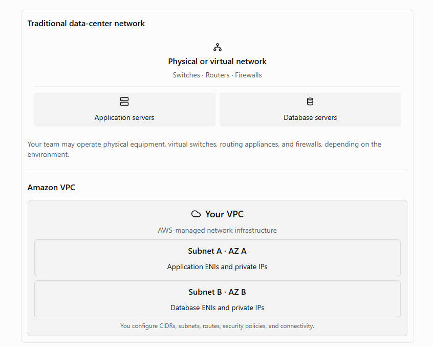
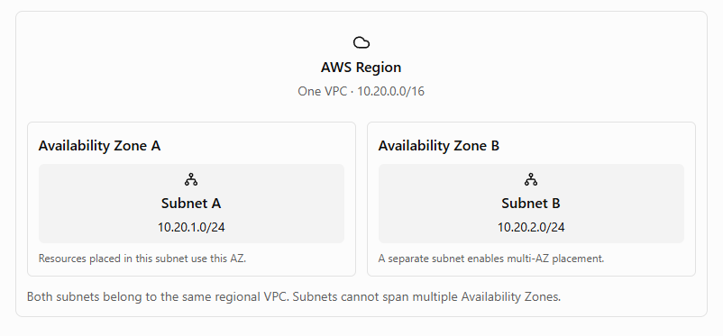

# Module 2 — Amazon VPC Fundamentals

AWS Networking Course · Pulumi Python · AWS CLI v2 · October 2026

## 1. Learning objectives

By the end of this module, you'll be able to:

- Explain how an Amazon VPC works and how it differs from a traditional network or a virtual network in a hypervisor.
- Understand the regional scope of a VPC and the Availability Zone scope of its subnets.
- Distinguish default VPCs from custom VPCs and understand what AWS creates automatically.
- Plan VPC IPv4 CIDRs, add secondary CIDRs, and understand IPv6 addressing.
- Explain subnets, route tables, and route-table associations.
- Configure VPC DNS attributes and understand the difference between DNS resolution and DNS hostnames.
- Understand Elastic Network Interfaces (ENIs) and private IP address assignment.
- Identify what AWS manages for you and what remains your responsibility.
- Deploy a minimal custom VPC using Pulumi with Python, then inspect and verify the resources with AWS CLI v2.

The lab will create a VPC, one subnet, and a custom route table. It will not create an internet gateway, NAT gateway, EC2 instance, or public-facing service.

## 2. What is an Amazon VPC?

An Amazon Virtual Private Cloud (Amazon VPC) is a logically isolated virtual network in your AWS account. You define its IP address ranges, divide those ranges into subnets, configure routing, and control network traffic using security groups and network ACLs.

Think of it as your own configurable network environment inside AWS.

A VPC is not a virtual machine, a physical router you administer, or a single server. It is a networking boundary within which AWS provides managed networking infrastructure for your resources.

### Traditional network vs. Amazon VPC



<!-- 
### Traditional data-center network

Physical or virtual network

Switches · Routers · Firewalls

Application servers

Database servers

Your team may operate physical equipment, virtual switches, routing appliances, and firewalls, depending on the environment.

### Amazon VPC

## Your VPC

AWS-managed network infrastructure

Subnet A · AZ A

Application ENIs and private IPs

Subnet B · AZ B

Database ENIs and private IPs

You configure CIDRs, subnets, routes, security policies, and connectivity. -->

The key difference is the operational model: AWS manages the underlying physical networking fabric, while you configure the logical network and the access rules for your workloads.

A VPC does not automatically provide every kind of connectivity. For example, creating a VPC alone does not give your instances direct internet access. That requires appropriate routing and connectivity resources, which we'll build in Module 3.

### What does VPC isolation mean?

VPCs are logically isolated from one another by default. Creating two VPCs does not automatically make their resources communicate.

Connectivity can be introduced deliberately through mechanisms such as:

- VPC peering.
- AWS Transit Gateway.
- AWS PrivateLink.
- Site-to-Site VPN or AWS Direct Connect.
- Public endpoints and internet routing, where configured.

Isolation does not mean that you can ignore security groups, routing, IAM, or application security. Those remain separate controls.

## 3. VPC scope: Regions and Availability Zones

A VPC is a regional resource. A subnet is an Availability Zone-scoped resource.

This distinction determines how you design resilient networks.



<!-- AWS Region

One VPC · 10.20.0.0/16

### Availability Zone A

Subnet A

10.20.1.0/24

Resources placed in this subnet use this AZ.

### Availability Zone B

Subnet B

10.20.2.0/24

A separate subnet enables multi-AZ placement.

Both subnets belong to the same regional VPC. Subnets cannot span multiple Availability Zones. -->

### Resource scope at a glance

| Resource                        | Scope                                                       |
| ------------------------------- | ----------------------------------------------------------- |
| VPC                             | Region                                                      |
| Subnet                          | One Availability Zone                                       |
| Route table                     | VPC-level resource within a Region                          |
| Security group                  | VPC-level resource within a Region                          |
| Network ACL                     | VPC-level resource within a Region; associated with subnets |
| Elastic Network Interface (ENI) | One subnet / Availability Zone                              |
| Internet gateway                | Attached to a VPC                                           |
| NAT gateway                     | Deployed in a specific subnet and AZ                        |

An AWS Region can contain multiple Availability Zones. The AZ names you see, such as `us-east-1a`, are account-relative mappings and may refer to different physical zones across different AWS accounts. When coordinating AZ placement across accounts, use the AZ IDs, such as `use1-az1`.

### Why does this matter?

Suppose you deploy an application in two AZs:

- Subnet A hosts application instances in AZ A.
- Subnet B hosts application instances in AZ B.
- Both subnets belong to the same VPC.
- A failure affecting one AZ need not take down the other AZ's application instances.

However, simply creating two subnets does not make an application highly available. Your compute capacity, load balancing, data layer, routing, and dependencies must also support the intended failure model.

A VPC itself is regional; it is not a resource that you create separately in each AZ.

## 4. Default VPCs vs. custom VPCs

AWS accounts commonly have a default VPC in each Region where the default VPC has not been deleted and where the account has the appropriate setup.

### Default VPC

AWS generally creates the following resources as part of the default VPC setup:

- A VPC with a default IPv4 CIDR, commonly `172.31.0.0/16`.
- A default subnet in each AZ available to the account in that Region at the time of creation.
- An internet gateway attached to the VPC.
- A main route table with a route to the internet gateway.
- A default security group.
- A default network ACL.
- Default DNS-related VPC attributes.

Default subnets typically assign public IPv4 addresses automatically to launched instances, subject to the subnet configuration and launch settings. The internet gateway and route do not by themselves guarantee an instance is reachable; public addressing and security rules also matter.

Important: Default VPCs and default subnets are convenient for introductory experiments, but they are not necessarily appropriate for production architecture.

### Custom VPC

A custom VPC gives you deliberate control over address planning, subnet layout, route tables, and connectivity.

It does not automatically include an internet gateway or NAT gateway, and it does not automatically create the subnet architecture you need.

| Property                         | Default VPC                            | Custom VPC                               |
| -------------------------------- | -------------------------------------- | ---------------------------------------- |
| Initial setup                    | AWS-provided defaults                  | You define the design                    |
| Address space                    | Default CIDR, commonly `172.31.0.0/16` | Your selected CIDR                       |
| Default subnets                  | Typically one per available AZ         | None unless you create them              |
| Internet gateway                 | Normally attached                      | Must be created and attached if required |
| Internet route                   | Normally present in main route table   | You configure it if needed               |
| Automatic public IPv4 assignment | Typically enabled on default subnets   | Configure explicitly if required         |
| Production address planning      | May be unsuitable without review       | Designed around your requirements        |

A custom VPC can still use default behaviors at the VPC level, including default security groups and a main route table. “Custom” does not mean every default resource is absent.

### Inspect your default VPC

Use AWS CLI v2 to find your active identity and current Region configuration:

```
aws sts get-caller-identity
aws configure list
aws ec2 describe-vpcs \
  --filters Name=isDefault,Values=true \
  --query 'Vpcs[].{VpcId:VpcId,CIDR:CidrBlock,State:State}' \
  --output table
```

If no VPC is returned, there may be no default VPC in the Region currently selected by your CLI. Specify the Region explicitly if needed:

```
aws ec2 describe-vpcs \
  --region us-east-1 \
  --filters Name=isDefault,Values=true \
  --output table
```

Do not delete or modify your default VPC just to complete this course. The lab will create a separate custom VPC.

## 5. VPC CIDR blocks and IP address planning

A VPC must have a primary IPv4 CIDR block. You can also associate additional IPv4 CIDR blocks and, optionally, IPv6 CIDR blocks. Each CIDR defines an address range that can be allocated to subnets.

AWS supports IPv4 VPC CIDRs from `/16` through `/28`. The default quota is five IPv4 CIDR blocks and five IPv6 CIDR blocks per VPC, with adjustable quotas where supported.&#x20;

[image](https://www.google.com/s2/favicons?domain=https://docs.aws.amazon.com\&sz=32)

Amazon Virtual Private Cloud

+1


### 5.1 Choosing a CIDR

For example, consider:

`10.42.0.0/16`

This contains 65,536 IPv4 addresses before AWS subnet reservations and other allocation constraints.

### Example address plan

## 10.42.0.0/16

VPC · 65,536 IPv4 addresses

10.42.1.0/24

AZ A · 256 addresses, 251 normally assignable

10.42.2.0/24

AZ B · 256 addresses, 251 normally assignable

10.42.10.0/24

Future application tier

10.42.20.0/24

Future database tier

For ordinary AWS IPv4 subnets, AWS reserves five addresses in every subnet: the first four and the last. A `/24` therefore has 251 addresses available for assignment to resources.&#x20;

[image](https://www.google.com/s2/favicons?domain=https://docs.aws.amazon.com\&sz=32)

Amazon Virtual Private Cloud


The address plan above is illustrative. Production subnet sizing should account for ENIs, load balancers, container IP consumption, scaling, and future growth.

### 5.2 Private IPv4 address ranges

For most VPCs, choose an address range from one of the RFC 1918 private ranges:

| Private range                     | CIDR             | Total addresses |
| --------------------------------- | ---------------- | --------------- |
| `10.0.0.0` – `10.255.255.255`     | `10.0.0.0/8`     | 16,777,216      |
| `172.16.0.0` – `172.31.255.255`   | `172.16.0.0/12`  | 1,048,576       |
| `192.168.0.0` – `192.168.255.255` | `192.168.0.0/16` | 65,536          |

These are totals for the complete ranges, not the capacity of one VPC.

Avoid overlapping address space between networks that you may later connect, including:

- Other AWS VPCs.
- Corporate networks.
- On-premises data centers.
- VPN-connected environments.
- Container networks and other private infrastructure.

Overlapping CIDRs can make routing ambiguous or prevent connectivity entirely.

### 5.3 Primary and secondary CIDRs

A VPC's primary CIDR is its original IPv4 address range. A secondary CIDR is an additional range associated with the same VPC.

For example:

- Primary: `10.42.0.0/16`
- Secondary: `10.43.0.0/16`

A secondary CIDR can help when the original address space is becoming exhausted or when you need a separate range for a new workload.

However, associating a secondary CIDR does not automatically create subnets. You must create subnets from that range and plan routing and address allocation appropriately.

CIDR association restrictions still apply, including overlap restrictions and AWS-specific rules about acceptable ranges. Check those restrictions before selecting a secondary block.&#x20;

[image](https://www.google.com/s2/favicons?domain=https://docs.aws.amazon.com\&sz=32)

Amazon Virtual Private Cloud

+1


### 5.4 IPv6 addressing

IPv6 provides a much larger address space than IPv4. AWS can allocate an IPv6 CIDR to your VPC and allow you to assign IPv6 CIDRs to individual subnets.

Three common subnet models are:

- IPv4-only: Resources use IPv4.
- Dual-stack: Resources can use both IPv4 and IPv6.
- IPv6-only: Resources use IPv6, subject to service and workload compatibility.

IPv6 is not simply a larger IPv4 range. Routing, security, DNS records, application compatibility, and internet connectivity all need to be considered independently. IPv6 addresses are globally unique in many AWS configurations, so don't assume IPv4-style private addressing or NAT behavior.&#x20;

[image](https://www.google.com/s2/favicons?domain=https://docs.aws.amazon.com\&sz=32)

Amazon Virtual Private Cloud

+1


For this module's lab, we'll use IPv4 only to keep the initial VPC simple. We'll explore IPv6 in detail in Module 11.

## 6. Subnets, route tables, and associations

A subnet is a segment of the VPC's IP address space. You select an Availability Zone when creating it, and the subnet's CIDR must fit within an associated VPC IPv4 or IPv6 range as appropriate.

A subnet does not inherently become public or private because of its name or CIDR.

Its routing configuration determines where traffic is sent.

### 6.1 How route tables work

A route table contains destination-to-target mappings. When a resource sends traffic, AWS uses the applicable route table to determine the route for the destination.

A new VPC automatically has a main route table with a local route for its VPC CIDR. A custom route table can be created and explicitly associated with a subnet.&#x20;

[image](https://www.google.com/s2/favicons?domain=https://docs.aws.amazon.com\&sz=32)

Amazon Virtual Private Cloud

+1


Conceptually, our lab will look like this:

VPC · 10.42.0.0/16

Logically isolated network

### Custom route table

10.42.0.0/16

local

The VPC's local route enables routing within the VPC address space.

Subnet · 10.42.1.0/24

Availability Zone A

The route table has a local route that allows communication between subnets in the VPC's address space, subject to security controls and other applicable configuration. We won't add a default route to the internet in this lab.

### 6.2 Main route table vs. custom route table

Every VPC has a main route table. Every subnet is associated with exactly one route table at a time, either explicitly or implicitly through the main route table.

- Main route table: The fallback route table for subnets without an explicit association.
- Custom route table: A separate route table you create and associate with one or more subnets.
- Explicit association: The subnet is deliberately associated with a selected route table.

A custom route table is useful for isolating routing behavior. For example, later we'll give public subnets routes through an internet gateway while private subnets use a different route table.

The word private does not mean that a subnet is completely disconnected from all networks. It usually means that it has no direct route to an internet gateway. A private subnet may still have routes to other VPC subnets, a NAT gateway, VPC endpoints, peered VPCs, or corporate networks.

### 6.3 What happens when traffic is routed?

Suppose an application in `10.42.1.10` sends a packet to `10.42.2.10`.

1. The source sends the packet toward the VPC network.
2. AWS evaluates the applicable route table.
3. The local route for `10.42.0.0/16` matches the destination.
4. AWS routes the packet toward the destination within the VPC.
5. Security groups, network ACLs, and other relevant controls determine whether traffic is permitted.

The route table tells AWS where to send traffic; it is not a firewall. We'll study the actual filtering behavior in Module 5.

## 7. VPC DNS attributes

DNS translates names into addresses. Amazon VPC provides access to the Amazon Route 53 Resolver for DNS resolution within the VPC. Two VPC attributes are especially important: `enableDnsSupport` and `enableDnsHostnames`.&#x20;

[image](https://www.google.com/s2/favicons?domain=https://docs.aws.amazon.com\&sz=32)

Amazon Virtual Private Cloud

+1


| Attribute            | What it controls                                                                                                       |
| -------------------- | ---------------------------------------------------------------------------------------------------------------------- |
| `enableDnsSupport`   | Whether DNS resolution through the Amazon-provided resolver is supported in the VPC                                    |
| `enableDnsHostnames` | Whether DNS hostnames can be assigned to instances in the VPC, subject to the relevant configuration and resource type |

These are related, but they are not interchangeable.

For example, if an application needs to resolve an AWS service name or an internal DNS name through the Amazon-provided resolver, DNS support matters. If you also want EC2 instances to receive applicable DNS hostnames, DNS hostname settings matter.

For the lab, we'll explicitly enable both attributes.

To inspect these settings on an existing VPC:

```
aws ec2 describe-vpc-attribute \
  --vpc-id vpc-xxxxxxxxxxxxxxxxx \
  --attribute enableDnsSupport

aws ec2 describe-vpc-attribute \
  --vpc-id vpc-xxxxxxxxxxxxxxxxx \
  --attribute enableDnsHostnames
```

Replace the example VPC ID with your actual VPC ID.

We'll study private hosted zones, forwarding, Route 53 Resolver endpoints, and hybrid DNS in Module 6. For now, the important point is that enabling VPC DNS attributes does not automatically create a custom DNS namespace for your applications.

## 8. Elastic Network Interfaces and private IP assignment

An Elastic Network Interface (ENI) is a virtual network interface associated with a subnet. It provides the networking attachment through which supported AWS resources communicate.

An ENI can have properties such as:

- A MAC address.
- A primary private IPv4 address.
- Additional private IPv4 addresses.
- IPv6 addresses, where configured and supported.
- One or more associated security groups.
- A subnet and Availability Zone association.

An EC2 instance normally has a primary network interface. Additional interfaces may be attached when supported and when the instance type and networking configuration allow them.

### 8.1 Private IP addresses

When an EC2 instance is launched into a subnet, AWS normally selects an available private IPv4 address for its network interface unless you specify an available address yourself.

The address must be valid for the subnet and cannot be one of AWS's reserved IPv4 addresses.

For example, with subnet `10.42.1.0/24`:

- `10.42.1.0` is reserved.
- `10.42.1.1` is reserved for the VPC router.
- `10.42.1.2` is reserved for AWS DNS use.
- `10.42.1.3` is reserved for future use.
- `10.42.1.255` is reserved.
- `10.42.1.10` is an example of an address that could be assigned if available.

AWS documents these subnet reservations in its subnet-sizing guide.&#x20;

[image](https://www.google.com/s2/favicons?domain=https://docs.aws.amazon.com\&sz=32)

Amazon Virtual Private Cloud

+1


### 8.2 Primary and secondary private IPs

The primary private IPv4 address is associated with the primary network interface and is not reassigned to a different ENI while that primary assignment remains in place. Secondary private IPv4 addresses provide additional flexibility and can be reassigned between eligible interfaces.

An important distinction: an ENI's private IP address is not the same thing as a public IPv4 address. When an instance has a public IPv4 address, AWS maps that public address to its private address for internet communication through the relevant internet gateway configuration. The instance generally operates using its private address internally.&#x20;

[image](https://www.google.com/s2/favicons?domain=https://docs.aws.amazon.com\&sz=32)

Amazon Virtual Private Cloud

+1


We'll inspect ENIs in the lab indirectly by listing network interfaces associated with our subnet. Because we won't launch an EC2 instance, the subnet will not contain an instance ENI created by the lab.

## 9. AWS-managed infrastructure and shared responsibility

AWS manages the physical networking fabric, underlying infrastructure, and availability of the managed VPC networking components according to AWS's service commitments. You manage the logical configuration and the workloads you deploy into that network.

The shared responsibility model distinguishes security of the cloud from security in the cloud. The precise division depends on the service and configuration.&#x20;

[image](https://www.google.com/s2/favicons?domain=https://docs.aws.amazon.com\&sz=32)

Amazon Virtual Private Cloud

+1


| AWS is responsible for                                      | You are responsible for                                    |
| ----------------------------------------------------------- | ---------------------------------------------------------- |
| Physical data centers and underlying network infrastructure | Selecting non-overlapping CIDRs                            |
| Underlying managed networking infrastructure                | Creating appropriate subnets and routes                    |
| Operating the managed VPC service                           | Configuring security groups and network ACLs               |
| Service-level infrastructure resilience                     | Designing workloads for AZ failures                        |
| Maintaining the underlying cloud platform                   | Monitoring traffic and investigating connectivity failures |

For example, AWS provides the underlying VPC router functionality, but you must design your routes correctly. AWS offers security groups, but you must choose appropriate rules. AWS provides infrastructure across AZs, but your architecture must use multiple AZs when the required resilience calls for it.

Production principle: managed infrastructure reduces operational burden; it does not eliminate the need for network design, access control, monitoring, or incident response.

## 10. Hands-on lab — Create a custom VPC with Pulumi

We'll now turn the concepts into actual AWS resources.

We'll use the current Pulumi AWS provider, Python, and AWS CLI v2. The examples follow the Pulumi AWS provider's documented VPC, subnet, and route-table APIs.&#x20;

[image](https://www.google.com/s2/favicons?domain=https://www.pulumi.com\&sz=32)

Pulumi Registry

+2


### Lab architecture

Custom VPC

## 10.42.0.0/16

DNS support and DNS hostnames enabled

Subnet

10.42.1.0/24

One Availability Zone

Route table

Local route

Explicit subnet association

No internet gateway, NAT gateway, EC2 instance, or public IP address is created by this lab.

### 10.1 Prerequisites

You'll need:

- An AWS account with permission to create and inspect VPC resources.
- AWS CLI v2 configured with credentials.
- Pulumi CLI installed.
- Python and a virtual environment.
- An AWS Region in which you can create the resources.

Check your AWS identity and Region:

```
aws sts get-caller-identity
aws configure list
aws ec2 describe-availability-zones \
  --filters Name=state,Values=available \
  --query 'AvailabilityZones[].{Name:ZoneName,ID:ZoneId}' \
  --output table
```

If you have not configured an AWS profile, configure one using your existing credentials or your organization's approved authentication method. Avoid putting access keys directly into source code.

### 10.2 Create the project

Create a directory:

```
mkdir vpc-fundamentals
cd vpc-fundamentals

pulumi new aws-python
```

Follow the prompts to select a project name, stack, Region, and any requested settings. The AWS Python template creates the Pulumi project files.

The relevant structure will look like this:

```
vpc-fundamentals/
├── Pulumi.yaml
├── Pulumi.dev.yaml
├── __main__.py
└── requirements.txt
```

Your actual generated files may differ slightly. Keep the generated `Pulumi.yaml` and use the following configuration in the Python entry point.

For a fresh project, you can replace the contents of `requirements.txt` with:

```
pulumi>=3.0.0,<4.0.0
pulumi-aws>=7.0.0,<8.0.0
```

Then install dependencies:

```
python -m venv .venv
```

On Windows PowerShell:

```
.\.venv\Scripts\Activate.ps1
python -m pip install --upgrade pip
pip install -r requirements.txt
```

The version ranges use the Pulumi 3.x SDK and AWS provider 7.x API family. Pin exact tested versions in your project's dependency lock or deployment workflow when reproducibility is important.

### 10.3 Configure the Region

Set the stack's Region explicitly:

```
pulumi config set aws:region us-east-1
```

This is an example Region. Use one that is appropriate for your account and lab.

To verify the AWS CLI's selected Region:

```
aws configure get region
```

Remember that Pulumi and the AWS CLI can use different Region settings. We'll explicitly select the Region in CLI commands when verifying the deployment.

### 10.4 Write the Pulumi program

Replace `__main__.py` with the following:

```
        "Name": "fundamentals-vpc",        "Environment": "learning",        "ManagedBy": "Pulumi",    },)# --------------------------------------------------# 2. Select an available Availability Zone# --------------------------------------------------availability_zones = aws.get_availability_zones(    state="available",)az_name = availability_zones.names[0]# --------------------------------------------------# 3. Create one subnet# --------------------------------------------------subnet = aws.ec2.Subnet(    "fundamentals-subnet",    vpc_id=vpc.id,    cidr_block="10.42.1.0/24",    availability_zone=az_name,    map_public_ip_on_launch=False,    tags={        "Name": "fundamentals-subnet",        "Environment": "learning",        "ManagedBy": "Pulumi",    },)# --------------------------------------------------# 4. Create a custom route table# --------------------------------------------------route_table = aws.ec2.RouteTable(    "fundamentals-route-table",    vpc_id=vpc.id,    tags={        "Name": "fundamentals-route-table",        "Environment": "learning",        "ManagedBy": "Pulumi",    },)# --------------------------------------------------# 5. Explicitly associate the subnet# --------------------------------------------------association = aws.ec2.RouteTableAssociation(    "fundamentals-route-table-association",    subnet_id=subnet.id,    route_table_id=route_table.id,)# --------------------------------------------------# 6. Export values for inspection# --------------------------------------------------pulumi.export("vpc_id", vpc.id)pulumi.export("vpc_cidr", vpc.cidr_block)pulumi.export("subnet_id", subnet.id)pulumi.export("subnet_cidr", subnet.cidr_block)pulumi.export("availability_zone", subnet.availability_zone)pulumi.export("route_table_id", route_table.id)pulumi.export("route_table_association_id", association.id)
```

### 10.5 Understand the resource dependencies

Pulumi builds a dependency graph from the resource inputs and outputs.

\#chatgpt-mermaid-\_r_7tk\_{font-family:-apple-system-body,ui-sans-serif,-apple-system,system-ui,"Segoe UI",Helvetica,"Apple Color Emoji",Arial,sans-serif,"Segoe UI Emoji","Segoe UI Symbol";font-size:16px;fill:rgb(13, 13, 13);}@keyframes edge-animation-frame{from{stroke-dashoffset:0;}}@keyframes dash{to{stroke-dashoffset:0;}}#chatgpt-mermaid-\_r_7tk\_ .edge-animation-slow{stroke-dasharray:9,5!important;stroke-dashoffset:900;animation:dash 50s linear infinite;stroke-linecap:round;}#chatgpt-mermaid-\_r_7tk\_ .edge-animation-fast{stroke-dasharray:9,5!important;stroke-dashoffset:900;animation:dash 20s linear infinite;stroke-linecap:round;}#chatgpt-mermaid-\_r_7tk\_ .error-icon{fill:rgb(243, 243, 243);}#chatgpt-mermaid-\_r_7tk\_ .error-text{fill:rgb(13, 13, 13);stroke:rgb(13, 13, 13);}#chatgpt-mermaid-\_r_7tk\_ .edge-thickness-normal{stroke-width:1px;}#chatgpt-mermaid-\_r_7tk\_ .edge-thickness-thick{stroke-width:3.5px;}#chatgpt-mermaid-\_r_7tk\_ .edge-pattern-solid{stroke-dasharray:0;}#chatgpt-mermaid-\_r_7tk\_ .edge-thickness-invisible{stroke-width:0;fill:none;}#chatgpt-mermaid-\_r_7tk\_ .edge-pattern-dashed{stroke-dasharray:3;}#chatgpt-mermaid-\_r_7tk\_ .edge-pattern-dotted{stroke-dasharray:2;}#chatgpt-mermaid-\_r_7tk\_ .marker{fill:rgb(143, 143, 143);stroke:rgb(143, 143, 143);}#chatgpt-mermaid-\_r_7tk\_ .marker.cross{stroke:rgb(143, 143, 143);}#chatgpt-mermaid-\_r_7tk\_ svg{font-family:-apple-system-body,ui-sans-serif,-apple-system,system-ui,"Segoe UI",Helvetica,"Apple Color Emoji",Arial,sans-serif,"Segoe UI Emoji","Segoe UI Symbol";font-size:16px;}#chatgpt-mermaid-\_r_7tk\_ p{margin:0;}#chatgpt-mermaid-\_r_7tk\_ .label{font-family:-apple-system-body,ui-sans-serif,-apple-system,system-ui,"Segoe UI",Helvetica,"Apple Color Emoji",Arial,sans-serif,"Segoe UI Emoji","Segoe UI Symbol";color:rgb(13, 13, 13);}#chatgpt-mermaid-\_r_7tk\_ .cluster-label text{fill:rgb(13, 13, 13);}#chatgpt-mermaid-\_r_7tk\_ .cluster-label span{color:rgb(13, 13, 13);}#chatgpt-mermaid-\_r_7tk\_ .cluster-label span p{background-color:transparent;}#chatgpt-mermaid-\_r_7tk\_ .label text,#chatgpt-mermaid-\_r_7tk\_ span{fill:rgb(13, 13, 13);color:rgb(13, 13, 13);}#chatgpt-mermaid-\_r_7tk\_ .node rect,#chatgpt-mermaid-\_r_7tk\_ .node circle,#chatgpt-mermaid-\_r_7tk\_ .node ellipse,#chatgpt-mermaid-\_r_7tk\_ .node polygon,#chatgpt-mermaid-\_r_7tk\_ .node path{fill:rgb(226, 242, 230);stroke:rgb(107, 198, 127);stroke-width:1px;}#chatgpt-mermaid-\_r_7tk\_ .rough-node .label text,#chatgpt-mermaid-\_r_7tk\_ .node .label text,#chatgpt-mermaid-\_r_7tk\_ .image-shape .label,#chatgpt-mermaid-\_r_7tk\_ .icon-shape .label{text-anchor:middle;}#chatgpt-mermaid-\_r_7tk\_ .node .katex path{fill:#000;stroke:#000;stroke-width:1px;}#chatgpt-mermaid-\_r_7tk\_ .rough-node .label,#chatgpt-mermaid-\_r_7tk\_ .node .label,#chatgpt-mermaid-\_r_7tk\_ .image-shape .label,#chatgpt-mermaid-\_r_7tk\_ .icon-shape .label{text-align:center;}#chatgpt-mermaid-\_r_7tk\_ .node.clickable{cursor:pointer;}#chatgpt-mermaid-\_r_7tk\_ .root .anchor path{fill:rgb(143, 143, 143)!important;stroke-width:0;stroke:rgb(143, 143, 143);}#chatgpt-mermaid-\_r_7tk\_ .arrowheadPath{fill:rgb(143, 143, 143);}#chatgpt-mermaid-\_r_7tk\_ .edgePath .path{stroke:rgb(143, 143, 143);stroke-width:1px;}#chatgpt-mermaid-\_r_7tk\_ .flowchart-link{stroke:rgb(143, 143, 143);fill:none;}#chatgpt-mermaid-\_r_7tk\_ .edgeLabel{background-color:rgb(252, 252, 252);text-align:center;}#chatgpt-mermaid-\_r_7tk\_ .edgeLabel p{background-color:rgb(252, 252, 252);}#chatgpt-mermaid-\_r_7tk\_ .edgeLabel rect{opacity:0.5;background-color:rgb(252, 252, 252);fill:rgb(252, 252, 252);}#chatgpt-mermaid-\_r_7tk\_ .labelBkg{background-color:rgba(252, 252, 252, 0.5);}#chatgpt-mermaid-\_r_7tk\_ .cluster rect{fill:rgb(243, 243, 243);stroke:rgba(0, 0, 0, 0.1);stroke-width:1px;}#chatgpt-mermaid-\_r_7tk\_ .cluster text{fill:rgb(13, 13, 13);}#chatgpt-mermaid-\_r_7tk\_ .cluster span{color:rgb(13, 13, 13);}#chatgpt-mermaid-\_r_7tk\_ div.mermaidTooltip{position:absolute;text-align:center;max-width:200px;padding:2px;font-family:-apple-system-body,ui-sans-serif,-apple-system,system-ui,"Segoe UI",Helvetica,"Apple Color Emoji",Arial,sans-serif,"Segoe UI Emoji","Segoe UI Symbol";font-size:12px;background:rgb(243, 243, 243);border:1px solid rgba(0, 0, 0, 0.1);border-radius:2px;pointer-events:none;z-index:100;}#chatgpt-mermaid-\_r_7tk\_ .flowchartTitleText{text-anchor:middle;font-size:18px;fill:rgb(13, 13, 13);}#chatgpt-mermaid-\_r_7tk\_ rect.text{fill:none;stroke-width:0;}#chatgpt-mermaid-\_r_7tk\_ .icon-shape,#chatgpt-mermaid-\_r_7tk\_ .image-shape{background-color:rgb(252, 252, 252);text-align:center;}#chatgpt-mermaid-\_r_7tk\_ .icon-shape p,#chatgpt-mermaid-\_r_7tk\_ .image-shape p{background-color:rgb(252, 252, 252);padding:2px;}#chatgpt-mermaid-\_r_7tk\_ .icon-shape .label rect,#chatgpt-mermaid-\_r_7tk\_ .image-shape .label rect{opacity:0.5;background-color:rgb(252, 252, 252);fill:rgb(252, 252, 252);}#chatgpt-mermaid-\_r_7tk\_ .label-icon{display:inline-block;height:1em;overflow:visible;vertical-align:-0.125em;}#chatgpt-mermaid-\_r_7tk\_ .node .label-icon path{fill:currentColor;stroke:revert;stroke-width:revert;}#chatgpt-mermaid-\_r_7tk\_ .node .neo-node{stroke:rgb(107, 198, 127);}#chatgpt-mermaid-\_r_7tk\_ [data-look="neo"].node rect,#chatgpt-mermaid-\_r_7tk\_ [data-look="neo"].cluster rect,#chatgpt-mermaid-\_r_7tk\_ [data-look="neo"].node polygon{stroke:url(#chatgpt-mermaid-\_r_7tk\_-gradient);filter:drop-shadow( 1px 2px 2px rgba(185,185,185,1));}#chatgpt-mermaid-\_r_7tk\_ [data-look="neo"].swimlane.cluster rect{filter:none;}#chatgpt-mermaid-\_r_7tk\_ [data-look="neo"].node path{stroke:url(#chatgpt-mermaid-\_r_7tk\_-gradient);stroke-width:1px;}#chatgpt-mermaid-\_r_7tk\_ [data-look="neo"].node .outer-path{filter:drop-shadow( 1px 2px 2px rgba(185,185,185,1));}#chatgpt-mermaid-\_r_7tk\_ [data-look="neo"].node .neo-line path{stroke:rgb(107, 198, 127);filter:none;}#chatgpt-mermaid-\_r_7tk\_ [data-look="neo"].node circle{stroke:url(#chatgpt-mermaid-\_r_7tk\_-gradient);filter:drop-shadow( 1px 2px 2px rgba(185,185,185,1));}#chatgpt-mermaid-\_r_7tk\_ [data-look="neo"].node circle .state-start{fill:#000000;}#chatgpt-mermaid-\_r_7tk\_ [data-look="neo"].icon-shape .icon{fill:url(#chatgpt-mermaid-\_r_7tk\_-gradient);filter:drop-shadow( 1px 2px 2px rgba(185,185,185,1));}#chatgpt-mermaid-\_r_7tk\_ [data-look="neo"].icon-shape .icon-neo path{stroke:url(#chatgpt-mermaid-\_r_7tk\_-gradient);filter:drop-shadow( 1px 2px 2px rgba(185,185,185,1));}#chatgpt-mermaid-\_r_7tk\_ .node text{font-size:14px;font-weight:600;letter-spacing:normal;fill:rgb(0, 105, 42);}#chatgpt-mermaid-\_r_7tk\_ .edgeLabels text{font-size:13px;font-weight:600;letter-spacing:-0.08px;fill:rgb(0, 105, 42);}#chatgpt-mermaid-\_r_7tk\_ .node tspan[font-weight="normal"],#chatgpt-mermaid-\_r_7tk\_ .edgeLabels tspan[font-weight="normal"]{font-weight:600;}#chatgpt-mermaid-\_r_7tk\_ .edgeLabel .label rect{opacity:1;rx:13px;ry:13px;fill:rgb(237, 250, 242);stroke:rgb(166, 211, 184);stroke-width:1px;}#chatgpt-mermaid-\_r_7tk\_ .node rect,#chatgpt-mermaid-\_r_7tk\_ .node circle,#chatgpt-mermaid-\_r_7tk\_ .node ellipse,#chatgpt-mermaid-\_r_7tk\_ .node polygon,#chatgpt-mermaid-\_r_7tk\_ .node path{fill:rgb(217, 244, 228);stroke:rgba(0, 0, 0, 0.1);stroke-width:1px;}#chatgpt-mermaid-\_r_7tk\_ .node rect{rx:16px;ry:16px;}#chatgpt-mermaid-\_r_7tk\_ .node.mermaid-decision .label-container{fill:rgb(237, 250, 242);stroke:rgb(195, 220, 205);stroke-dasharray:2,2;}#chatgpt-mermaid-\_r_7tk\_ .edgePaths .flowchart-link{stroke:rgb(143, 143, 143);stroke-width:1px;stroke-linecap:round;stroke-linejoin:round;}#chatgpt-mermaid-\_r_7tk\_ .marker{fill:rgb(143, 143, 143);stroke:rgb(143, 143, 143);}#chatgpt-mermaid-\_r_7tk\_ :root{--mermaid-font-family:-apple-system-body,ui-sans-serif,-apple-system,system-ui,"Segoe UI",Helvetica,"Apple Color Emoji",Arial,sans-serif,"Segoe UI Emoji","Segoe UI Symbol";}VPCSubnetCustom route tableRoute table associationExport resource IDs

For example, `vpc.id` is an output from the VPC resource. Passing it into `subnet.vpc_id` tells Pulumi that the subnet depends on the VPC. Similarly, the association depends on both the subnet and the route table.

Pulumi can therefore create these resources in dependency order without hardcoding generated IDs.

Notice that we don't manually add the local route. AWS automatically provides the local route in a VPC's route tables.

### 10.6 Preview the changes

Before deploying:

```
pulumi preview
```

Inspect the proposed resource changes. You should see resources corresponding to:

- One VPC.
- One subnet.
- One custom route table.
- One route-table association.

The AWS provider may also perform data-source lookups, such as querying available AZs. These are not additional infrastructure resources.

If the preview shows an unexpected internet gateway, NAT gateway, EC2 instance, or other resource, investigate before proceeding.

### 10.7 Deploy the VPC

Run:

```
pulumi up
```

Review the preview shown by Pulumi and approve the update.

When the deployment completes, retrieve the outputs:

```
pulumi stack output
```

Example output structure:

```
vpc_id: vpc-0123456789abcdef0
vpc_cidr: 10.42.0.0/16
subnet_id: subnet-0123456789abcdef0
subnet_cidr: 10.42.1.0/24
availability_zone: us-east-1a
route_table_id: rtb-0123456789abcdef0
route_table_association_id: rtbassoc-0123456789abcdef0
```

These IDs are illustrative; use the actual values returned by your deployment.

### 10.8 Inspect the resources with AWS CLI v2

Set your Region:

```
aws configure set region us-east-1
```

If you selected another Region for Pulumi, use that Region instead.

On Windows PowerShell, retrieve the VPC ID:

```
$vpcId = pulumi stack output vpc_id
$subnetId = pulumi stack output subnet_id
$routeTableId = pulumi stack output route_table_id
```

#### Inspect the VPC

```
aws ec2 describe-vpcs `
  --vpc-ids $vpcId `
  --query 'Vpcs[].{VpcId:VpcId,CIDR:CidrBlock,State:State,Default:IsDefault,DhcpOptions:DhcpOptionsId}' `
  --output table
```

Expected observations:

- The VPC is available.
- The primary CIDR is `10.42.0.0/16`.
- `IsDefault` is `false`.

#### Inspect the DNS attributes

```
aws ec2 describe-vpc-attribute `
  --vpc-id $vpcId `
  --attribute enableDnsSupport

aws ec2 describe-vpc-attribute `
  --vpc-id $vpcId `
  --attribute enableDnsHostnames
```

Both should be enabled.

#### Inspect the subnet

```
aws ec2 describe-subnets `
  --subnet-ids $subnetId `
  --query 'Subnets[].{SubnetId:SubnetId,VpcId:VpcId,CIDR:CidrBlock,AZ:AvailabilityZone,AvailableIPs:AvailableIpAddressCount,PublicIPAutoAssign:MapPublicIpOnLaunch}' `
  --output table
```

Verify that the subnet belongs to your VPC, uses `10.42.1.0/24`, and has automatic public IPv4 assignment disabled.

The available-IP count is dynamic and can change as addresses are allocated.

#### Inspect the custom route table

```
aws ec2 describe-route-tables `
  --route-table-ids $routeTableId `
  --query 'RouteTables[].{RouteTableId:RouteTableId,VpcId:VpcId,Routes:Routes,Associations:Associations}' `
  --output json
```

Look for a route whose destination is `10.42.0.0/16` and whose target is `local`.

You should not see an internet-gateway default route (`0.0.0.0/0`) in this custom route table.

#### Verify the subnet association

```
aws ec2 describe-route-tables `
  --filters "Name=association.subnet-id,Values=$subnetId" `
  --query 'RouteTables[].{RouteTableId:RouteTableId,Associations:Associations}' `
  --output json
```

This verifies which route table is associated with the subnet. The association should point to the custom route table created by Pulumi.

#### Inspect ENIs in the subnet

```
aws ec2 describe-network-interfaces `
  --filters "Name=subnet-id,Values=$subnetId" `
  --query 'NetworkInterfaces[].{ENI:NetworkInterfaceId,PrivateIP:PrivateIpAddress,Status:Status,Description:Description}' `
  --output table
```

Because we didn't create an EC2 instance or other resource requiring a network interface, you should not expect an instance ENI from this lab. Other AWS-managed resources or account-level features can create additional network interfaces in some environments.

## 11. Troubleshooting

| Symptom                              | Likely cause                                                                | What to do                                                           |
| ------------------------------------ | --------------------------------------------------------------------------- | -------------------------------------------------------------------- |
| `UnauthorizedOperation`              | The AWS identity lacks required EC2 permissions                             | Inspect the identity and IAM permissions                             |
| `InvalidVpcID.NotFound`              | Wrong VPC ID or Region                                                      | Verify the ID and explicitly select the correct Region               |
| CIDR overlap error                   | The requested subnet overlaps an existing subnet or is outside the VPC CIDR | Recheck the VPC and subnet ranges                                    |
| No available AZs returned            | Region, account, or AZ availability issue                                   | Inspect available AZs and the selected Region                        |
| Pulumi provider or dependency errors | Incompatible or missing Python dependencies                                 | Activate the intended virtual environment and reinstall dependencies |
| DNS attribute remains disabled       | The deployed configuration differs from the intended code or stack          | Check the active stack, preview, and AWS CLI attributes              |
| Route-table association is missing   | The association resource wasn't deployed or the wrong subnet was queried    | Inspect Pulumi outputs and AWS route-table associations              |

### A systematic debugging sequence

When a deployment fails, use this order:

1. Check `aws sts get-caller-identity` to verify the identity.
2. Check `pulumi stack` and `pulumi config` to confirm the active stack and Region.
3. Run `pulumi preview` to inspect the intended resource changes.
4. Read the complete AWS API error message; don't assume every failure is an IAM issue.
5. Inspect the deployed resources with `describe-vpcs`, `describe-subnets`, and `describe-route-tables`.
6. Run `pulumi refresh` only when you need to reconcile Pulumi's state with actual infrastructure; understand its effect before proceeding.

For this lab, there are no application packets to trace because we have not launched workloads. The objective is to establish and verify the network's foundational resources.

## 12. Security, cost, and production considerations

### Security

- Keep the VPC isolated until you deliberately design its connectivity.
- Do not add public routes just to make a deployment appear functional.
- Use a deployment identity with the minimum permissions necessary.
- Keep secrets out of source code and version control.
- Tag resources consistently so ownership and purpose are clear.

### Cost

The VPC, subnet, route table, and route-table association used here do not normally incur separate hourly charges. This does not mean every AWS networking lab is free: NAT gateways, interface endpoints, public IPv4 addresses, data transfer, and many other resources can incur charges.

An internet gateway itself has no separate hourly charge, but traffic and other related services can cost money.&#x20;

[image](https://www.google.com/s2/favicons?domain=https://docs.aws.amazon.com\&sz=32)

Amazon Virtual Private Cloud


### Production design

For a production environment, a single subnet is generally insufficient for a multi-AZ application. You would normally plan separate subnets across multiple AZs, reserve sufficient IP capacity, define routing deliberately, and configure security controls and observability.

We will build that architecture incrementally in the next modules rather than introduce all the resources at once.

### Cleanup

When you're finished, preview the deletion:

```
pulumi destroy --preview
```

If your installed Pulumi CLI doesn't support that flag, use its documented preview workflow for destroy operations. Review the planned deletion before executing:

```
pulumi destroy
```

This removes the resources managed by this lab's stack. Do not remove the stack or its state until you are sure you no longer need it. Also, don't delete resources in the AWS account manually unless you understand how that affects Pulumi's state.

## 13. Official references

- [Amazon VPC User Guide](https://docs.aws.amazon.com/vpc/latest/userguide/) — core concepts, routing, subnets, addressing, and security.
- [VPC basics](https://docs.aws.amazon.com/vpc/latest/userguide/vpc-subnet-basics.html) — regional scope and foundational resources.
- [VPC CIDR blocks](https://docs.aws.amazon.com/vpc/latest/userguide/vpc-cidr-blocks.html) — primary and secondary address ranges.
- [Subnet sizing](https://docs.aws.amazon.com/vpc/latest/userguide/subnet-sizing.html) — subnet ranges and reserved addresses.
- [VPC DNS attributes](https://docs.aws.amazon.com/vpc/latest/userguide/vpc-dns.html) — DNS support and hostnames.
- [Pulumi AWS VPC resource](https://www.pulumi.com/registry/packages/aws/api-docs/ec2/vpc/) — Python resource properties and examples.
- [Pulumi AWS subnet resource](https://www.pulumi.com/registry/packages/aws/api-docs/ec2/subnet/) — subnet configuration.
- [Pulumi AWS route-table resource](https://www.pulumi.com/registry/packages/aws/api-docs/ec2/routetable/) — route tables and routing configuration.

## Module 2 complete

You now have the conceptual model for a VPC, its regional and AZ-scoped resources, CIDR planning, route tables, DNS, ENIs, and AWS's networking responsibilities. The lab provides a repeatable Pulumi foundation you can inspect with AWS CLI v2.

The next module is Module 3 — Subnets, Routes, and Internet Connectivity, where we'll turn this isolated network into a deliberately designed multi-AZ network with public and private subnets, internet gateways, and explicit routing.